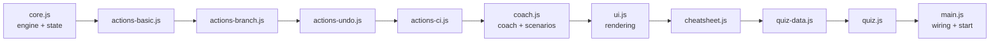
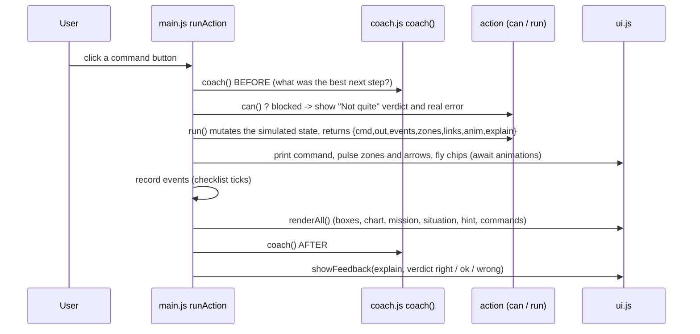
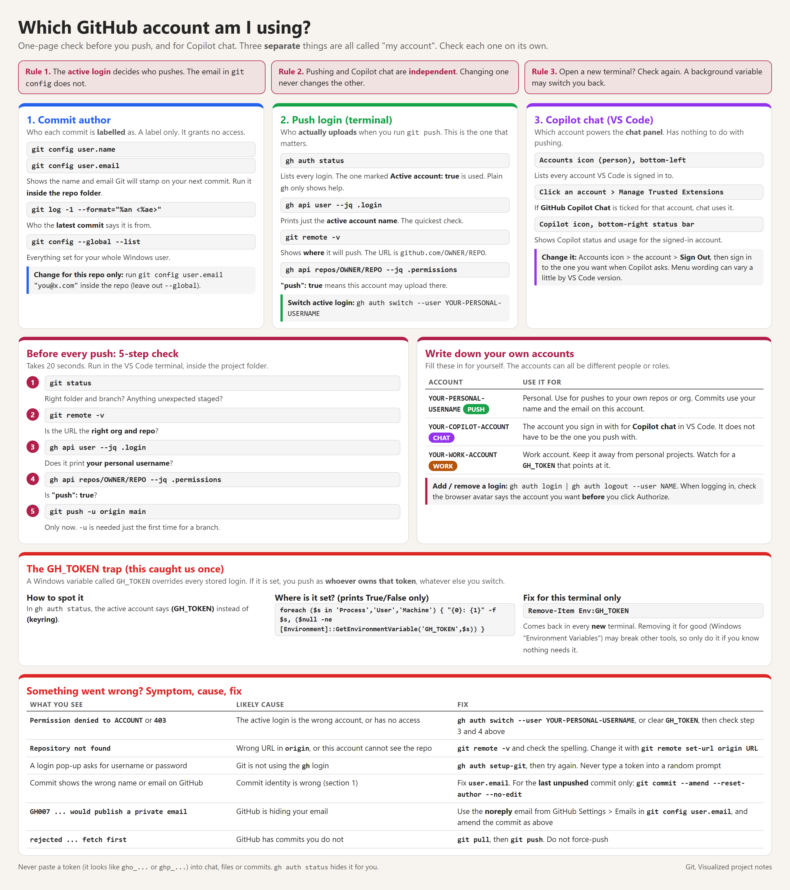

# Git, Visualized: Design, Planning and Build Guide

> **What this file is.** A complete, start-to-finish record of how the "Git, Visualized" learning web page was planned, designed, built, tested, debugged and extended, written so that a person with **no prior context** can rebuild the exact same application from scratch using only this document.
>
> **What you get at the end.** A browser-only web page (no server, no build step, no packages) that teaches Git and GitHub by simulation: four animated boxes (working folder, staging area, local repository, GitHub), a live commit-history chart, 17 guided scenarios with checklists, a coach that tells you where you are and whether each choice was right or wrong, 58 clickable commands, a 54-question quiz, a Git-vs-GitHub explainer, a printable cheat sheet, and a dark/light theme.

---

## Table of contents

1. [How to use this document](#1-how-to-use-this-document)
2. [Background and goal](#2-background-and-goal)
3. [Requirements and decisions log](#3-requirements-and-decisions-log)
4. [The plan](#4-the-plan)
5. [Prerequisites and environment](#5-prerequisites-and-environment)
6. [Project structure](#6-project-structure)
7. [Architecture and design decisions](#7-architecture-and-design-decisions)
8. [Step-by-step build (recreate everything)](#8-step-by-step-build-recreate-everything)
9. [Running and verifying](#9-running-and-verifying)
10. [Automated and manual tests](#10-automated-and-manual-tests)
11. [Reference tables (generated from the source)](#11-reference-tables-generated-from-the-source)
12. [Chronological build log](#12-chronological-build-log)
13. [Troubleshooting guide](#13-troubleshooting-guide)
14. [Extending the app](#14-extending-the-app)
15. [Known limitations and ideas](#15-known-limitations-and-ideas)
16. [Appendix A: Commit this project and publish it with GitHub Pages](#appendix-a-commit-this-project-and-publish-it-with-github-pages)
17. [Appendix B: Every terminal command used while building](#appendix-b-every-terminal-command-used-while-building)
18. [Appendix C: Glossary](#appendix-c-glossary)
19. [Appendix D: Changes after the first publish](#appendix-d-changes-after-the-first-publish)

---

## 1. How to use this document

**To rebuild the app:** read sections 5 and 6, then follow section 8 in order. Section 8 contains the **complete final source code of every file**. You create each file and paste the content exactly. Nothing else is required: no `npm install`, no compiler, no framework.

**To understand it:** read sections 2 to 4 (why it exists and how it was planned) and section 7 (how it works).

**To check your copy:** section 9 (open it, what you should see) and section 10 (tests you can run in the browser's developer console).

**If something goes wrong:** section 13.

**To change or extend it:** section 14.

Conventions used here:

| Convention | Meaning |
|------------|---------|
| `monospace` | A file name, command, code identifier or value. |
| "Why:" | A short explanation of the reason a step was done. |
| Paths | Relative to the project folder. The original folder was `C:\Repos\git-how`, but any folder works. |
| PowerShell | The original machine was Windows with PowerShell. Equivalent commands for macOS/Linux are given where it matters. |

> The source code in section 8 is the **final state** after all revisions. Earlier prototypes (for example the first single-file `app.js`) were replaced. They are described in the build log (section 12) but not needed to rebuild the final app.

---

## 2. Background and goal

### Who this is for

The requester is a **junior systems administrator** who is **not a developer**. They had read about Git and tried `git clone` and `git push`, and wanted to understand the whole workflow, not just a few commands, and to practise it safely.

### The original request (paraphrased closely)

Build a simple, visually appealing web page that demonstrates **how Git works from start to finish**: creating a repository, cloning it, making changes, branches, pulls, merges, pull requests and so on. Fill in any critical steps a beginner might have missed. Show the workflow as a thread or chain with **buttons** (one per Git action). Clicking a button should show an **animated flow** of what happens, so a viewer understands exactly what each command does. Start by giving a plan, and build only after the plan is approved.

### What was built, in one paragraph

A static web page (`index.html` plus `style.css` and a `js/` folder). It simulates Git and GitHub entirely in the browser memory. You pick a **scenario** (for example "Fix a merge conflict"). The page sets up a prepared situation, describes **where you are** in plain English, and lets you pick a **command**. It then tells you whether the choice was **right**, **fine but not the best next step**, or **wrong**, explains **why**, shows the **terminal output** a real computer would print, and **animates** files and commits moving between four boxes while a **commit chart** redraws.

---

## 3. Requirements and decisions log

This is the complete list of what the requester asked for, in order, and what was decided in response.

| # | Requester said (summary) | Decision / response |
|---|--------------------------|---------------------|
| R1 | Plan first. Build a visual page showing the full Git/GitHub workflow with buttons that animate each action. Fill in steps I missed. | Gave a written plan (section 4): four zones, commit graph, command buttons, stage tabs, guided mode, phases, open questions. **No code until approved.** |
| R2 | Add three optional extras from the plan: a **quiz mode**, a **printable cheat sheet**, and a **Git vs GitHub side-by-side explainer**. | Added to the scope. Built last (section 12, turns 5 and 6). |
| R3 | Single file or folder? "I will let you decide." | **Folder** (`index.html`, `style.css`, scripts). Easier to read and edit while learning. Later grew into a `js/` folder of modules (R6). |
| R4 | Build in **phases**. | Phase 1 first, shown for review before continuing. |
| R5 | **GitHub only**, no GitLab "merge request" wording. | All pull-request wording is GitHub's ("pull request"). GitLab/Bitbucket are only mentioned as alternatives in the explainer. |
| R5b | **Dark** theme with colourful branches, plus a **toggle for light**. | Dark by default. Toggle in the top bar. Choice saved in `localStorage`. Six branch colours. |
| R6 | After Phase 1: it is not clear which part is the interactive "testing" section. Make it obvious. Make commands and the interactive section **more descriptive**, assume **no prior Git knowledge**. Give context, say what each button does, **ask what the next action should be**, then explain in simple English **why the choice was right or wrong**. | Added a how-to strip, glossary, "WATCH" vs "TRY IT YOURSELF" tags, a framed sandbox with three numbered steps (where you are / pick a command / was it right and why), a **coach** with verdicts, and a hint button. |
| R7 | The sandbox only has three steps (Setup, Daily loop, Sync). Make it **more comprehensive**, covering many more scenarios and **all the most commonly used commands**. | Rewrote the engine with branches, merges, conflicts, rebase, pull requests, stash, undo, tags, ignore. Added **scenarios** with checklists (15 at first). Split the code into modules under `js/`. |
| R8 | Also cover **Issues** and **GitHub Actions**, then add a **printable cheat sheet**. | Added an "Issues & Actions" tab, simulated CI runs, two more scenarios (16 and 17), and a cheat sheet overlay with print styles. |
| R9 | "Yes please" to building the **quiz** and the **Git vs GitHub explainer**. | Quiz overlay with 54 questions. Collapsible explainer card with a comparison table. |
| R10 | "Let me just use what is there already before we add anything else. How do I access the page?" | Explained that `index.html` opens by double-click. No further features were added. |
| R11 | Write this documentation file. | This document. |

### Standing design constraints (applied throughout)

These came from the environment's web-artifact guidelines, which were read before building:

* **Theme tokens.** All component colours must come from CSS custom properties named `--cp-*` (never hard-coded hex values inside component rules). Light and dark values are defined once, on `:root` and `html[data-theme="dark"]`. A small inline script at the top of `<head>` sets `data-theme` before the page paints, so there is no flash of the wrong theme.
* **Typography.** `"Segoe UI", Aptos, Calibri, -apple-system, BlinkMacSystemFont, sans-serif` for text and `Consolas, "Courier New", Courier, monospace` for code. Not Inter or generic system-ui.
* **Shape.** About 10px radius for controls, 16px for cards, subtle shadows, no heavy glassmorphism.
* **Accent.** Deep rose/crimson accent (`#b11f4b` light, `#fd8ea1` dark). The requested "colourful branches" are separate variables (`--b0` to `--b5`) and zone colours (`--z-*`), defined next to the theme tokens.

---

## 4. The plan

This is the plan presented before any code was written (requirement R1), preserved so you can see the original intent.

### Concept

One self-contained web page with three parts:

1. A **four-zone diagram** showing where work lives: **Working Directory** (files you edit), **Staging Area** (changes marked for the next commit), **Local Repository** (your commits, the hidden `.git` folder), **Remote (GitHub)** (the shared copy online).
2. A **commit graph**: dots on a line, with branches forking off and merging back.
3. A **command palette** of buttons. Clicking one animates what happens in the diagram and the graph, with a plain-English explanation.

### Layout sketch

```
+----------------------------------------------------------+
|  Stage tabs: Setup | Daily Loop | Branching | Collab | Fix |
+----------------------------------------------------------+
| [Working Dir] -> [Staging] -> [Local Repo] <-> [GitHub]   |
|     animated file "cards" fly between zones               |
+----------------------------------------------------------+
| Commit graph:  o--o--o--o  main                           |
|                    \--o--o  feature/login                 |
+-------------------------------+--------------------------+
| Buttons: [git add] [commit]...| "What just happened?"    |
|                               | command + explanation    |
+-------------------------------+--------------------------+
```

Each button click should: show the exact command, animate files/commits between zones, explain it in plain English (what changed and why you would use it), and optionally show a gotcha.

### Topics planned (including steps a beginner might miss)

| Stage | Actions |
|-------|---------|
| 1. Setup | install and configure (`git config`), `git init`, create repo on GitHub, `git remote add origin`, `git clone`, authentication, `.gitignore`, README |
| 2. Daily loop | edit a file, `git status`, `git diff`, `git add`, `git commit`, `git log`, `git push` |
| 3. Staying in sync | `git fetch` vs `git pull`, `git pull --rebase` |
| 4. Branching | `git branch`, `git switch -c`, switching, deleting |
| 5. Merging | fast-forward, 3-way merge, conflicts, `git rebase` vs merge |
| 6. GitHub collaboration | fork, upstream, push a branch, pull request, review, merge options (merge commit / squash / rebase), delete branch, sync after merge |
| 7. Undo and fix | `git restore`, `git reset` (soft/mixed/hard), `git revert`, `git stash`, `git commit --amend`, `git cherry-pick`, `git reflog` |
| 8. Extras | tags and releases, Issues, GitHub Actions, branch protection, clone vs fork |

### Guided mode

A "Play full story" idea: run the whole lifecycle as a narrated walkthrough (create repo, clone, branch, edit, add, commit, push, open PR, review, merge, pull, delete branch), with pause and step controls, plus a free **sandbox** mode. This evolved into the scenario system (R7).

### Technical approach chosen

* Plain **HTML + CSS + JavaScript**. No frameworks, no build step, no server. Double-click to open; free to host later on GitHub Pages.
* **SVG** (generated by JavaScript) for the commit graph, **CSS animations** plus the **Web Animations API** for the flying chips.
* A small **state model** tracks files in each zone, commits and branches. Buttons that do not make sense still respond: they explain why the action fails (and print the real error message), which teaches the rules.
* Dark theme, colour-coded zones and branches, large readable text.

### Build phases planned

1. Skeleton, four zones, commit graph, core loop (`add`, `commit`, `push`, `pull`, `fetch`, `clone`).
2. Branching, merging (fast-forward, 3-way, conflicts), rebase.
3. GitHub pull-request workflow.
4. Undo/fix, tags, extras, guided mode.
5. Polish, glossary tooltips, publishing to GitHub Pages.

### How the plan changed in practice

* The first build (Phase 1) delivered the core loop only. Feedback (R6) reshaped the page around a **coach-driven sandbox**.
* A second request (R7) made the engine much bigger, so the phases 2 to 4 were delivered together as **scenarios** rather than as separate tabs of buttons.
* "Fork + upstream" and "cherry-pick" were in the plan but were **not built** (section 15).
* "Play full story" became the **scenario checklists** instead of a narrated video-style player.

---

## 5. Prerequisites and environment

### What the original build used

| Item | Detail |
|------|--------|
| OS | Windows, shell: PowerShell |
| Editor | Visual Studio Code |
| Browser | Chromium-based browser (VS Code's integrated browser was used for testing) |
| Project folder | `C:\Repos\git-how` (it already contained an empty Git repository, `.git`, with no commits) |
| Languages | HTML5, CSS3, JavaScript (ES2020, no modules, no transpiling) |
| Dependencies | **None** |
| Optional | Node.js 22 (only used to generate the reference tables in section 11 and the documentation itself; the app does not need it) |

### What you need to rebuild it

* Any text editor (VS Code recommended).
* A **current browser** (Chrome, Edge, Firefox, or Safari 16.2 or newer). The CSS uses `color-mix()`, CSS custom properties, `:focus-visible`, `details/summary`, `@media print`, and the JavaScript uses the Web Animations API (`element.animate`), ES2020 syntax (optional chaining is not used; spread, `Object.fromEntries`, async/await are), and optional `localStorage`.
* Windows built-in fonts "Segoe UI" and "Consolas" look best. Other systems fall back to the listed alternatives.
* **No internet** is required to run the page. The page loads no external files.
* **Git** itself is not needed to run the page. It is only needed if you follow Appendix A.

---

## 6. Project structure

```
git-how/
|-- index.html                  Page structure, theme bootstrap, script tags, overlays
|-- style.css                   All styling: themes, layout, animations, print styles
|-- README.md                   Project overview for GitHub visitors
|-- assets/
|   |-- github-account-cheatsheet.html   Source of the account-check cheat sheet
|   `-- github-account-cheatsheet.png    Image shown in the Cheat sheets overlay
|-- GIT-VISUALIZER-DESIGN-PLANNING-AND-BUILD-GUIDE.md   (this document)
`-- js/
    |-- core.js                 The simulated Git engine: state, commits, merge, rebase, push, fetch, CI
    |-- actions-basic.js        Tabs + commands: setup, daily loop, sync (push/fetch/pull/teammate)
    |-- actions-branch.js       Commands: branches, merge, rebase, conflict fixing, pull requests
    |-- actions-undo.js         Commands: restore, stash, amend, reset, revert, reflog, ignore, tags
    |-- actions-ci.js           Commands: Issues and GitHub Actions
    |-- coach.js                The "where you are" text, right/wrong logic, and the 17 scenarios
    |-- ui.js                   Rendering: boxes, commit chart, scenario picker, commands, feedback, terminal, animation
    |-- cheatsheet.js           Printable cheat sheet overlay
    |-- quiz-data.js            The 54 quiz questions (data only)
    |-- quiz.js                 Quiz overlay logic
    `-- main.js                 Wiring: run an action, judge the choice, start scenarios, reset, theme
```

### Script load order (important)

The scripts are plain (non-module) scripts that share one global object, `window.GV`. They **must load in this order**, because later files use what earlier files define:

1. `core.js` (creates `GV`, the state `GV.S`, and the engine)
2. `actions-basic.js` (creates `GV.ACTIONS`, `GV.TABS`, shared helpers)
3. `actions-branch.js`, `actions-undo.js`, `actions-ci.js` (append more actions)
4. `coach.js` (reads `GV.ACTIONS` indirectly through ids; defines scenarios and `GV.coach`)
5. `ui.js` (rendering functions)
6. `cheatsheet.js` (reads `GV.ACTIONS` and `GV.TABS`)
7. `quiz-data.js` then `quiz.js`
8. `main.js` last (builds `GV.ACTION` lookup, wires everything, starts the app)

> **Why plain scripts and not ES modules?** ES modules do not load from `file://` URLs in several browsers (CORS restrictions), and the goal was "double-click `index.html` and it works".

---

## 7. Architecture and design decisions

### 7.1 Module dependency overview



### 7.2 What happens on one click



### 7.3 The simulated world: state object `S`

All state lives in one object, `GV.S`. It is **cleared and refilled in place** on reset (so every module keeps the same reference).

| Field | Meaning |
|-------|---------|
| `configured` | Has `git config` (name and email) been done? Commits are refused until it is. |
| `hasLocal`, `hasRemote`, `linked` | Does a local repo exist, does a GitHub repo exist, is `origin` configured. |
| `head` | Name of the current local branch. |
| `commits` | Every commit ever made: `{ id, parents[], msg, snap, lane, author, seq }`. `snap` is a snapshot `{ fileName: content }`. `lane` is the branch it was created on (used for chart colour/row). |
| `seq`, `nextHash` | Counters: ordering of commits and fake hash generation. |
| `lanes` | Branch names in the order first seen. Index decides the colour. |
| `local` | `{ objs: Set of commit ids the local repo has, branches: {name: id}, tracking: {name: id} (the "origin/name" bookmarks), tags: {name: id} }`. |
| `remote` | `{ objs, branches, tags }` for GitHub. |
| `work` | The working folder: `{ fileName: content }`. |
| `index` | The staging area: `{ fileName: content }`. It mirrors `HEAD` until you `add`. |
| `stash` | Stack of shelved changes. |
| `reflog` | History of where `HEAD` pointed: `{ id, text }`. |
| `prs`, `issues`, `runs` | Pull requests, issues, and GitHub Actions runs (GitHub-side objects). |
| `conflict` | While a merge is stopped on conflicts: `{ theirs, label, msg, files[], detail }`. |
| `counters` | `{ edit, team }` used to make unique file contents and teammate messages. |
| `ev` | Events counter, e.g. `{ commit: 2, "push-branch": 1 }`. Scenario checklists tick when their event count is above 0. |

**Key idea:** the local repo and GitHub do not hold separate copies of commits. A commit is stored once in `S.commits`, and each side remembers **which ids it has** (`objs`) and **where its branch labels point**. A "push" copies ids and moves a label; a "fetch" does the reverse.

### 7.4 File model: contents, not version numbers

The first prototype tracked files as version numbers. That could not represent conflicts, because two branches editing the same file would both become "version 2". The final engine stores **file contents as strings**. Each edit generates a unique one-line text (for example `index.html: edit 3 on feature`). Snapshots are plain objects `{ name: content }`.

Derived file states (function `GV.fileList()`):

| Flag | Condition |
|------|-----------|
| `untracked` | in the folder, not in the staging area, not ignored, not in a conflict |
| `staged` | in the staging area and different from `HEAD` |
| `unstaged` | in the staging area but the folder copy differs |
| `conflicted` | listed in `S.conflict.files` |
| `ignored` | untracked and matches a pattern in `.gitignore` (`*.ext` or exact name) |
| `isNew` | tracked but not in `HEAD` |

### 7.5 Engine operations (in `core.js`)

| Function | Purpose |
|----------|---------|
| `mkCommit`, `ancestors`, `isAnc`, `give` | Create a commit; walk parents; test ancestry; copy a commit and its ancestors into a repo. |
| `mergeBase(a, b)` | Newest commit (by `seq`) that is an ancestor of both. Good enough for this simulation. |
| `mergeSnaps(base, ours, theirs, label)` | **File-level three-way merge.** For each file: equal sides take that value; if one side equals the base take the other side; if both changed differently it is a **conflict** and conflict markers are written (`<<<<<<< HEAD` ... `=======` ... `>>>>>>> label`). |
| `opMerge` | Returns `uptodate`, `ff` (fast-forward), `merge` (merge commit with two parents), `conflict` (sets `S.conflict`, stages the clean files) or `blocked` (uncommitted edits would be overwritten). |
| `opRebase` | Replays this branch's commits one by one onto the target using `mergeSnaps`. Conflicts cancel the rebase (not simulated). Old commits become unreachable. |
| `opPush`, `opFetch`, `opPrune` | Copy commit ids between local and remote, move labels, detect **rejection** (remote tip is not an ancestor of your tip). |
| `opSwitch`, `opNewBranch`, `checkoutSnap` | Switch branch; rewrite folder and staging area to a snapshot while keeping untracked files and unrelated uncommitted edits. |
| `wouldOverwrite` | Lists uncommitted tracked files that a switch/merge would clobber, so the simulation can refuse like Git does. |
| `opCI` | GitHub Actions: if the pushed snapshot contains `.github/workflows/ci.yml`, create a run. It **fails** if any other file's content matches `/BUG\|BROKEN/`. |
| `visibleIds` | Commits to draw: everything reachable from a branch, tag or `origin/*` bookmark (so rewritten/abandoned commits disappear from the chart, but remain in the reflog). |
| `sim.base()` | Preset used by most scenarios: configured, GitHub repo with README, cloned, plus one pushed commit `Add index.html`. |

### 7.6 Actions: the shape of a command

Every button is an object in `GV.ACTIONS`:

```js
{
  id: "add",                 // unique key, used by scenarios, coach and events
  tab: "daily",              // which group of buttons it appears under
  btn: "git add .",          // button label
  cmd: "git add .",          // command echoed in the terminal if blocked (starts with # for non-git steps)
  desc: "Stage changes for the next commit",    // what it does (shown on the button)
  when: "After changing files, ...",            // "Use it:" line on the button
  ro: true,                  // optional: read-only command ("only looks, changes nothing")
  can() { ... },             // returns null if allowed, else { why, out[] } = why it would fail + real error text
  run() { ... }              // mutates state, returns the result object below
}
```

`run()` returns:

| Key | Meaning |
|-----|---------|
| `cmd` | Command line(s) to print in the terminal (strings starting with `#` print as comments). |
| `out` | Output lines. A string, or `{ t: text, c: "ok" | "err" | "hint" | "out" }`. |
| `events` | Extra event names to record (for example `push-rejected`, `merge-conflict`). |
| `zones` | Box ids to pulse: `wd`, `stage`, `local`, `remote`. |
| `links` | Arrow ids to animate: `l-wd-stage`, `l-stage-local`, `l-push`, `l-fetch`. |
| `anim` | Flying chips: `{ from, to, label, delay }`. `from === to` makes the chip drop in from above the box. |
| `explain` | `{ title, what, steps[], tip, warn }`. If `warn` is true the action "failed" (for example a rejected push). |

### 7.7 The coach (the teaching engine)

For the current state, `GV.coach()` returns:

| Field | Meaning |
|-------|---------|
| `situation` | HTML paragraph(s) shown in Step 1: where you are, in plain English. |
| `best` | Array of action ids that are the right next step. |
| `reasons` | For each best id, **why** it is right. |
| `fine` | For other ids, a note shown when the action works but is not the best step. |
| `complete` | True when the scenario's checklist is finished. |

Resolution order inside `GV.coach()`:

1. Scenario complete? Return the "Scenario complete" message.
2. A **merge stopped on conflicts**? Use the conflict coach (status, then fix the file, then `add`, then `commit`), in **every** scenario.
3. Otherwise, call the active scenario's own `coach()`; with no scenario ("Free play"), call the **generic coach**.

The generic coach checks, in order: not configured, nothing exists, remote only, staged changes, unstaged/untracked changes, local-only repo, not linked, GitHub ahead, local ahead, otherwise "edit a file". Building blocks (`commitStep`, `addStep`, `pushStep`, `pullStep`, `editStep`) are shared by the scenarios.

**Verdict rules (in `main.js`):**

| Situation | Verdict |
|-----------|---------|
| `can()` blocked it | **Not quite** (red): why it fails, the real error in the terminal, and the better next step. State unchanged. |
| It ran and `explain.warn` is true, and it was the recommended step | **Expected error** (amber): used in the "diverged histories" scenario, where trying the push is the lesson. |
| It ran and `explain.warn` is true | **Not quite** (red): Git refused. |
| It ran and its id is in `best` | **Right choice** (green) with the reason. |
| It ran, not in `best` | **That worked, but it is not the next step** (amber), with the `fine` note (or "checking is always safe" for read-only commands) and the better next step. |

**Events:** after a successful run, `S.ev[action.id]` is incremented (not for failed attempts), and any `events` returned by `run()` are incremented too. Scenario checklist items name events.

### 7.8 Scenarios

Each scenario is `{ id, title, tab, blurb, intro, setup(), checklist[{ev,text}], coach() }`. `startScenario(id)` calls `setup()` (which resets the state and builds a prepared situation), clears `S.ev`, clears the message box and hint, and selects the matching tab. The full list is in section 11.

### 7.9 Rendering (`ui.js`)

* **Boxes:** each list is rebuilt on every render. A memory of previously shown keys (`seen`) decides which rows get the "enter" slide-in animation, so only **new** items animate.
* **Commit chart (SVG):** commits sorted by creation order become columns (`x = GX0 + index * GDX`). Branch lanes become rows. Constants: `GX0 = 130`, `GDX = 116`, `GY0 = 50 + maxPills * 24`, `GDY = 120 + 18 * (maxPills - 1)`. Node styles: **solid** = on both your computer and GitHub, **ring** = only local, **dashed ring** = only on GitHub. Labels ("pills") stack above a node: `HEAD -> branch`, `origin/branch` (dashed), `GitHub: branch`, `tag: name`.
* **Fork visibility:** when `main` has diverged, commits that are not on the first-parent chain of the main tip are drawn on an extra row `main~` (shown as "main (other)"), so forks and merge commits are visible.
* **Edges:** straight line within a lane, cubic curve between lanes; merge commits draw their second parent edge in the other branch's colour; edges to remote-only commits are dashed.
* **Labels readable over lines:** commit hash and message text use `paint-order: stroke` with a background-coloured stroke (a "halo"), added after the first test showed a curve cutting through text.
* **Flying chips:** `GV.fly(from, to, label, delay)` creates a fixed-position chip and animates it with `element.animate`. Reduced-motion users skip it.
* **Busy lock:** while animating, `ui.busy` is true and `body.busy` disables pointer events on command buttons.

### 7.10 Page layout and teaching design

* **How-to strip** (what Git is, Watch/Try/Learn) and a **glossary** at the very top.
* **Git vs GitHub explainer** (collapsible card).
* **WATCH** cards (tag in grey) are read-only: the four boxes and the commit history.
* **TRY IT YOURSELF** card (accent border, accent tag) is the only clickable area: scenario picker, mission checklist, then three numbered steps: **1. Where you are right now**, **2. What should you do next? Pick a command** (with hint button and command-group tabs), **3. Was it right? What happened?** plus a **terminal**.
* Every command button shows the command, what it does, **"Use it:"** when to use it, and a "only looks, changes nothing" badge for read-only ones.
* The sandbox sits **between** the boxes and the history chart so the boxes are visible while you click.

### 7.11 Theme system

* `<head>` script sets `data-theme` on `<html>` from (in order) `localStorage["gitviz-theme"]`, the `?scoutTheme=` URL parameter, then `"dark"`.
* The toggle in the top bar flips the attribute and saves the choice (wrapped in `try/catch` because `localStorage` can be blocked on `file://` pages in some browsers).
* Colours exist only as variables: `--cp-*` (theme), `--b0..--b5` (branches), `--z-wd`, `--z-stage`, `--z-local`, `--z-remote` (zones).
* Tints are made with `color-mix(in srgb, var(--x) NN%, ...)`.

### 7.12 Cheat sheet and printing

* The cheat sheet is built from the **same** `GV.ACTIONS` list (skipping practice-only actions such as "Teammate pushes"), plus static sections (golden rules, commit message tips, common errors, Git vs GitHub, key words).
* Opening it adds `body.cheat-open`. The print stylesheet (`@media print`) hides everything except the overlay **only when that class is present**, forces a black-on-white palette whatever the theme, sets `@page` margins, and keeps two columns with `break-inside: avoid`.

### 7.13 Quiz

* Data format (one row per question): `[category, question, correct answer, [3 wrong answers], explanation, scenario id]`.
* At run time answers are shuffled. After each answer you see correct/incorrect and the explanation. Keys `1` to `4` pick an answer. The result screen lists missed questions with a **"Practise this in the sandbox"** button that closes the quiz and starts the scenario (`GV.practise(id)`). Best score is saved under `localStorage["gitviz-quiz-best"]`.

### 7.14 Accessibility, security and robustness

* Buttons are real `<button>` elements; tabs use `role="tab"` and `aria-selected`; the scenario chips use `aria-pressed`; overlays use `role="dialog"` and `aria-modal`; live regions (`aria-live="polite"`) announce situation and feedback. Esc closes overlays. `prefers-reduced-motion` disables animations (CSS and the chip animation).
* **Escaping:** every dynamic string that comes from state (file names, commit messages, the user's typed commit message) goes through `esc()` before being placed in `innerHTML`. Static explanation strings authored in the code may contain HTML tags on purpose.
* **No network access** of any kind. No external fonts, scripts or images. Nothing real is ever read, written or sent.

---

## 8. Step-by-step build (recreate everything)

Follow these steps in order. After each file there is a short "Why" so you know what it is for. **Create the files with exactly the contents shown.**

### Step 1. Create the project folder

Why: all files must live together, because `index.html` refers to the others by relative path.

PowerShell (Windows):

```powershell
New-Item -ItemType Directory -Force -Path C:\Repos\git-how\js
Set-Location C:\Repos\git-how
```

macOS / Linux:

```bash
mkdir -p ~/git-how/js && cd ~/git-how
```

(Optional) make it a Git repository so you can practise committing it later (Appendix A):

```bash
git init
```

### Step 2. `index.html`

Why: the page skeleton. Contents, from top to bottom:

* `<head>`: UTF-8, viewport, title, the **theme bootstrap script** (runs before paint), link to `style.css`.
* Top bar: logo, title, **Quiz**, **Cheat sheets**, **Reset sandbox** buttons and the **dark/light switch**.
* "New to Git? Start here" strip with the three-step explanation, **Jump to the sandbox** link and a **glossary** (`<details>`).
* **Git vs GitHub** card (`<details open>`).
* **WATCH** card with the four zones (`z-wd`, `z-stage`, `z-local`, `z-remote`) and the arrows between them (`l-wd-stage`, `l-stage-local`, `l-push`, `l-fetch`).
* **TRY IT YOURSELF** sandbox: banner, scenario bar (`#scenarios`, `#mission`), then the two columns with Steps 1 to 3 and the terminal.
* **WATCH** card for the commit history (`#graph-scroll`, `#graph`).
* Footer note, the cheat-sheet overlay (`#cheatsheet`), the quiz overlay (`#quiz`), and the 11 script tags in the correct order.

The element **ids** are used by the JavaScript. Do not rename them.

**File: `index.html`**

````html
<!DOCTYPE html>
<html lang="en" data-theme="dark">
<head>
  <meta charset="utf-8">
  <meta name="viewport" content="width=device-width, initial-scale=1">
  <title>Git, Visualized</title>
  <script>
    // Runs first so the page never flashes the wrong theme. Saved choice > ?scoutTheme= > dark.
    (() => {
      let saved = null;
      try { saved = localStorage.getItem("gitviz-theme"); } catch (e) {}
      const param = new URLSearchParams(window.location.search).get("scoutTheme");
      document.documentElement.setAttribute("data-theme", saved || param || "dark");
    })();
  </script>
  <link rel="stylesheet" href="style.css">
</head>
<body>
  <header class="topbar">
    <div class="brand">
      <svg class="logo" viewBox="0 0 48 32" aria-hidden="true">
        <path class="l1" d="M6 16 H24 M24 16 Q30 16 32 8 H42 M24 16 Q30 16 32 24 H42"/>
        <circle class="n1" cx="6" cy="16" r="4"/>
        <circle class="n1" cx="24" cy="16" r="4"/>
        <circle class="n2" cx="42" cy="8" r="4"/>
        <circle class="n3" cx="42" cy="24" r="4"/>
      </svg>
      <div>
        <h1>Git, visualized</h1>
        <p>Click a command and watch what happens, from an empty repo to a merged change.</p>
      </div>
    </div>
    <div class="topbar-actions">
      <button id="btn-quiz" class="btn" type="button">Quiz</button>
      <button id="btn-cheat" class="btn" type="button">Cheat sheets</button>
      <button id="btn-reset" class="btn" type="button">Reset sandbox</button>
      <label class="switch" title="Switch between dark and light theme">
        <input type="checkbox" id="theme-toggle" role="switch" aria-label="Use light theme">
        <span class="track"><span class="thumb"></span></span>
        <span class="switch-label" id="theme-label">Dark</span>
      </label>
    </div>
  </header>

  <main>
    <section class="howto" aria-label="How to use this page">
      <h2>New to Git? Start here</h2>
      <p class="howto-lead">Git keeps a history of your project so you can save versions of your work, undo mistakes, and work with other people. GitHub is a website that stores a shared copy online. This page is a safe practice area: nothing you click here changes any real file.</p>
      <ol class="howto-steps">
        <li><span class="num">1</span><div><b>Watch</b><br>The boxes and the history chart on this page are a live picture of a project. They change as you work.</div></li>
        <li><span class="num">2</span><div><b>Try</b><br>Use the <b>Try it yourself</b> sandbox to pick Git commands. Wrong choices are fine. That is how you learn.</div></li>
        <li><span class="num">3</span><div><b>Learn</b><br>After every click you are told if it was the right move, why, and what to do next.</div></li>
      </ol>
      <div class="howto-actions">
        <a class="btn primary" href="#sandbox">Jump to the sandbox</a>
        <details class="glossary">
          <summary>Key words you will see</summary>
          <dl>
            <dt>Repository (repo)</dt><dd>A project folder that Git is tracking, plus its full history.</dd>
            <dt>Commit</dt><dd>A saved snapshot of your project at one moment, with a short message. Like a save point in a game.</dd>
            <dt>Working directory</dt><dd>The normal folder on your computer where you edit files.</dd>
            <dt>Staging area</dt><dd>A waiting room where you choose which changes go into the next commit.</dd>
            <dt>Local / remote</dt><dd>Local is your computer. Remote is a copy somewhere else, usually GitHub.</dd>
            <dt>origin</dt><dd>The default nickname for the remote (GitHub) address.</dd>
            <dt>Branch (main)</dt><dd>A line of commits. <code>main</code> is the default, main line of your project.</dd>
            <dt>Merge / rebase</dt><dd>Two ways to bring one branch's work into another. Merge joins the lines. Rebase replays commits to keep a straight line.</dd>
            <dt>Conflict</dt><dd>Two branches changed the same lines. Git pauses and asks you to choose.</dd>
            <dt>Pull request (PR)</dt><dd>A GitHub proposal to merge a branch, where teammates review it first.</dd>
            <dt>Stash</dt><dd>A shelf for unfinished changes you are not ready to commit.</dd>
            <dt>Tag</dt><dd>A permanent label on one commit, usually a release like v1.0.</dd>
            <dt>HEAD</dt><dd>A marker meaning "you are here": the commit you are currently on.</dd>
            <dt>Clone / push / pull</dt><dd>Clone: download a repo. Push: upload your commits. Pull: download others' commits and combine them with yours.</dd>
          </dl>
        </details>
      </div>
    </section>

    <details class="card vs" open>
      <summary><h2>Git vs GitHub: what is the difference?</h2></summary>
      <div class="vs-grid">
        <div class="vs-col vs-git">
          <span class="tag watch">The tool</span>
          <h3>Git</h3>
          <p>A program installed on <b>your computer</b>. It records the history of your files: what changed, who changed it, and when. It works fully offline and is free.</p>
          <p class="vs-ana"><b>Think of it as:</b> a file system with built-in version history for a whole folder.</p>
          <p class="vs-ex">Commands: <code>commit</code> <code>branch</code> <code>merge</code> <code>log</code> <code>status</code></p>
        </div>
        <div class="vs-link" aria-hidden="true"><span><code>clone</code><code>push</code><code>pull</code><code>fetch</code></span><small>connect them</small></div>
        <div class="vs-col vs-gh">
          <span class="tag try">The website</span>
          <h3>GitHub</h3>
          <p>An <b>online service</b> that stores Git repositories so people can share and collaborate. It adds reviews, issue tracking and automation. You need an account and internet.</p>
          <p class="vs-ana"><b>Think of it as:</b> the shared file server with a web portal, permissions and a ticket system on top. GitLab and Bitbucket do the same job.</p>
          <p class="vs-ex">Features: <code>pull requests</code> <code>issues</code> <code>Actions</code> <code>forks</code></p>
        </div>
      </div>
      <table class="vs-table">
        <thead><tr><th>What you want</th><th>Git (your computer)</th><th>GitHub (website)</th></tr></thead>
        <tbody>
          <tr><td>Record history of changes (commits)</td><td>Yes</td><td>Shows it in the browser</td></tr>
          <tr><td>Work without internet</td><td>Yes</td><td>No</td></tr>
          <tr><td>Branches and merging</td><td>Yes</td><td>Shows branches, offers merge buttons</td></tr>
          <tr><td>Pull requests and code review</td><td>No</td><td>Yes</td></tr>
          <tr><td>Issues (bugs, tasks)</td><td>No</td><td>Yes</td></tr>
          <tr><td>Automatic tests (Actions)</td><td>No</td><td>Yes</td></tr>
          <tr><td>Control who is allowed to push to a project</td><td>No</td><td>Yes</td></tr>
        </tbody>
      </table>
    </details>

    <section class="card" aria-label="Where your work lives">
      <div class="card-head">
        <h2><span class="tag watch">Watch</span>Where your work lives</h2>
        <p>A live picture, not clickable. Use the sandbox below to make things happen here. Work moves from left to right.</p>
      </div>
      <div class="flow" id="flow">
        <div class="zone" id="z-wd" style="--zc: var(--z-wd)">
          <div class="zone-head">
            <svg viewBox="0 0 24 24" aria-hidden="true"><path d="M3 6a2 2 0 0 1 2-2h4l2 2h8a2 2 0 0 1 2 2v9a2 2 0 0 1-2 2H5a2 2 0 0 1-2-2z"/></svg>
            <div><h3>Working Directory</h3><p>The files you edit on your computer</p></div>
          </div>
          <ul class="zone-body" id="wd-body"></ul>
        </div>

        <div class="link" id="l-wd-stage"><span class="lbl">git add</span><span class="line"></span></div>

        <div class="zone" id="z-stage" style="--zc: var(--z-stage)">
          <div class="zone-head">
            <svg viewBox="0 0 24 24" aria-hidden="true"><path d="M12 3l9 5-9 5-9-5z"/><path d="M3 13l9 5 9-5"/></svg>
            <div><h3>Staging Area</h3><p>Changes picked for the next commit</p></div>
          </div>
          <ul class="zone-body" id="stage-body"></ul>
        </div>

        <div class="link" id="l-stage-local"><span class="lbl">git commit</span><span class="line"></span></div>

        <div class="zone" id="z-local" style="--zc: var(--z-local)">
          <div class="zone-head">
            <svg viewBox="0 0 24 24" aria-hidden="true"><ellipse cx="12" cy="6" rx="8" ry="3"/><path d="M4 6v6c0 1.7 3.6 3 8 3s8-1.3 8-3V6"/><path d="M4 12v6c0 1.7 3.6 3 8 3s8-1.3 8-3v-6"/></svg>
            <div><h3>Local Repository</h3><p>Your commit history (the hidden .git folder)</p></div>
          </div>
          <ul class="zone-body" id="local-body"></ul>
        </div>

        <div class="linkpair">
          <div class="link" id="l-push"><span class="lbl">git push</span><span class="line"></span></div>
          <div class="link left" id="l-fetch"><span class="lbl">fetch / pull</span><span class="line"></span></div>
        </div>

        <div class="zone" id="z-remote" style="--zc: var(--z-remote)">
          <div class="zone-head">
            <svg viewBox="0 0 24 24" aria-hidden="true"><path d="M7 18a4 4 0 0 1-.5-7.97A6 6 0 0 1 18 9a4.5 4.5 0 0 1-.5 9z"/></svg>
            <div><h3>GitHub (remote)</h3><p>The shared copy, called "origin"</p></div>
          </div>
          <ul class="zone-body" id="remote-body"></ul>
        </div>
      </div>
    </section>

    <section id="sandbox" class="card sandbox" aria-label="Try it yourself: interactive sandbox">
      <div class="sb-banner">
        <h2><span class="tag try">Try it yourself</span>Interactive sandbox</h2>
        <p>This is the part you click. Pick a scenario, read where you are, choose a command, then read what happened. Watch the boxes above and the history below react.</p>
      </div>
      <div class="scn-bar">
        <h3 class="scn-heading">Choose a scenario <span>Each one sets up a real situation and gives you a checklist</span></h3>
        <div class="scenarios" id="scenarios" role="group" aria-label="Scenarios"></div>
        <div class="mission" id="mission" aria-live="polite"></div>
      </div>
      <div class="sb-grid">
        <div class="sb-col">
          <div class="step-block">
            <h3 class="step-head"><span class="num">1</span>Where you are right now</h3>
            <div id="situation" class="situation" aria-live="polite"></div>
          </div>
          <div class="step-block">
            <h3 class="step-head"><span class="num">2</span>What should you do next? Pick a command</h3>
            <div class="hintrow" id="hint"></div>
            <div class="tabs" id="tabs" role="tablist" aria-label="Command groups"></div>
            <p class="tab-intro" id="tab-intro"></p>
            <div class="actions" id="actions"></div>
          </div>
        </div>
        <div class="sb-col sb-col-right">
          <div class="step-block">
            <h3 class="step-head"><span class="num">3</span>Was it right? What happened?</h3>
            <div id="explain" aria-live="polite"></div>
          </div>
          <div class="step-block">
            <h3 class="step-head term-head">Terminal <span>what a real computer would print</span></h3>
            <div class="terminal" id="terminal" role="log"></div>
          </div>
        </div>
      </div>
    </section>

    <section class="card" aria-label="Commit history">
      <div class="card-head">
        <h2><span class="tag watch">Watch</span>Commit history</h2>
        <div class="legend">
          <span><i class="dot full"></i>On your computer and GitHub</span>
          <span><i class="dot local"></i>Only on your computer (not pushed)</span>
          <span><i class="dot remote"></i>Only on GitHub (not fetched)</span>
        </div>
      </div>
      <div class="graph-scroll" id="graph-scroll"><div class="graph" id="graph"></div></div>
    </section>

  </main>

  <footer class="foot">Everything here is a simulation. Nothing touches your real files or your real GitHub account.</footer>

  <div id="cheatsheet" class="cheat-overlay" role="dialog" aria-modal="true" aria-label="Cheat sheets" hidden>
    <div class="cheat-bar">
      <div class="cheat-tabs" role="tablist" aria-label="Cheat sheets">
        <button type="button" class="tab" role="tab" id="tab-commands" aria-selected="true" aria-controls="cheat-page">Commands</button>
        <button type="button" class="tab" role="tab" id="tab-account" aria-selected="false" aria-controls="acct-page">Which GitHub account am I using?</button>
      </div>
      <div><button id="cheat-print" class="btn primary" type="button">Print</button> <button id="cheat-close" class="btn" type="button">Close</button></div>
    </div>
    <article class="cheat-page" id="cheat-page" role="tabpanel" aria-labelledby="tab-commands"></article>
    <article class="cheat-page acct-page" id="acct-page" role="tabpanel" aria-labelledby="tab-account" hidden>
      <p class="acct-intro">Confused about which GitHub account you are signed in to, for pushing or for Copilot chat? Use this page. <a href="assets/github-account-cheatsheet.png" target="_blank" rel="noopener">Open the image full size</a>.</p>
      
    </article>
  </div>

  <div id="quiz" class="cheat-overlay" role="dialog" aria-modal="true" aria-labelledby="quiz-title" hidden>
    <div class="cheat-bar">
      <span>Quiz: what would you use?</span>
      <button id="quiz-close" class="btn" type="button">Close</button>
    </div>
    <article class="cheat-page quiz-page" id="quiz-page"></article>
  </div>

  <script src="js/core.js"></script>
  <script src="js/actions-basic.js"></script>
  <script src="js/actions-branch.js"></script>
  <script src="js/actions-undo.js"></script>
  <script src="js/actions-ci.js"></script>
  <script src="js/coach.js"></script>
  <script src="js/ui.js"></script>
  <script src="js/cheatsheet.js"></script>
  <script src="js/quiz-data.js"></script>
  <script src="js/quiz.js"></script>
  <script src="js/main.js"></script>
</body>
</html>
````

### Step 3. `style.css`

Why: all visuals: the theme variables (light and dark), layout, the four boxes and arrows, animations (slide-in, zone pulse, marching arrow dashes, node pop), the SVG chart styles, the sandbox, scenario chips and checklist, verdict boxes, terminal, cheat sheet, quiz, Git-vs-GitHub card, **print styles** and responsive rules.

Notes for the reader:

* The theme variable blocks appear first. Everything else uses `var(--cp-*)`.
* The `@media (max-width: 1000px)` block near the end is **one** block that several sections contribute to. Keep its opening and closing brace intact when editing (see troubleshooting, section 13).
* A few older rules (`.bottom`, `.stack`, `.suggest`) are leftovers from the first layout and are harmless; they style elements that no longer exist.

**File: `style.css`**

````css
/* ---------- Theme tokens ---------- */
:root {
  color-scheme: light;
  --cp-bg: #f7f4ef;
  --cp-bg-elevated: #fcfbf8;
  --cp-surface: #ffffff;
  --cp-surface-soft: #f5f5f5;
  --cp-border: #dedede;
  --cp-border-strong: #919191;
  --cp-text: #242424;
  --cp-text-muted: #5c5c5c;
  --cp-text-soft: #6f6f6f;
  --cp-accent: #b11f4b;
  --cp-accent-hover: #9a1a41;
  --cp-accent-soft: rgba(177, 31, 75, 0.08);
  --cp-accent-fg: #ffffff;
  --cp-success: #16a34a;
  --cp-danger: #dc2626;
  --cp-warning: #f59e0b;
  --cp-link: #0078d4;
  --cp-shadow: 0 18px 48px rgba(0, 0, 0, 0.12);
  --cp-overlay: rgba(255, 255, 255, 0.8);
  --cp-panel: rgba(255, 255, 255, 0.86);
  --cp-panel-strong: rgba(255, 255, 255, 0.96);
  --cp-sheen: rgba(255, 255, 255, 0.55);
  --cp-highlight: rgba(177, 31, 75, 0.12);

  /* Branch colors (one per lane in the commit graph) */
  --b0: #2563eb;
  --b1: #16a34a;
  --b2: #d97706;
  --b3: #9333ea;
  --b4: #ea580c;
  --b5: #0d9488;

  /* Zone colors */
  --z-wd: #d97706;
  --z-stage: #16a34a;
  --z-local: #2563eb;
  --z-remote: var(--cp-accent);
}

html[data-theme="dark"] {
  color-scheme: dark;
  --cp-bg: #3d3b3a;
  --cp-bg-elevated: #343231;
  --cp-surface: #292929;
  --cp-surface-soft: #2e2e2e;
  --cp-border: #474747;
  --cp-border-strong: #5f5f5f;
  --cp-text: #dedede;
  --cp-text-muted: #919191;
  --cp-text-soft: #b0b0b0;
  --cp-accent: #fd8ea1;
  --cp-accent-hover: #fb7b91;
  --cp-accent-soft: rgba(253, 142, 161, 0.14);
  --cp-accent-fg: #1a1a1a;
  --cp-success: #4ade80;
  --cp-danger: #f87171;
  --cp-warning: #fbbf24;
  --cp-link: #4da6ff;
  --cp-shadow: 0 18px 48px rgba(0, 0, 0, 0.32);
  --cp-overlay: rgba(41, 41, 41, 0.88);
  --cp-panel: rgba(41, 41, 41, 0.72);
  --cp-panel-strong: rgba(41, 41, 41, 0.96);
  --cp-sheen: rgba(255, 255, 255, 0.04);
  --cp-highlight: rgba(253, 142, 161, 0.12);

  --b0: #60a5fa;
  --b1: #4ade80;
  --b2: #fbbf24;
  --b3: #c084fc;
  --b4: #fb923c;
  --b5: #2dd4bf;

  --z-wd: #fbbf24;
  --z-stage: #4ade80;
  --z-local: #60a5fa;
}

/* ---------- Base ---------- */
* { box-sizing: border-box; }
html { scroll-behavior: smooth; }
body {
  margin: 0;
  background: var(--cp-bg);
  color: var(--cp-text);
  font-family: "Segoe UI", Aptos, Calibri, -apple-system, BlinkMacSystemFont, sans-serif;
  font-size: 15px;
  line-height: 1.5;
}
code, .mono, .terminal, .cmd {
  font-family: Consolas, "Courier New", Courier, monospace;
}
h1, h2, h3, p { margin: 0; }
button { font: inherit; color: inherit; cursor: pointer; }
:focus-visible { outline: 2px solid var(--cp-accent); outline-offset: 2px; }

main { max-width: 1280px; margin: 0 auto; padding: 16px 20px 8px; display: grid; gap: 16px; }

/* ---------- Top bar ---------- */
.topbar {
  display: flex; align-items: center; justify-content: space-between; gap: 16px; flex-wrap: wrap;
  padding: 16px 24px;
  background: var(--cp-bg-elevated);
  border-bottom: 1px solid var(--cp-border);
}
.brand { display: flex; align-items: center; gap: 14px; }
.brand h1 { font-size: 1.4rem; line-height: 1.2; }
.brand p { color: var(--cp-text-muted); font-size: 0.9rem; }
.logo { width: 52px; height: 36px; }
.logo path { fill: none; stroke-width: 2.5; stroke-linecap: round; stroke: var(--b0); }
.logo .l1 { stroke: var(--b0); }
.logo .n1 { fill: var(--b0); }
.logo .n2 { fill: var(--b1); }
.logo .n3 { fill: var(--b3); }
.topbar-actions { display: flex; align-items: center; gap: 16px; }

.btn {
  background: var(--cp-surface); border: 1px solid var(--cp-border-strong);
  border-radius: 0.625rem; padding: 6px 14px;
}
.btn:hover { border-color: var(--cp-accent); color: var(--cp-accent); }

.switch { display: inline-flex; align-items: center; gap: 8px; cursor: pointer; user-select: none; }
.switch input { position: absolute; opacity: 0; pointer-events: none; }
.switch .track {
  width: 44px; height: 24px; border-radius: 12px; background: var(--cp-surface-soft);
  border: 1px solid var(--cp-border-strong); position: relative; transition: background 0.2s;
}
.switch .thumb {
  position: absolute; top: 2px; left: 2px; width: 18px; height: 18px; border-radius: 50%;
  background: var(--cp-text-soft); transition: transform 0.2s, background 0.2s;
}
.switch input:checked + .track { background: var(--cp-accent-soft); }
.switch input:checked + .track .thumb { transform: translateX(20px); background: var(--cp-accent); }
.switch input:focus-visible + .track { outline: 2px solid var(--cp-accent); outline-offset: 2px; }
.switch-label { min-width: 34px; font-size: 0.9rem; color: var(--cp-text-soft); }

/* ---------- Cards ---------- */
.card {
  background: var(--cp-surface); border: 1px solid var(--cp-border); border-radius: 16px;
  padding: 16px 18px; box-shadow: 0 0 2px rgba(0, 0, 0, 0.12), 0 1px 2px rgba(0, 0, 0, 0.14);
  min-width: 0;
}
.card-head { display: flex; align-items: baseline; justify-content: space-between; gap: 12px; flex-wrap: wrap; margin-bottom: 12px; }
.card-head h2 { font-size: 1.05rem; }
.card-head p { color: var(--cp-text-muted); font-size: 0.88rem; }

/* ---------- Four zones ---------- */
.flow { display: flex; align-items: stretch; gap: 0; }
.zone {
  flex: 1 1 0; min-width: 0;
  border: 1.5px solid color-mix(in srgb, var(--zc) 55%, var(--cp-border));
  background: color-mix(in srgb, var(--zc) 7%, var(--cp-surface));
  border-radius: 14px; padding: 12px; display: flex; flex-direction: column; gap: 10px;
  transition: opacity 0.3s, box-shadow 0.3s, border-color 0.3s;
}
.zone.absent { opacity: 0.5; border-style: dashed; }
.zone.pulse { animation: zonepulse 1.1s ease-out; }
@keyframes zonepulse {
  0%   { box-shadow: 0 0 0 0 color-mix(in srgb, var(--zc) 70%, transparent); }
  60%  { box-shadow: 0 0 0 10px color-mix(in srgb, var(--zc) 0%, transparent); border-color: var(--zc); }
  100% { box-shadow: 0 0 0 0 transparent; }
}
.zone-head { display: flex; align-items: center; gap: 10px; }
.zone-head svg {
  width: 28px; height: 28px; flex: none; fill: none; stroke: var(--zc); stroke-width: 1.8;
  stroke-linecap: round; stroke-linejoin: round;
}
.zone-head h3 { font-size: 0.98rem; line-height: 1.2; }
.zone-head p { font-size: 0.78rem; color: var(--cp-text-muted); line-height: 1.3; }
.zone-body { list-style: none; margin: 0; padding: 0; display: grid; gap: 6px; align-content: start; min-height: 120px; }
.zone-body li {
  display: flex; align-items: center; justify-content: space-between; gap: 8px; flex-wrap: wrap;
  background: var(--cp-surface); border: 1px solid var(--cp-border); border-radius: 8px;
  padding: 5px 9px; font-size: 0.85rem; min-width: 0;
}
.zone-body li.enter { animation: slidein 0.5s ease-out; }
@keyframes slidein { from { opacity: 0; transform: translateY(-8px) scale(0.96); } to { opacity: 1; transform: none; } }
.zone-body .fname { font-family: Consolas, "Courier New", monospace; overflow-wrap: anywhere; }
.zone-body .hash { font-family: Consolas, "Courier New", monospace; color: var(--zc); font-weight: 600; }
.zone-body .msg { flex: 1 1 60%; overflow-wrap: anywhere; }
.zone-body li.empty { border-style: dashed; background: transparent; color: var(--cp-text-muted); font-style: italic; }
.zone-body li.meta { background: color-mix(in srgb, var(--zc) 14%, var(--cp-surface)); border-color: var(--zc); font-weight: 600; font-size: 0.8rem; }
.zone-body li.more { background: transparent; border: none; color: var(--cp-text-muted); padding: 0 4px; }
.badges { display: inline-flex; gap: 4px; flex-wrap: wrap; }
.badge { font-size: 0.7rem; padding: 1px 7px; border-radius: 999px; border: 1px solid currentColor; white-space: nowrap; }
.b-red { color: var(--cp-danger); }
.b-amber { color: var(--cp-warning); }
.b-green { color: var(--cp-success); }
.b-muted { color: var(--cp-text-muted); }

/* ---------- Arrows between zones ---------- */
.link { width: 84px; flex: none; display: flex; flex-direction: column; align-items: center; justify-content: center; gap: 4px; padding: 0 4px; }
.linkpair { width: 92px; flex: none; display: flex; flex-direction: column; justify-content: center; gap: 22px; }
.linkpair .link { width: 100%; }
.link .lbl { font-family: Consolas, "Courier New", monospace; font-size: 0.72rem; color: var(--cp-text-muted); text-align: center; line-height: 1.2; }
.link .line {
  position: relative; width: 100%; height: 3px; border-radius: 2px; background: var(--cp-border-strong);
  transition: background 0.3s;
}
.link .line::after {
  content: ""; position: absolute; right: -2px; top: 50%; transform: translateY(-50%);
  border-left: 8px solid var(--cp-border-strong); border-top: 5px solid transparent; border-bottom: 5px solid transparent;
  transition: border-color 0.3s;
}
.link.left .line { transform: scaleX(-1); }
.link.active .lbl { color: var(--cp-accent); font-weight: 700; }
.link.active .line {
  background: repeating-linear-gradient(90deg, var(--cp-accent) 0 8px, transparent 8px 16px);
  background-size: 16px 100%; animation: march 0.5s linear infinite;
}
.link.active .line::after { border-left-color: var(--cp-accent); }
@keyframes march { to { background-position: 16px 0; } }

/* Chips that fly between zones */
.fly {
  position: fixed; left: 0; top: 0; z-index: 50; pointer-events: none; white-space: nowrap;
  background: var(--cp-accent); color: var(--cp-accent-fg); border-radius: 999px; padding: 3px 12px;
  font-family: Consolas, "Courier New", monospace; font-size: 0.8rem; font-weight: 600;
  box-shadow: 0 4px 14px rgba(0, 0, 0, 0.35); opacity: 0;
}

/* ---------- Commit graph ---------- */
.legend { display: flex; gap: 16px; flex-wrap: wrap; font-size: 0.8rem; color: var(--cp-text-muted); }
.legend span { display: inline-flex; align-items: center; gap: 6px; }
.dot { display: inline-block; width: 12px; height: 12px; border-radius: 50%; border: 2px solid var(--b0); }
.dot.full { background: var(--b0); }
.dot.local { background: var(--cp-surface); }
.dot.remote { background: var(--cp-surface); border-style: dashed; opacity: 0.8; }
.graph-scroll { overflow-x: auto; border: 1px solid var(--cp-border); border-radius: 10px; background: var(--cp-bg-elevated); }
.graph { min-height: 150px; }
.graph svg { display: block; }
.graph .empty { padding: 48px 16px; text-align: center; color: var(--cp-text-muted); font-style: italic; }
.g-lane-line { stroke: var(--cp-border); stroke-width: 1; stroke-dasharray: 2 6; }
.g-lane-name { font-family: Consolas, monospace; font-size: 12px; font-weight: 700; fill: var(--lc); }
.g-edge { fill: none; stroke: var(--lc); stroke-width: 3; }
.g-edge.dashed { stroke-dasharray: 5 5; opacity: 0.7; }
.g-node circle { stroke: var(--lc); stroke-width: 3; }
.g-node.full circle { fill: var(--lc); }
.g-node.local circle { fill: var(--cp-bg-elevated); }
.g-node.remote circle { fill: var(--cp-bg-elevated); stroke-dasharray: 4 3; opacity: 0.85; }
.g-node circle.pop { transform-box: fill-box; transform-origin: center; animation: nodepop 0.6s cubic-bezier(.2, 1.6, .4, 1); }
@keyframes nodepop { from { transform: scale(0); } to { transform: scale(1); } }
.g-hash { font-family: Consolas, monospace; font-size: 12px; font-weight: 700; fill: var(--cp-text); text-anchor: middle; }
.g-msg { font-size: 11px; fill: var(--cp-text-muted); text-anchor: middle; }
.g-hash, .g-msg { paint-order: stroke; stroke: var(--cp-bg-elevated); stroke-width: 4px; stroke-linejoin: round; }
.g-pill rect { stroke-width: 1.5; }
.g-pill text { font-family: Consolas, monospace; font-size: 11.5px; font-weight: 700; text-anchor: middle; dominant-baseline: central; }
.g-pill.local rect { fill: var(--lc); stroke: var(--lc); }
.g-pill.local text { fill: var(--cp-bg); }
.g-pill.track rect { fill: var(--cp-bg-elevated); stroke: var(--lc); stroke-dasharray: 4 3; }
.g-pill.track text { fill: var(--lc); }
.g-pill.remote rect { fill: color-mix(in srgb, var(--z-remote) 18%, var(--cp-bg-elevated)); stroke: var(--z-remote); }
.g-pill.remote text { fill: var(--z-remote); }

/* ---------- Commands + explanation ---------- */
.bottom { display: grid; grid-template-columns: minmax(0, 1.15fr) minmax(0, 1fr); gap: 16px; align-items: start; }
.stack { display: grid; gap: 16px; min-width: 0; }

.tabs { display: flex; gap: 6px; flex-wrap: wrap; margin-bottom: 10px; }
.tab {
  background: var(--cp-surface-soft); border: 1px solid var(--cp-border); border-radius: 999px;
  padding: 5px 14px; font-size: 0.88rem;
}
.tab:hover { border-color: var(--cp-accent); }
.tab[aria-selected="true"] { background: var(--cp-accent); color: var(--cp-accent-fg); border-color: var(--cp-accent); font-weight: 600; }
.tab-intro { color: var(--cp-text-muted); font-size: 0.9rem; margin-bottom: 10px; }

.suggest {
  display: flex; align-items: center; gap: 10px; flex-wrap: wrap; margin-bottom: 12px;
  background: var(--cp-accent-soft); border: 1px solid var(--cp-accent); border-radius: 10px;
  padding: 8px 12px; font-size: 0.9rem;
}
.suggest .chip {
  background: var(--cp-accent); color: var(--cp-accent-fg); border: none; border-radius: 999px;
  padding: 3px 12px; font-family: Consolas, monospace; font-weight: 700; font-size: 0.85rem;
}
.suggest .chip:hover { background: var(--cp-accent-hover); }

.actions { display: grid; grid-template-columns: repeat(auto-fill, minmax(200px, 1fr)); gap: 8px; }
.msgrow { grid-column: 1 / -1; display: flex; align-items: center; gap: 8px; flex-wrap: wrap; font-size: 0.88rem; }
.msgrow input {
  flex: 1 1 220px; background: var(--cp-bg-elevated); color: var(--cp-text);
  border: 1px solid var(--cp-border-strong); border-radius: 8px; padding: 6px 10px; font: inherit;
}
.act {
  text-align: left; display: flex; flex-direction: column; gap: 2px;
  background: var(--cp-bg-elevated); border: 1px solid var(--cp-border); border-radius: 10px; padding: 8px 12px;
  transition: border-color 0.15s, transform 0.1s, background 0.15s;
}
.act:hover { border-color: var(--cp-accent); background: var(--cp-accent-soft); }
.act:active { transform: scale(0.98); }
.act .cmd { font-weight: 700; font-size: 0.9rem; color: var(--cp-accent); }
.act .desc { font-size: 0.8rem; color: var(--cp-text-muted); line-height: 1.3; }
.act.blocked { opacity: 0.55; border-style: dashed; }
.act.suggested { border-color: var(--cp-accent); box-shadow: 0 0 0 2px var(--cp-accent-soft); }
body.busy .act, body.busy .suggest .chip { pointer-events: none; opacity: 0.6; }

#explain { font-size: 0.92rem; }
#explain .ex-title { font-family: Consolas, monospace; font-size: 1rem; font-weight: 700; color: var(--cp-accent); margin-bottom: 6px; overflow-wrap: anywhere; }
#explain .ex-what { margin-bottom: 8px; }
#explain h4 { margin: 10px 0 4px; font-size: 0.8rem; text-transform: uppercase; letter-spacing: 0.05em; color: var(--cp-text-muted); }
#explain ul { margin: 0; padding-left: 20px; }
#explain li { margin-bottom: 3px; }
#explain .ex-tip {
  margin-top: 10px; padding: 8px 12px; border-left: 4px solid var(--cp-link);
  background: var(--cp-surface-soft); border-radius: 0 8px 8px 0;
}
#explain.warn .ex-title { color: var(--cp-warning); }
#explain.fade { animation: fadein 0.4s ease-out; }
@keyframes fadein { from { opacity: 0; transform: translateY(4px); } to { opacity: 1; transform: none; } }
#explain code { background: var(--cp-surface-soft); padding: 1px 5px; border-radius: 4px; font-size: 0.88em; }

.terminal {
  background: var(--cp-bg-elevated); border: 1px solid var(--cp-border); border-radius: 10px;
  padding: 10px 12px; height: 240px; overflow-y: auto; font-size: 0.82rem; line-height: 1.45;
}
.terminal .ln { white-space: pre-wrap; overflow-wrap: anywhere; }
.terminal .prompt { color: var(--cp-success); }
.terminal .cmdtext { color: var(--cp-text); font-weight: 700; }
.terminal .ok { color: var(--cp-success); }
.terminal .err { color: var(--cp-danger); }
.terminal .hint, .terminal .comment { color: var(--cp-text-muted); }
.terminal .out { color: var(--cp-text-soft); }

.foot { text-align: center; color: var(--cp-text-muted); font-size: 0.82rem; padding: 12px 20px 28px; }

/* ---------- How-to strip ---------- */
.howto { background: var(--cp-bg-elevated); border: 1px solid var(--cp-border); border-radius: 16px; padding: 16px 18px; }
.howto h2 { font-size: 1.1rem; margin-bottom: 4px; }
.howto-lead { color: var(--cp-text-soft); margin-bottom: 12px; max-width: 90ch; }
.howto-steps { list-style: none; margin: 0; padding: 0; display: grid; grid-template-columns: repeat(3, minmax(0, 1fr)); gap: 12px; }
.howto-steps li {
  display: flex; gap: 10px; align-items: flex-start; font-size: 0.9rem;
  background: var(--cp-surface); border: 1px solid var(--cp-border); border-radius: 10px; padding: 10px 12px;
}
.num {
  flex: none; width: 24px; height: 24px; border-radius: 50%; display: inline-flex; align-items: center; justify-content: center;
  background: var(--cp-accent); color: var(--cp-accent-fg); font-weight: 700; font-size: 0.85rem;
}
.howto-actions { display: flex; align-items: flex-start; gap: 16px; flex-wrap: wrap; margin-top: 12px; }
.btn.primary { background: var(--cp-accent); color: var(--cp-accent-fg); border-color: var(--cp-accent); font-weight: 600; text-decoration: none; display: inline-block; }
.btn.primary:hover { background: var(--cp-accent-hover); color: var(--cp-accent-fg); }
.glossary { flex: 1 1 320px; font-size: 0.9rem; }
.glossary summary { cursor: pointer; font-weight: 600; padding: 6px 0; color: var(--cp-link); }
.glossary dl { display: grid; grid-template-columns: max-content 1fr; gap: 4px 14px; margin: 8px 0 0; }
.glossary dt { font-weight: 700; }
.glossary dd { margin: 0; color: var(--cp-text-soft); }
.glossary code, .situation code, .verdict code, .hintrow code { background: var(--cp-surface-soft); padding: 1px 5px; border-radius: 4px; font-size: 0.88em; }

/* ---------- Tags: Watch vs Try ---------- */
.tag {
  display: inline-block; font-size: 0.68rem; font-weight: 700; letter-spacing: 0.08em; text-transform: uppercase;
  border-radius: 999px; padding: 2px 10px; margin-right: 10px; vertical-align: middle; font-family: "Segoe UI", Aptos, sans-serif;
}
.tag.watch { background: var(--cp-surface-soft); color: var(--cp-text-soft); border: 1px solid var(--cp-border-strong); }
.tag.try { background: var(--cp-accent); color: var(--cp-accent-fg); }

/* ---------- Sandbox ---------- */
.sandbox { border: 2px solid var(--cp-accent); padding: 0; overflow: hidden; scroll-margin-top: 12px; }
.sb-banner { background: var(--cp-accent-soft); border-bottom: 1px solid var(--cp-accent); padding: 14px 18px; }
.sb-banner h2 { font-size: 1.25rem; }
.sb-banner p { color: var(--cp-text-soft); margin-top: 2px; }
.sb-grid { display: grid; grid-template-columns: minmax(0, 1.15fr) minmax(0, 1fr); }
.sb-col { padding: 16px 18px; min-width: 0; }
.sb-col-right { border-left: 1px solid var(--cp-border); background: var(--cp-bg-elevated); }
.step-block + .step-block { margin-top: 20px; }
.step-head { display: flex; align-items: center; gap: 10px; font-size: 1rem; margin: 0 0 10px; }
.term-head { font-size: 0.9rem; }
.term-head span { font-weight: 400; color: var(--cp-text-muted); font-size: 0.8rem; }

.situation {
  background: var(--cp-surface-soft); border-left: 4px solid var(--cp-accent); border-radius: 0 10px 10px 0;
  padding: 12px 14px; font-size: 0.93rem;
}
.situation p { margin: 0 0 8px; }
.situation p:last-child { margin-bottom: 0; }
.situation ul { margin: 0 0 8px; padding-left: 20px; }
.situation .note { color: var(--cp-warning); }

.hintrow { margin-bottom: 10px; font-size: 0.9rem; display: flex; align-items: center; gap: 10px; flex-wrap: wrap; min-height: 30px; }
.hintrow .btn { padding: 3px 12px; font-size: 0.85rem; }
.hintrow .hint-text { background: var(--cp-accent-soft); border: 1px solid var(--cp-accent); border-radius: 8px; padding: 4px 10px; }

.verdict { border-left: 6px solid var(--vc); background: color-mix(in srgb, var(--vc) 10%, var(--cp-surface)); border-radius: 0 10px 10px 0; padding: 10px 14px; margin-bottom: 14px; }
.verdict.right { --vc: var(--cp-success); }
.verdict.ok { --vc: var(--cp-warning); }
.verdict.wrong { --vc: var(--cp-danger); }
.verdict .v-label { font-weight: 700; color: var(--vc); font-size: 1rem; margin-bottom: 4px; }
.verdict p { margin: 0 0 6px; }
.verdict p:last-child { margin-bottom: 0; }
.verdict .v-next { color: var(--cp-text-soft); font-size: 0.9rem; }
.ex-section { font-size: 0.78rem; text-transform: uppercase; letter-spacing: 0.06em; color: var(--cp-text-muted); margin-bottom: 4px; }

.act .when { font-size: 0.76rem; color: var(--cp-text-soft); margin-top: 2px; }
.act .when b { font-weight: 600; }
.act .ro { align-self: flex-start; font-size: 0.68rem; border: 1px solid var(--cp-border-strong); color: var(--cp-text-muted); border-radius: 999px; padding: 0 8px; margin-top: 4px; }

/* ---------- Scenarios ---------- */
.scn-bar { padding: 14px 18px; border-bottom: 1px solid var(--cp-border); background: var(--cp-bg-elevated); }
.scn-heading { font-size: 0.95rem; margin: 0 0 8px; }
.scn-heading span { font-weight: 400; color: var(--cp-text-muted); font-size: 0.82rem; margin-left: 8px; }
.scenarios { display: flex; flex-wrap: wrap; gap: 6px; }
.scn {
  display: inline-flex; align-items: center; gap: 7px; background: var(--cp-surface); border: 1px solid var(--cp-border-strong);
  border-radius: 999px; padding: 4px 12px 4px 5px; font-size: 0.84rem;
}
.scn:hover { border-color: var(--cp-accent); }
.scn-num {
  width: 21px; height: 21px; border-radius: 50%; display: inline-flex; align-items: center; justify-content: center;
  background: var(--cp-surface-soft); border: 1px solid var(--cp-border-strong); font-size: 0.75rem; font-weight: 700;
}
.scn.free { padding-left: 12px; border-style: dashed; }
.scn[aria-pressed="true"] { background: var(--cp-accent); color: var(--cp-accent-fg); border-color: var(--cp-accent); font-weight: 600; }
.scn[aria-pressed="true"] .scn-num { background: var(--cp-accent-fg); color: var(--cp-accent); border-color: var(--cp-accent-fg); }
.scn.done:not([aria-pressed="true"]) .scn-num { background: var(--cp-success); color: var(--cp-accent-fg); border-color: var(--cp-success); }
.scn.done .scn-title::after { content: " \2713"; }
.mission { margin-top: 12px; background: var(--cp-surface); border: 1px solid var(--cp-border); border-radius: 10px; padding: 10px 14px; }
.mission-head { display: flex; justify-content: space-between; gap: 12px; flex-wrap: wrap; margin-bottom: 6px; }
.mission-count { color: var(--cp-text-muted); font-size: 0.85rem; }
.mission-note { color: var(--cp-text-muted); font-size: 0.9rem; margin: 0; }
.checklist { list-style: none; margin: 0; padding: 0; display: flex; flex-wrap: wrap; gap: 6px 14px; font-size: 0.88rem; }
.checklist li { display: inline-flex; align-items: center; gap: 6px; color: var(--cp-text-soft); }
.checklist li::before { content: ""; width: 14px; height: 14px; border-radius: 4px; border: 2px solid var(--cp-border-strong); flex: none; }
.checklist li.ticked { color: var(--cp-text); text-decoration: line-through; text-decoration-color: var(--cp-text-muted); }
.checklist li.ticked::before { background: var(--cp-success); border-color: var(--cp-success); box-shadow: inset 0 0 0 2px var(--cp-surface); }
.mission-done { display: flex; align-items: center; gap: 12px; flex-wrap: wrap; margin-top: 10px; color: var(--cp-success); font-weight: 700; }

.badge.b-purple, .b-purple { color: var(--b3); }
.zone-body li.meta.soft { background: transparent; border-style: dashed; font-weight: 400; color: var(--cp-text-soft); }
.zone-body li.pr { border-color: var(--b3); }
.zone-body li.pr.merged { opacity: 0.8; }
.g-pill.tag rect { fill: var(--cp-surface-soft); stroke: var(--cp-border-strong); }
.g-pill.tag text { fill: var(--cp-text); }
.g-pill.tag.unpushed rect { stroke-dasharray: 4 3; }

/* ---------- Cheat sheet ---------- */
.cheat-overlay { position: fixed; inset: 0; z-index: 100; background: var(--cp-bg); overflow: auto; }
.cheat-overlay[hidden] { display: none; }
.cheat-bar {
  position: sticky; top: 0; z-index: 1; display: flex; justify-content: space-between; align-items: center; gap: 12px; flex-wrap: wrap;
  background: var(--cp-bg-elevated); border-bottom: 1px solid var(--cp-border); padding: 10px 20px; font-weight: 600;
}
.cheat-page { max-width: 1100px; margin: 16px auto 40px; padding: 24px 28px; background: var(--cp-surface); border: 1px solid var(--cp-border); border-radius: 16px; }
.cheat-tabs { display: flex; gap: 6px; flex-wrap: wrap; }
.cheat-page[hidden] { display: none; }
.acct-page { max-width: 1100px; }
.acct-page img { display: block; width: 100%; height: auto; border: 1px solid var(--cp-border); border-radius: 8px; }
.acct-intro { margin: 0 0 12px; color: var(--cp-text-soft); }
.acct-intro a { color: var(--cp-link); }
.cs-head h1 { font-size: 1.6rem; margin: 0; }
.cs-head p { color: var(--cp-text-muted); margin-bottom: 14px; }
.cs-flow { display: flex; align-items: stretch; gap: 6px; margin-bottom: 8px; }
.cs-box { flex: 1; border: 2px solid var(--zc); border-radius: 10px; padding: 8px 10px; display: flex; flex-direction: column; text-align: center; font-size: 0.85rem; }
.cs-box span { color: var(--cp-text-muted); font-size: 0.75rem; }
.cs-wd { --zc: var(--z-wd); } .cs-st { --zc: var(--z-stage); } .cs-lo { --zc: var(--z-local); } .cs-re { --zc: var(--z-remote); }
.cs-arrow { display: flex; align-items: center; font-size: 0.75rem; text-align: center; }
.cs-arrow code::after { content: " \2192"; }
.cs-back { font-size: 0.85rem; color: var(--cp-text-soft); margin-bottom: 16px; }
.cs-cols { column-count: 2; column-gap: 32px; }
.cs-sec { break-inside: avoid; margin-bottom: 16px; }
.cs-sec h2 { font-size: 1rem; border-bottom: 2px solid var(--cp-accent); padding-bottom: 2px; margin-bottom: 6px; }
.cs-sec table { width: 100%; border-collapse: collapse; font-size: 0.82rem; }
.cs-sec td { padding: 4px 6px 4px 0; vertical-align: top; border-bottom: 1px solid var(--cp-border); }
.cs-sec td:first-child { width: 42%; }
.cs-sec code, .cs-flow code { font-family: Consolas, "Courier New", monospace; font-size: 0.95em; font-weight: 600; }
.cs-when { display: block; color: var(--cp-text-muted); font-size: 0.76rem; }
.cs-note { display: block; color: var(--cp-text-muted); font-size: 0.7rem; font-style: italic; }
.cs-sec ol, .cs-sec ul { margin: 0; padding-left: 18px; font-size: 0.84rem; }
.cs-sec dl { margin: 0; font-size: 0.82rem; display: grid; grid-template-columns: max-content 1fr; gap: 3px 10px; }
.cs-sec dt { font-weight: 700; } .cs-sec dd { margin: 0; color: var(--cp-text-soft); }

@media print {
  :root, html[data-theme="dark"] {
    color-scheme: light; --cp-bg: #ffffff; --cp-bg-elevated: #ffffff; --cp-surface: #ffffff; --cp-surface-soft: #f5f5f5;
    --cp-border: #bbbbbb; --cp-text: #000000; --cp-text-muted: #444444; --cp-text-soft: #222222; --cp-accent: #b11f4b;
    --z-wd: #d97706; --z-stage: #16a34a; --z-local: #2563eb;
  }
  @page { margin: 12mm; }
  body.cheat-open > *:not(#cheatsheet) { display: none !important; }
  body.cheat-open .cheat-overlay { position: static; overflow: visible; background: none; }
  body.cheat-open .cheat-bar { display: none; }
  body.cheat-open .acct-intro { display: none; }
  body.cheat-open .cheat-page { max-width: none; margin: 0; padding: 0; border: none; }
  .cs-sec td { padding: 2px 4px 2px 0; }
}

/* ---------- Git vs GitHub ---------- */
.vs summary { cursor: pointer; list-style: none; }
.vs summary::-webkit-details-marker { display: none; }
.vs summary h2 { display: inline; font-size: 1.1rem; }
.vs summary::after { content: " (click to collapse or expand)"; color: var(--cp-text-muted); font-size: 0.8rem; }
.vs-grid { display: grid; grid-template-columns: 1fr auto 1fr; gap: 14px; align-items: stretch; margin: 14px 0; }
.vs-col { border: 2px solid var(--vc); border-radius: 14px; padding: 12px 16px; background: color-mix(in srgb, var(--vc) 6%, var(--cp-surface)); }
.vs-git { --vc: var(--z-local); }
.vs-gh { --vc: var(--z-remote); }
.vs-col h3 { font-size: 1.3rem; margin: 6px 0; color: var(--vc); }
.vs-col p { margin: 0 0 8px; font-size: 0.92rem; }
.vs-ana { color: var(--cp-text-soft); }
.vs-ex code { background: var(--cp-surface-soft); padding: 1px 6px; border-radius: 4px; margin-right: 4px; font-size: 0.85em; }
.vs-link { display: flex; flex-direction: column; align-items: center; justify-content: center; gap: 4px; color: var(--cp-text-muted); text-align: center; }
.vs-link span { display: flex; flex-direction: column; gap: 4px; }
.vs-link code { font-size: 0.8rem; border: 1px dashed var(--cp-border-strong); border-radius: 6px; padding: 1px 8px; }
.vs-link small { font-size: 0.75rem; }
.vs-table { width: 100%; border-collapse: collapse; font-size: 0.9rem; }
.vs-table th, .vs-table td { text-align: left; padding: 6px 10px; border-bottom: 1px solid var(--cp-border); }
.vs-table th { color: var(--cp-text-muted); font-size: 0.8rem; text-transform: uppercase; letter-spacing: 0.04em; }
.vs-table td:nth-child(2) { color: var(--z-local); font-weight: 600; }
.vs-table td:nth-child(3) { color: var(--z-remote); font-weight: 600; }

/* ---------- Quiz ---------- */
.quiz-page { max-width: 780px; }
.qz-lead { color: var(--cp-text-soft); margin: 4px 0 12px; }
.qz-h { font-size: 0.8rem; text-transform: uppercase; letter-spacing: 0.06em; color: var(--cp-text-muted); margin: 16px 0 6px; }
.qz-chips { display: flex; flex-wrap: wrap; gap: 6px; }
.qz-start { display: flex; align-items: center; gap: 10px; flex-wrap: wrap; margin-top: 20px; }
.qz-best { color: var(--cp-text-muted); font-size: 0.9rem; }
.qz-top { display: flex; justify-content: space-between; color: var(--cp-text-muted); font-size: 0.88rem; margin-bottom: 4px; }
.qz-bar { height: 6px; background: var(--cp-surface-soft); border-radius: 3px; overflow: hidden; margin-bottom: 16px; }
.qz-bar i { display: block; height: 100%; background: var(--cp-accent); transition: width 0.3s; }
.qz-q { font-size: 1.3rem; margin: 0 0 14px; }
.qz-opts { display: grid; gap: 8px; }
.qz-opt {
  display: flex; align-items: center; gap: 12px; text-align: left; background: var(--cp-bg-elevated);
  border: 1.5px solid var(--cp-border-strong); border-radius: 10px; padding: 10px 14px; font-size: 0.98rem;
}
.qz-opt:hover:not(:disabled) { border-color: var(--cp-accent); background: var(--cp-accent-soft); }
.qz-opt:disabled { cursor: default; }
.qz-opt code { font-family: Consolas, "Courier New", monospace; font-weight: 600; }
.qz-key { flex: none; width: 24px; height: 24px; border-radius: 6px; display: inline-flex; align-items: center; justify-content: center; background: var(--cp-surface-soft); border: 1px solid var(--cp-border-strong); font-size: 0.8rem; font-weight: 700; }
.qz-opt.right { border-color: var(--cp-success); background: color-mix(in srgb, var(--cp-success) 14%, var(--cp-surface)); }
.qz-opt.wrong { border-color: var(--cp-danger); background: color-mix(in srgb, var(--cp-danger) 14%, var(--cp-surface)); }
.qz-feedback { margin-top: 16px; }
.qz-feedback .verdict { margin-bottom: 12px; }
.qz-score { display: flex; align-items: baseline; gap: 14px; }
.qz-score strong { font-size: 2.4rem; color: var(--cp-accent); }
.qz-score span { font-size: 1.2rem; color: var(--cp-text-muted); }
.qz-missed { list-style: none; margin: 0; padding: 0; display: grid; gap: 12px; }
.qz-missed li { border: 1px solid var(--cp-border); border-radius: 10px; padding: 10px 14px; font-size: 0.92rem; }
.qz-missed code { font-family: Consolas, "Courier New", monospace; font-weight: 600; }
.qz-why { color: var(--cp-text-soft); }
.qz-prac { margin-top: 6px; padding: 3px 12px; font-size: 0.85rem; }
.verdict code { font-family: Consolas, "Courier New", monospace; }

/* ---------- Narrow screens ---------- */
@media (max-width: 1000px) {
  .howto-steps { grid-template-columns: 1fr; }
  .cs-cols { column-count: 1; }
  .vs-grid { grid-template-columns: 1fr; }
  .vs-link span { flex-direction: row; }
  .sb-grid { grid-template-columns: 1fr; }
  .sb-col-right { border-left: none; border-top: 1px solid var(--cp-border); }
  .bottom { grid-template-columns: 1fr; }
  .flow { flex-direction: column; }
  .link, .linkpair { width: 100%; flex-direction: row; justify-content: center; gap: 16px; padding: 8px 0; }
  .linkpair .link { width: auto; flex-direction: row; }
  .link .line { width: 3px; height: 28px; }
  .link .line::after {
    right: auto; left: 50%; top: auto; bottom: -2px; transform: translateX(-50%);
    border-left: 5px solid transparent; border-right: 5px solid transparent;
    border-top: 8px solid var(--cp-border-strong); border-bottom: none;
  }
  .link.left .line { transform: scaleY(-1); }
  .link.active .line { background: repeating-linear-gradient(180deg, var(--cp-accent) 0 8px, transparent 8px 16px); background-size: 100% 16px; animation: marchv 0.5s linear infinite; }
  .link.active .line::after { border-top-color: var(--cp-accent); border-left-color: transparent; }
  @keyframes marchv { to { background-position: 0 16px; } }
}

@media (prefers-reduced-motion: reduce) {
  *, *::before, *::after { animation-duration: 0.01ms !important; transition-duration: 0.01ms !important; }
}
````

### Step 4. `js/core.js`

Why: the simulated Git engine and the single shared state object. Defines `window.GV`, the state `GV.S`, UI state `GV.ui`, constants (`REPO`, `URL_HTTP`, `URL_SSH`, `WORKFLOW`), string helpers (`esc`, `plural`, `ex`), commit utilities, the file model, three-way merge, merge / rebase / push / fetch / switch operations, CI runs, and the scenario preset helper `GV.sim`.

**File: `js/core.js`**

````javascript
/* Core model: a tiny in-memory Git. Nothing real is touched.
   S holds everything. Commits live once in S.commits; the local repo and GitHub each remember
   which commits they have (objs) and where their branch pointers are. */
(function () {
  "use strict";
  const G = (window.GV = {});
  const S = (G.S = {});

  G.ui = { tab: "setup", msg: "", hint: false, busy: false, scn: "s1", done: new Set() };
  G.REPO = "my-project";
  G.URL_HTTP = "github.com/you/my-project";
  G.URL_SSH = "git@github.com:you/my-project.git";

  G.esc = (s) => String(s).replace(/[&<>"']/g, (c) => ({ "&": "&amp;", "<": "&lt;", ">": "&gt;", '"': "&quot;", "'": "&#39;" }[c]));
  G.plural = (n, w) => `${n} ${w}${n === 1 ? "" : "s"}`;
  G.ex = (title, what, steps, tip, warn) => ({ title, what, steps: steps || [], tip, warn });

  const fresh = () => ({
    configured: false,
    hasLocal: false,
    hasRemote: false,
    linked: false, // is "origin" set up?
    head: "main", // current branch
    commits: {},
    seq: 0,
    nextHash: 1,
    lanes: ["main"],
    local: { objs: new Set(), branches: {}, tracking: {}, tags: {} }, // tracking = origin/<branch>
    remote: { objs: new Set(), branches: {}, tags: {} },
    work: {}, // working folder: name -> content
    index: {}, // staging area: name -> content (mirrors HEAD until you add)
    stash: [],
    reflog: [],
    prs: [],
    issues: [],
    runs: [], // GitHub Actions workflow runs
    conflict: null, // set while a merge has stopped on conflicts
    counters: { edit: 0, team: 0 },
    ev: {}, // events: which actions have been done (used by the scenario checklists)
  });
  G.reset = () => {
    Object.keys(S).forEach((k) => delete S[k]);
    Object.assign(S, fresh());
  };

  /* ---------- commits ---------- */
  G.newHash = () => {
    const n = S.nextHash++;
    return (Math.imul(n + 7919, 2654435761) >>> 0).toString(16).padStart(8, "0").slice(0, 7);
  };
  G.ensureLane = (l) => { if (!S.lanes.includes(l)) S.lanes.push(l); };
  G.mkCommit = (parents, msg, snap, lane, author) => {
    const id = G.newHash();
    S.commits[id] = { id, parents, msg, snap, lane, author: author || "you", seq: ++S.seq };
    G.ensureLane(lane);
    return id;
  };
  G.ancestors = (id) => {
    const out = new Set();
    const stack = [id];
    while (stack.length) {
      const c = stack.pop();
      if (!c || out.has(c)) continue;
      out.add(c);
      stack.push(...S.commits[c].parents);
    }
    return out;
  };
  G.isAnc = (a, b) => G.ancestors(b).has(a);
  G.give = (objs, id) => G.ancestors(id).forEach((c) => objs.add(c));
  G.snapOf = (id) => (id ? S.commits[id].snap : {});
  G.headId = () => S.local.branches[S.head];
  G.headSnap = () => G.snapOf(G.headId());
  G.logHead = (text) => S.reflog.push({ id: G.headId(), text });
  G.bySeq = (a, b) => S.commits[a].seq - S.commits[b].seq;
  G.mergeBase = (a, b) => {
    const B = G.ancestors(b);
    let best = null;
    G.ancestors(a).forEach((c) => { if (B.has(c) && (!best || S.commits[c].seq > S.commits[best].seq)) best = c; });
    return best;
  };
  G.aheadBehind = (b) => {
    b = b || S.head;
    const L = S.local.branches[b], T = S.local.tracking[b];
    if (!T) return null;
    const aL = L ? G.ancestors(L) : new Set(), aT = G.ancestors(T);
    let ahead = 0, behind = 0;
    aL.forEach((c) => { if (!aT.has(c)) ahead++; });
    aT.forEach((c) => { if (!aL.has(c)) behind++; });
    return { ahead, behind };
  };
  // Commits worth drawing: anything reachable from a branch, tag or origin/* bookmark.
  G.visibleIds = () => {
    const roots = [...Object.values(S.local.branches), ...Object.values(S.local.tracking), ...Object.values(S.remote.branches), ...Object.values(S.local.tags), ...Object.values(S.remote.tags)];
    const set = new Set();
    roots.forEach((r) => G.ancestors(r).forEach((c) => set.add(c)));
    return [...set].filter((c) => S.local.objs.has(c) || S.remote.objs.has(c)).sort(G.bySeq);
  };

  /* ---------- files ---------- */
  G.isIgnored = (n) => {
    const g = S.work[".gitignore"];
    if (!g || n === ".gitignore") return false;
    return g.split("\n").some((raw) => {
      const p = raw.trim();
      if (!p || p[0] === "#") return false;
      return p.startsWith("*.") ? n.endsWith(p.slice(1)) : n === p;
    });
  };
  G.fileList = () => {
    const hs = G.headSnap();
    const names = [...new Set([...Object.keys(S.work), ...Object.keys(S.index)])];
    return names.map((name) => {
      const w = S.work[name], i = S.index[name], h = hs[name];
      const conflicted = !!(S.conflict && S.conflict.files.includes(name));
      const tracked = i !== undefined;
      const ignored = !tracked && G.isIgnored(name);
      return {
        name, w, i, h, conflicted, ignored,
        untracked: !tracked && !ignored && !conflicted,
        staged: tracked && i !== h && !conflicted,
        unstaged: tracked && w !== i && !conflicted,
        isNew: tracked && h === undefined,
      };
    });
  };
  G.staged = () => G.fileList().filter((f) => f.staged);
  G.unstaged = () => G.fileList().filter((f) => f.unstaged);
  G.untracked = () => G.fileList().filter((f) => f.untracked);
  G.conflicted = () => G.fileList().filter((f) => f.conflicted);
  G.dirtyNames = () => G.fileList().filter((f) => f.staged || f.unstaged || f.conflicted).map((f) => f.name);
  G.contentFor = (name) => `${name}: edit ${++S.counters.edit} on ${S.head}`;
  // Tracked files with changes that switching to / merging in `snap` would overwrite.
  G.wouldOverwrite = (snap) => {
    const hs = G.headSnap();
    return G.dirtyNames().filter((n) => snap[n] !== hs[n]);
  };
  // Replace the folder + staging area with a snapshot. Untracked files stay. Names in `keep` are left alone.
  G.checkoutSnap = (snap, keepNames) => {
    const keep = new Set(keepNames || []);
    Object.keys(S.index).forEach((n) => {
      if (!(n in snap) && !keep.has(n)) { delete S.index[n]; delete S.work[n]; }
    });
    Object.entries(snap).forEach(([n, c]) => {
      if (keep.has(n)) return;
      S.index[n] = c;
      S.work[n] = c;
    });
  };

  // File-level three-way merge. Same file changed differently on both sides = conflict.
  G.mergeSnaps = (base, ours, theirs, label) => {
    const out = {}, conflicts = [], detail = {};
    new Set([...Object.keys(base), ...Object.keys(ours), ...Object.keys(theirs)]).forEach((n) => {
      const b = base[n], o = ours[n], t = theirs[n];
      let r;
      if (o === t) r = o;
      else if (o === b) r = t;
      else if (t === b) r = o;
      else {
        conflicts.push(n);
        detail[n] = { ours: o, theirs: t };
        r = `<<<<<<< HEAD\n${o === undefined ? "" : o}\n=======\n${t === undefined ? "" : t}\n>>>>>>> ${label}`;
      }
      if (r !== undefined) out[n] = r;
    });
    return { snap: out, conflicts, detail };
  };

  /* ---------- operations shared by actions and scenario presets ---------- */
  G.opRemoteCreate = (withReadme) => {
    S.hasRemote = true;
    if (withReadme) {
      const id = G.mkCommit([], "Initial commit", { "README.md": "# my-project" }, "main", "you");
      G.give(S.remote.objs, id);
      S.remote.branches.main = id;
    }
  };
  G.opClone = () => {
    S.hasLocal = true;
    S.linked = true;
    Object.values(S.remote.branches).forEach((id) => G.give(S.local.objs, id));
    S.local.tracking = { ...S.remote.branches };
    S.local.tags = { ...S.remote.tags };
    S.local.branches.main = S.remote.branches.main;
    S.head = "main";
    G.checkoutSnap(G.snapOf(S.remote.branches.main));
    G.logHead(`clone: from ${G.URL_SSH}`);
  };
  G.opStageAll = () => {
    const names = [];
    G.fileList().forEach((f) => {
      if (f.unstaged || f.untracked || f.conflicted) { S.index[f.name] = f.w; names.push(f.name); }
    });
    if (S.conflict) S.conflict.files = S.conflict.files.filter((n) => !names.includes(n));
    return names;
  };
  G.opCommitIndex = (msg, opts) => {
    opts = opts || {};
    const L = G.headId();
    const id = G.mkCommit(opts.parents || (L ? [L] : []), msg, { ...S.index }, S.head, opts.author || "you");
    G.give(S.local.objs, id);
    S.local.branches[S.head] = id;
    G.logHead(`commit${L ? "" : " (initial)"}: ${msg}`);
    return id;
  };
  G.opNewBranch = (name) => {
    const from = S.head;
    S.local.branches[name] = G.headId();
    G.ensureLane(name);
    S.head = name;
    G.logHead(`checkout: moving from ${from} to ${name}`);
  };
  G.opSwitch = (name) => {
    const snap = G.snapOf(S.local.branches[name]);
    const over = G.wouldOverwrite(snap);
    if (over.length) return { kind: "blocked", files: over };
    const dirty = G.dirtyNames(), from = S.head;
    S.head = name;
    G.checkoutSnap(snap, dirty);
    G.logHead(`checkout: moving from ${from} to ${name}`);
    return { kind: "ok" };
  };
  G.opPush = (force) => {
    const b = S.head, L = G.headId(), R = S.remote.branches[b];
    if (R === L) return { kind: "uptodate" };
    if (R && !force && !G.isAnc(R, L)) return { kind: "rejected", R, L, known: S.local.objs.has(R) };
    const count = [...G.ancestors(L)].filter((c) => !S.remote.objs.has(c)).length;
    const first = !S.local.tracking[b];
    G.give(S.remote.objs, L);
    S.remote.branches[b] = L;
    S.local.tracking[b] = L;
    return { kind: "ok", old: R, L, count, first, forced: !!(force && R && !G.isAnc(R, L)) };
  };
  G.opFetch = () => {
    const ups = [], tags = [];
    Object.entries(S.remote.branches).forEach(([b, id]) => {
      const old = S.local.tracking[b];
      if (old !== id) { G.give(S.local.objs, id); S.local.tracking[b] = id; ups.push({ b, old, id }); }
    });
    Object.entries(S.remote.tags).forEach(([t, id]) => {
      if (S.local.tags[t] !== id) { S.local.tags[t] = id; G.give(S.local.objs, id); tags.push(t); }
    });
    return { ups, tags };
  };
  G.opPrune = () => {
    const gone = Object.keys(S.local.tracking).filter((b) => !(b in S.remote.branches));
    gone.forEach((b) => delete S.local.tracking[b]);
    return gone;
  };
  G.opMerge = (T, label, msg) => {
    const L = G.headId();
    if (!L || G.isAnc(T, L)) return { kind: "uptodate" };
    const dirty = G.dirtyNames();
    if (G.isAnc(L, T)) {
      const snap = G.snapOf(T), over = G.wouldOverwrite(snap);
      if (over.length) return { kind: "blocked", files: over };
      const hs = G.headSnap();
      const changed = Object.keys(snap).filter((n) => snap[n] !== hs[n]);
      S.local.branches[S.head] = T;
      G.checkoutSnap(snap, dirty);
      G.logHead(`merge ${label}: Fast-forward`);
      return { kind: "ff", from: L, to: T, changed };
    }
    const res = G.mergeSnaps(G.snapOf(G.mergeBase(L, T)), G.snapOf(L), G.snapOf(T), label);
    const over = G.wouldOverwrite(res.snap);
    if (over.length) return { kind: "blocked", files: over };
    const hs = G.headSnap();
    const changed = Object.keys(res.snap).filter((n) => res.snap[n] !== hs[n]);
    if (res.conflicts.length) {
      S.conflict = { theirs: T, label, msg, files: res.conflicts.slice(), detail: res.detail };
      Object.entries(res.snap).forEach(([n, c]) => {
        S.work[n] = c;
        if (!res.conflicts.includes(n)) S.index[n] = c;
        else if (hs[n] === undefined) delete S.index[n];
        else S.index[n] = hs[n];
      });
      return { kind: "conflict", files: res.conflicts, changed };
    }
    const id = G.mkCommit([L, T], msg, res.snap, S.head, "you");
    G.give(S.local.objs, id);
    S.local.branches[S.head] = id;
    G.checkoutSnap(res.snap, dirty);
    G.logHead(`merge ${label}: Merge made by the 'ort' strategy.`);
    return { kind: "merge", id, changed };
  };
  G.opAbortMerge = () => {
    S.conflict = null;
    G.checkoutSnap(G.headSnap());
  };
  G.opRebase = (T) => {
    const L = G.headId();
    if (G.isAnc(T, L)) return { kind: "uptodate" };
    const aT = G.ancestors(T);
    const mine = [...G.ancestors(L)].filter((c) => !aT.has(c)).sort(G.bySeq);
    if (mine.some((c) => S.commits[c].parents.length > 1)) return { kind: "merges" };
    if (G.isAnc(L, T)) {
      S.local.branches[S.head] = T;
      G.checkoutSnap(G.snapOf(T));
      G.logHead(`rebase (finish): fast-forward to ${T}`);
      return { kind: "ok", count: 0, created: [] };
    }
    let parent = T;
    const created = [];
    for (const c of mine) {
      const cm = S.commits[c];
      const res = G.mergeSnaps(G.snapOf(cm.parents[0]), G.snapOf(parent), cm.snap, "rebase");
      if (res.conflicts.length) return { kind: "conflict", files: res.conflicts };
      parent = G.mkCommit([parent], cm.msg, res.snap, cm.lane, cm.author);
      G.give(S.local.objs, parent);
      created.push(parent);
    }
    S.local.branches[S.head] = parent;
    G.checkoutSnap(G.snapOf(parent));
    G.logHead(`rebase (finish): refs/heads/${S.head} onto ${T}`);
    return { kind: "ok", count: mine.length, created };
  };
  G.opTeammate = (files, msg, branch) => {
    branch = branch || "main";
    const R = S.remote.branches[branch];
    const id = G.mkCommit(R ? [R] : [], msg, { ...G.snapOf(R), ...files }, branch, "teammate");
    G.give(S.remote.objs, id);
    S.remote.branches[branch] = id;
    return id;
  };

  /* ---------- GitHub Actions: a run starts when the pushed snapshot contains the workflow file ---------- */
  G.WORKFLOW = ".github/workflows/ci.yml";
  G.opCI = (id, branch) => {
    const snap = G.snapOf(id);
    if (!(G.WORKFLOW in snap)) return null;
    const failed = Object.entries(snap).some(([n, c]) => n !== G.WORKFLOW && /BUG|BROKEN/.test(c));
    const run = { n: S.runs.length + 1, sha: id, branch, status: failed ? "failed" : "passed" };
    S.runs.push(run);
    return run;
  };
  G.latestRun = (sha) => [...S.runs].reverse().find((r) => r.sha === sha);

  // Used by scenario presets to fast-forward the sandbox to an interesting starting point.
  G.sim = {
    commit(files, msg, author) {
      Object.entries(files).forEach(([n, c]) => { S.work[n] = c; });
      G.opStageAll();
      return G.opCommitIndex(msg, { author });
    },
    base() {
      G.reset();
      S.configured = true;
      G.opRemoteCreate(true);
      G.opClone();
      G.sim.commit({ "index.html": "index.html: Welcome page" }, "Add index.html");
      G.opPush();
    },
  };
})();
````

### Step 5. `js/actions-basic.js`

Why: defines the command groups (`GV.TABS`) and the first commands: **Setup** (`config`, `ghcreate`, `init`, `remoteadd`, `clone`), **Daily loop** (`edit`, `editshared`, `status`, `diff`, `diffstaged`, `add`, `commit`, `log`), **Sync** (`push`, `forcepush`, `fetch`, `fetchprune`, `pull`, and the two practice actions "Teammate pushes" and "Teammate edits index.html"). It also holds shared helpers used by other files: `notRepo`, `midMerge`, `mergeLines`, `mergeExplain`, `fetchLines`.

**File: `js/actions-basic.js`**

````javascript
/* Actions, part 1: setup, daily loop, syncing with GitHub. */
(function () {
  "use strict";
  const G = window.GV, S = G.S, { esc, plural, ex } = G;
  const A = (G.ACTIONS = []);
  const def = (o) => A.push(o);

  G.TABS = [
    { id: "setup", name: "Setup", intro: "Get a repository onto your computer. Two routes: start on GitHub and clone, or start locally with git init and connect later." },
    { id: "daily", name: "Daily loop", intro: "The cycle you repeat all day: edit, check, stage, commit. Everything here happens on your computer." },
    { id: "sync", name: "Sync with GitHub", intro: "Share your commits and get your teammates' commits. This is where Git meets GitHub." },
    { id: "branch", name: "Branches", intro: "A branch is a separate line of work, so you can try things without touching the main line." },
    { id: "merge", name: "Merge & rebase", intro: "Bring the work from one branch into another. Sometimes Git needs your help (a conflict)." },
    { id: "github", name: "Pull requests", intro: "The GitHub way to propose, review and merge changes. These buttons happen on the GitHub website." },
    { id: "ci", name: "Issues & Actions", intro: "Issues track the work to be done. GitHub Actions runs automatic checks (like tests) every time you push. Both live on GitHub." },
    { id: "undo", name: "Undo & fix", intro: "Everyone makes mistakes. Git has a different undo for each situation. Pick the one that matches yours." },
    { id: "extras", name: "Extras", intro: "Things you will meet sooner or later: ignoring files and tagging releases." },
  ];

  const notRepo = () => ({
    why: "There is no Git repository here yet, so Git has nothing to work with. Start with git init (new project) or git clone (copy of a GitHub project).",
    out: ["fatal: not a git repository (or any of the parent directories): .git"],
  });
  const midMerge = () =>
    S.conflict
      ? { why: "You are in the middle of a merge that stopped on conflicts. Fix them and commit, or abort the merge, before doing this.", out: ["error: You have not concluded your merge (MERGE_HEAD exists).", "hint: Please, commit your changes before you merge."] }
      : null;
  G.notRepo = notRepo;
  G.midMerge = midMerge;
  const needRepo = () => (S.hasLocal ? null : notRepo());
  const needCommit = () => needRepo() || (G.headId() ? null : { why: "There are no commits yet.", out: [`fatal: your current branch '${S.head}' does not have any commits yet`] });

  const diffstat = (names) => [...names.map((n) => ` ${n} | 1 +`), ` ${plural(names.length, "file")} changed, ${plural(names.length, "insertion")}(+)`];
  const fetchLines = (f) => {
    if (!f.ups.length && !f.tags.length) return [];
    const o = [`From ${G.URL_HTTP}`];
    f.ups.forEach((u) => o.push(u.old ? `   ${u.old}..${u.id}  ${u.b.padEnd(10)} -> origin/${u.b}` : ` * [new branch]      ${u.b.padEnd(10)} -> origin/${u.b}`));
    f.tags.forEach((t) => o.push(` * [new tag]         ${t} -> ${t}`));
    return o;
  };
  G.fetchLines = fetchLines;

  G.mergeLines = (r) => {
    if (r.kind === "uptodate") return ["Already up to date."];
    if (r.kind === "ff") return [`Updating ${r.from}..${r.to}`, "Fast-forward", ...diffstat(r.changed)];
    if (r.kind === "merge") return ["Merge made by the 'ort' strategy.", ...diffstat(r.changed)];
    if (r.kind === "conflict")
      return [...r.files.map((n) => `Auto-merging ${n}`), ...r.files.map((n) => ({ t: `CONFLICT (content): Merge conflict in ${n}`, c: "err" })), { t: "Automatic merge failed; fix conflicts and then commit the result.", c: "err" }];
    return [{ t: "error: Your local changes to the following files would be overwritten by merge:", c: "err" }, ...r.files.map((n) => `\t${n}`), "Please commit your changes or stash them before you merge.", "Aborting"];
  };
  G.mergeExplain = (r, cmd, src) => {
    const s = esc(src);
    if (r.kind === "uptodate") return ex(cmd, `Nothing to do. Your branch already contains everything from <code>${s}</code>.`, ["Git checked and found no commits on the other side that you do not have."], "'Already up to date' is good news, not an error.");
    if (r.kind === "ff")
      return ex(
        `${cmd} (fast-forward)`,
        `Your branch had nothing new of its own, so Git simply slid it forward to catch up with <code>${s}</code>. This is called a <b>fast-forward</b>.`,
        ["No new commit is created. The branch label just moves to a newer commit.", "Your working files were updated to match.", "History stays a single straight line."],
        "Fast-forward is the simplest merge. It is only possible when the branches have not drifted apart."
      );
    if (r.kind === "merge")
      return ex(
        `${cmd} (merge commit)`,
        `Both sides had new commits, so Git combined them with a special <b>merge commit</b>.`,
        ["A merge commit has <b>two parents</b>: the tip of your branch and the tip of the branch you merged. See the two lines join in the history chart.", "The two sides changed different files, so Git merged them automatically.", "The branch you merged from is untouched."],
        "If both sides edit the same file in different ways, you get a merge conflict instead."
      );
    if (r.kind === "conflict")
      return ex(
        `${cmd} (conflict)`,
        `Both sides changed the same file in different ways, and Git cannot guess which version you want. It <b>stopped halfway</b> and is waiting for you.`,
        [
          "A merge is now <b>in progress</b>. Nothing is lost, and you can still abort.",
          "In each conflicted file Git added markers: <code>&lt;&lt;&lt;&lt;&lt;&lt;&lt; HEAD</code> (your version), <code>=======</code>, then <code>&gt;&gt;&gt;&gt;&gt;&gt;&gt;</code> (their version).",
          "To finish: edit the file so it holds what you want and delete the markers, then <code>git add</code> it and <code>git commit</code>.",
        ],
        "Conflicts are normal, not a failure. Git only asks because only a human knows which change is right."
      );
    return ex(`${cmd} (refused)`, "Git refused to merge because it would overwrite changes you have not saved yet.", ["Your uncommitted edits touch files that the merge would change.", "Commit them or stash them, then try again."], "Git protects unsaved work. This refusal is on purpose.", true);
  };

  /* ================= SETUP ================= */
  def({
    id: "config", tab: "setup", btn: "git config", cmd: "git config --global user.name",
    desc: "Tell Git who you are", when: "Once, the first time you use Git on a computer.",
    can: () => (S.configured ? { why: "Already done. This is a one-time setup per computer.", out: [] } : null),
    run() {
      S.configured = true;
      return {
        cmd: ['git config --global user.name "You"', 'git config --global user.email "you@example.com"'], out: [],
        explain: ex("git config", "Every commit is stamped with an author name and email. This saves yours so Git can sign your work.", [
          "Saved in a file on your computer (<code>~/.gitconfig</code>). <code>--global</code> means it applies to every repository you use.",
          "Nothing is sent anywhere. GitHub matches commits to your account using the email.",
          "Without this, <code>git commit</code> refuses to run.",
        ], "Use the same email as your GitHub account so your commits show up under your profile."),
      };
    },
  });
  def({
    id: "ghcreate", tab: "setup", btn: "New repo on GitHub", cmd: "# github.com > New repository",
    desc: "Create the online copy (github.com)", when: "When starting a new project that should live on GitHub.",
    can: () => (S.hasRemote ? { why: "The GitHub repository already exists.", out: [] } : null),
    run() {
      const empty = S.hasLocal;
      G.opRemoteCreate(!empty);
      return {
        cmd: `# In your browser: github.com > New repository > "${G.REPO}"${empty ? "" : " (tick: Add a README)"}`, out: [], zones: ["remote"],
        anim: [{ from: "remote", to: "remote", label: "new repo" }],
        explain: ex("Create a repository on GitHub", "This happens on the GitHub website, not in Git. You are making an empty home on GitHub's servers where your project can live and be shared.",
          empty
            ? ["Because you already have a local repo, create the GitHub one <b>empty</b> (no README). GitHub then shows you the commands to connect them.", "Next: <code>git remote add origin</code> to link your computer to it, then <code>git push</code>."]
            : ["You ticked 'Add a README', so GitHub created the first commit for you. In the commit history it is a dashed circle: it exists only on GitHub.", "Your computer knows nothing about it yet. Next: <code>git clone</code> to download it."],
          "Git is the tool on your computer. GitHub is a website that hosts Git repositories. You can use Git without GitHub."),
      };
    },
  });
  def({
    id: "init", tab: "setup", btn: "git init", cmd: "git init",
    desc: "Turn a folder into a new local repo", when: "When you want to start tracking a folder on your own computer.",
    can: () =>
      S.hasLocal ? { why: "This folder is already a Git repository.", out: [`Reinitialized existing Git repository in ~/${G.REPO}/.git/`] }
      : S.hasRemote ? { why: "In this sandbox, if the GitHub repo already exists (with a README), use git clone instead. Connecting an unrelated local repo to it is a classic beginner trap.", out: [] } : null,
    run() {
      S.hasLocal = true;
      return {
        cmd: "git init", out: [`Initialized empty Git repository in ~/${G.REPO}/.git/`], zones: ["wd", "stage", "local"],
        explain: ex("git init", "Creates a hidden <code>.git</code> folder inside your project folder. That folder is the repository: it is where Git stores every commit.", [
          "Your folder becomes a Git project. Your files are untouched.", "The repository is empty. There are no commits yet.", "It exists only on your computer. GitHub does not know about it.",
        ], "Delete the .git folder and the project is just a normal folder again, with all your history gone."),
      };
    },
  });
  def({
    id: "remoteadd", tab: "setup", btn: "git remote add", cmd: `git remote add origin ${G.URL_SSH}`,
    desc: "Link your local repo to GitHub", when: "After git init, to connect your folder to a GitHub project.",
    can: () => needRepo() || (S.linked ? { why: "origin is already set up.", out: ["error: remote origin already exists."] } : !S.hasRemote ? { why: "There is no GitHub repository to point at yet. Create it first.", out: [] } : null),
    run() {
      S.linked = true;
      return {
        cmd: `git remote add origin ${G.URL_SSH}`, out: [], zones: ["local", "remote"], links: ["l-push", "l-fetch"],
        explain: ex("git remote add origin", "Saves a nickname (origin) for the GitHub address, so you can type <code>git push</code> instead of the full URL every time.", [
          "Nothing is sent over the network. It only stores the address in <code>.git/config</code>.", "<code>origin</code> is just the conventional name. <code>git clone</code> sets it up for you automatically.",
        ], "You only need this when you start local-first with git init. If you start with git clone, origin is already there."),
      };
    },
  });
  def({
    id: "clone", tab: "setup", btn: "git clone", cmd: `git clone ${G.URL_SSH}`,
    desc: "Download a GitHub repo to your computer", when: "To download an existing GitHub project to your computer.",
    can: () => S.hasLocal ? { why: "You already have a local copy.", out: [`fatal: destination path '${G.REPO}' already exists and is not an empty directory.`] }
      : !S.hasRemote ? { why: "There is nothing to clone yet. Create the repository on GitHub first.", out: [`fatal: repository '${G.URL_HTTP}' not found`] } : null,
    run() {
      G.opClone();
      return {
        cmd: `git clone ${G.URL_SSH}`,
        out: [`Cloning into '${G.REPO}'...`, "remote: Enumerating objects: 3, done.", "remote: Total 3 (delta 0), reused 0 (delta 0)", "Receiving objects: 100% (3/3), done."],
        zones: ["remote", "local", "wd"], links: ["l-fetch"],
        anim: [{ from: "remote", to: "local", label: "full history" }, { from: "local", to: "wd", label: "README.md", delay: 700 }],
        explain: ex("git clone", "Makes a complete copy of the GitHub repository on your computer: every file, every commit, the whole history.", [
          "Creates the project folder and the hidden <code>.git</code> folder (your local repository).",
          "Fills your working directory with the latest files so you can start editing.",
          "Sets up <code>origin</code> automatically, pointing at the GitHub repo.",
          "Creates <code>origin/main</code>, your computer's bookmark of where GitHub's main branch was at that moment.",
        ], "Clone once per project. After that you use pull to get new changes. You do not clone again."),
      };
    },
  });

  /* ================= DAILY LOOP ================= */
  const NAMES = ["index.html", "style.css", "app.js", "notes.txt"];
  def({
    id: "edit", tab: "daily", btn: "Edit a file", cmd: "# edit a file in your editor and save",
    desc: "Not a git command: change files in your editor", when: "Any time. This is you doing your real work.",
    can: () => (S.hasLocal ? null : { why: "There is no project folder yet. Run git init or git clone first.", out: [] }),
    run() {
      let name = NAMES.find((n) => !(n in S.work));
      const isNew = !!name;
      if (!name) name = NAMES[S.counters.edit % NAMES.length];
      S.work[name] = G.contentFor(name);
      return {
        cmd: isNew ? `# create ${name} in your editor and save` : `# change ${name} in your editor and save`, out: [], zones: ["wd"],
        anim: [{ from: "wd", to: "wd", label: name }],
        explain: ex(isNew ? `Create ${name}` : `Edit ${name}`, "This is just you working. Git does not run and does not notice until you ask it to (git status).", [
          isNew ? "A brand-new file is <b>untracked</b>: it exists in your folder, but Git is not watching it yet." : "The file is now <b>modified</b>: it differs from the last commit.",
          "Changes live only in your working directory at this point. They are not safe in history yet.",
        ], "Edit a file that is already staged and it appears twice: the staged version AND a newer unstaged one. Staging takes a snapshot of the file at the moment you run git add."),
      };
    },
  });
  def({
    id: "editshared", tab: "daily", btn: "Edit index.html", cmd: "# change index.html in your editor and save",
    desc: "Change the main page (the same file on every branch)", when: "To make a change that can clash with someone else's edit of the same file.",
    can: () => (S.hasLocal ? null : { why: "There is no project folder yet. Run git init or git clone first.", out: [] }),
    run() {
      const isNew = !("index.html" in S.work);
      S.work["index.html"] = G.contentFor("index.html");
      return {
        cmd: `# ${isNew ? "create" : "change"} index.html in your editor and save`, out: [], zones: ["wd"],
        anim: [{ from: "wd", to: "wd", label: "index.html" }],
        explain: ex("Edit index.html", "You changed the main page. Because every branch has this same file, two people changing it differently is how merge conflicts happen.", [
          "The file is now <b>modified</b> in your working directory.", "Nothing is saved to history until you add and commit.",
        ], "Small, focused commits make conflicts rarer and easier to solve."),
      };
    },
  });
  def({
    id: "status", tab: "daily", ro: true, btn: "git status", cmd: "git status",
    desc: "What has changed? What is staged?", when: "Any time you are unsure what state things are in.",
    can: needRepo,
    run() {
      const out = [`On branch ${S.head}`];
      if (!G.headId()) out.push("", "No commits yet");
      const ab = G.aheadBehind();
      if (ab) {
        const T = `'origin/${S.head}'`;
        if (!ab.ahead && !ab.behind) out.push(`Your branch is up to date with ${T}.`);
        else if (ab.ahead && !ab.behind) out.push(`Your branch is ahead of ${T} by ${plural(ab.ahead, "commit")}.`, '  (use "git push" to publish your local commits)');
        else if (!ab.ahead && ab.behind) out.push(`Your branch is behind ${T} by ${plural(ab.behind, "commit")}, and can be fast-forwarded.`, '  (use "git pull" to update your local branch)');
        else out.push(`Your branch and ${T} have diverged,`, `and have ${ab.ahead} and ${ab.behind} different commits each, respectively.`, '  (use "git pull" to merge the remote branch into yours)');
      }
      const fl = G.fileList(), st = fl.filter((f) => f.staged), un = fl.filter((f) => f.unstaged), ut = fl.filter((f) => f.untracked), cf = fl.filter((f) => f.conflicted);
      if (S.conflict) {
        out.push("", "You have unmerged paths.", '  (fix conflicts and run "git commit")', '  (use "git merge --abort" to abort the merge)');
        if (cf.length) { out.push("", "Unmerged paths:"); cf.forEach((f) => out.push({ t: `\tboth modified:   ${f.name}`, c: "err" })); }
      }
      if (st.length) { out.push("", "Changes to be committed:"); st.forEach((f) => out.push({ t: `\t${f.isNew ? "new file:   " : "modified:   "}${f.name}`, c: "ok" })); }
      if (un.length) { out.push("", "Changes not staged for commit:"); un.forEach((f) => out.push({ t: `\tmodified:   ${f.name}`, c: "err" })); }
      if (ut.length) { out.push("", "Untracked files:"); ut.forEach((f) => out.push({ t: `\t${f.name}`, c: "err" })); }
      if (!st.length && !un.length && !ut.length && !cf.length) out.push("", G.headId() ? "nothing to commit, working tree clean" : 'nothing to commit (create/copy files and use "git add" to track)');
      return {
        cmd: "git status", out, zones: ["wd", "stage"],
        explain: ex("git status", "Your dashboard. It reports what Git sees in your working directory and staging area. It never changes anything.", [
          "<b>Green</b>: staged, will go into the next commit.", "<b>Red</b>: changed or new, but not staged yet.", "The 'ahead / behind' line compares your branch with your <i>last known</i> copy of GitHub.",
        ], "Status does not contact GitHub. If a teammate pushed, you will not see 'behind' until you run git fetch or git pull. Run git status often."),
      };
    },
  });
  def({
    id: "diff", tab: "daily", ro: true, btn: "git diff", cmd: "git diff",
    desc: "Show line-by-line changes not yet staged", when: "To see exactly which lines you changed.", can: needRepo,
    run() {
      const out = [];
      G.fileList().filter((f) => f.unstaged || f.conflicted).forEach((f) => {
        if (f.conflicted) { out.push(`diff --cc ${f.name}`); f.w.split("\n").forEach((l) => out.push({ t: `++${l}`, c: "out" })); return; }
        out.push(`diff --git a/${f.name} b/${f.name}`, `--- a/${f.name}`, `+++ b/${f.name}`, "@@ -1 +1 @@", { t: `-${f.i}`, c: "err" }, { t: `+${f.w}`, c: "ok" });
      });
      return {
        cmd: "git diff", out, zones: ["wd"],
        explain: ex("git diff", "Shows exactly which lines changed in your working directory compared with what is staged (or committed, if nothing is staged).", [
          "<b>-</b> lines were removed, <b>+</b> lines were added.", out.length ? "Only tracked files that changed after your last git add are shown." : "No output means there are no unstaged changes to tracked files.",
        ], "Gotcha: git diff ignores brand-new untracked files, and ignores anything already staged. Use git diff --staged to review what you are about to commit."),
      };
    },
  });
  def({
    id: "diffstaged", tab: "daily", ro: true, btn: "git diff --staged", cmd: "git diff --staged",
    desc: "Review what you are about to commit", when: "Right before committing, to double-check.", can: needRepo,
    run() {
      const out = [];
      G.staged().forEach((f) => {
        out.push(`diff --git a/${f.name} b/${f.name}`);
        if (f.isNew) out.push("new file mode 100644", "@@ -0,0 +1 @@");
        else { out.push("@@ -1 +1 @@"); out.push({ t: `-${f.h}`, c: "err" }); }
        out.push({ t: `+${f.i}`, c: "ok" });
      });
      return {
        cmd: "git diff --staged", out, zones: ["stage"],
        explain: ex("git diff --staged", "Shows the changes sitting in the staging area: exactly what the next commit will contain.", ["A good habit is to run this right before every commit.", out.length ? "These are the changes that git commit will record." : "Nothing is staged right now."], "Also written as git diff --cached. Both mean the same thing."),
      };
    },
  });
  def({
    id: "add", tab: "daily", btn: "git add .", cmd: "git add .",
    desc: "Stage changes for the next commit", when: "After changing files, to choose what goes in the next commit.",
    can: () => {
      if (!S.hasLocal) return notRepo();
      const fl = G.fileList();
      if (fl.some((f) => f.conflicted && f.w.includes("<<<<<<<")))
        return { why: "The conflicted file still contains conflict markers (<<<<<<<, =======, >>>>>>>). Edit the file to fix it first. (Git itself would let you add it, but you would commit the markers.)", out: [] };
      if (!fl.some((f) => f.unstaged || f.untracked || f.conflicted)) return { why: "There is nothing new to stage. Change a file first.", out: [] };
      return null;
    },
    run() {
      const names = G.opStageAll();
      return {
        cmd: "git add .", out: [], zones: ["wd", "stage"], links: ["l-wd-stage"],
        anim: names.slice(0, 4).map((n, i) => ({ from: "wd", to: "stage", label: n, delay: i * 150 })),
        explain: ex("git add", "Moves your changes into the staging area: a waiting room where you choose exactly what goes into the next commit.", [
          "The <code>.</code> means 'everything in this folder'. You can also name one file: <code>git add index.html</code>.",
          "Git takes a snapshot of each file right now. Edit it again later and you must add again.", "Nothing is saved to history yet. This is just preparation.",
        ], "Why have a staging area? So you can change five files but commit only two of them as one tidy, logical change."),
      };
    },
  });
  def({
    id: "commit", tab: "daily", btn: "git commit", cmd: 'git commit -m "message"',
    desc: "Save the staged snapshot to history", when: "When your staged changes make one complete, sensible unit of work.",
    can: () => {
      if (!S.hasLocal) return notRepo();
      if (!S.configured) return { why: "Git does not know who you are yet. Run git config on the Setup tab first, then try again.", out: ["Author identity unknown", "", "*** Please tell me who you are.", "", "Run", '  git config --global user.email "you@example.com"', '  git config --global user.name "Your Name"', "", "fatal: unable to auto-detect email address"] };
      if (S.conflict) {
        if (S.conflict.files.length) return { why: "Some conflicted files are not resolved yet. Fix each file, then git add it, then commit.", out: S.conflict.files.map((n) => ({ t: `U\t${n}`, c: "err" })).concat([{ t: "error: Committing is not possible because you have unmerged files.", c: "err" }]) };
        return null;
      }
      if (!G.staged().length) return { why: "Nothing is staged, so there is nothing to commit. Use git add first.", out: ["On branch " + S.head, 'nothing added to commit but untracked files present (use "git add" to track)'] };
      return null;
    },
    run() {
      const merging = !!S.conflict;
      const staged = G.staged();
      const parent = G.headId();
      const custom = (G.ui.msg || "").trim();
      const msg = merging ? S.conflict.msg : custom || (staged.length === 1 ? `${staged[0].isNew ? "Add" : "Update"} ${staged[0].name}` : `Update ${staged.length} files`);
      const events = merging ? ["commit-merge"] : [];
      const id = G.opCommitIndex(msg, merging ? { parents: [parent, S.conflict.theirs] } : {});
      if (merging) S.conflict = null;
      G.ui.msg = "";
      const out = [`[${S.head}${parent ? "" : " (root-commit)"} ${id}] ${msg}`];
      if (!merging) {
        out.push(` ${plural(staged.length, "file")} changed, ${plural(staged.length, "insertion")}(+)`);
        staged.filter((f) => f.isNew).forEach((f) => out.push(` create mode 100644 ${f.name}`));
      }
      return {
        cmd: merging ? "git commit --no-edit" : `git commit -m "${msg}"`, out, events, zones: ["stage", "local"], links: ["l-stage-local"],
        anim: [{ from: "stage", to: "local", label: id }],
        explain: merging
          ? ex("git commit (finish the merge)", "You fixed the conflicts and told Git. This commit finishes the merge.", [
              `A <b>merge commit</b> <code>${id}</code> is created with two parents: your branch and the branch you merged.`, "Git pre-filled the commit message, so you do not have to write one.", "The merge is no longer in progress.",
            ], "After resolving a conflict the work is only on your computer. Push it to share it.")
          : ex("git commit", "Takes everything in the staging area and permanently records it as one commit: a labelled snapshot of your project at this moment.", [
              `A new commit <code>${id}</code> is added to your local history, pointing back to its parent. That chain of parents is the 'history'.`,
              `Your branch (<code>${esc(S.head)}</code>) and <code>HEAD</code> move forward to the new commit.`, "The staging area is now empty again.", "Still only on your computer. GitHub does not have it until you push.",
            ], "Write messages that say WHY, in the present tense: 'Fix login timeout'. Future you will be grateful."),
      };
    },
  });
  def({
    id: "log", tab: "daily", ro: true, btn: "git log --oneline", cmd: "git log --oneline",
    desc: "Show the history of commits", when: "To see the list of saved snapshots.", can: needCommit,
    run() {
      const ids = [...G.ancestors(G.headId())].sort((a, b) => G.bySeq(b, a));
      const out = ids.map((id) => {
        const deco = [];
        if (id === G.headId()) deco.push(`HEAD -> ${S.head}`);
        Object.entries(S.local.branches).forEach(([b, t]) => { if (t === id && b !== S.head) deco.push(b); });
        Object.entries(S.local.tracking).forEach(([b, t]) => { if (t === id) deco.push(`origin/${b}`); });
        Object.entries(S.local.tags).forEach(([t, tid]) => { if (tid === id) deco.push(`tag: ${t}`); });
        return `${id}${deco.length ? ` (${deco.join(", ")})` : ""} ${S.commits[id].msg}`;
      });
      return {
        cmd: "git log --oneline", out, zones: ["local"],
        explain: ex("git log", "Lists the commits in your local history, newest first. <code>--oneline</code> keeps it to one short line per commit.", [
          "The 7-character code is the start of the commit's unique ID (its hash).", "<code>HEAD -> main</code> means 'you are here, on main'. <code>origin/main</code> marks where GitHub's main was when you last talked to it.",
        ], "Press q to leave the log if it opens a scrolling view in a real terminal."),
      };
    },
  });

  /* ================= SYNC ================= */
  const pushCan = () => {
    if (!S.hasLocal) return notRepo();
    if (!S.hasRemote || !S.linked) return { why: "Git does not know where to push. Create the GitHub repo and run git remote add (or use git clone).", out: ["fatal: No configured push destination."] };
    if (!G.headId()) return { why: "You have no commits to push yet.", out: [`error: src refspec ${S.head} does not match any`, `error: failed to push some refs to '${G.URL_SSH}'`] };
    return midMerge();
  };
  def({
    id: "push", tab: "sync", btn: "git push", cmd: "git push -u origin main",
    desc: "Upload your commits to GitHub", when: "After committing, to upload your work to GitHub.", can: pushCan,
    run() {
      const r = G.opPush(false);
      const b = S.head;
      if (r.kind === "uptodate")
        return { cmd: `git push origin ${b}`, out: ["Everything up-to-date"], zones: ["local", "remote"], explain: ex("git push", "GitHub already has everything you have.", ["No commits are ahead of GitHub, so nothing was uploaded."], "Make a new commit first, then push.") };
      if (r.kind === "rejected")
        return {
          cmd: `git push origin ${b}`, events: ["push-rejected"], zones: ["remote"], links: ["l-push"],
          out: [
            { t: ` ! [rejected]        ${b} -> ${b} (${r.known ? "non-fast-forward" : "fetch first"})`, c: "err" }, { t: `error: failed to push some refs to '${G.URL_SSH}'`, c: "err" },
            { t: "hint: Updates were rejected because the remote contains work that you do", c: "hint" }, { t: "hint: not have locally. Integrate the remote changes (e.g. 'git pull')", c: "hint" }, { t: "hint: before pushing again.", c: "hint" },
          ],
          explain: ex("git push (rejected)", "GitHub refused your push. It has commits on this branch that are not in your history, so accepting yours would overwrite them.", [
            "Git protects shared history: a push is only allowed if it simply adds on top of what GitHub already has.",
            "Most often a teammate pushed first. Fix: run <code>git pull</code> to bring their commits in and combine them with yours, then push again.",
            "It also happens if you rewrote commits that were already pushed (amend, reset, rebase).",
          ], "Never be tempted by a plain git push --force here. It would erase your teammate's work on GitHub.", true),
        };
      const out = [`Enumerating objects: ${r.count * 3}, done.`, `Writing objects: 100% (${r.count * 3}/${r.count * 3}), done.`, `To ${G.URL_SSH}`, r.old ? `   ${r.old}..${r.L}  ${b} -> ${b}` : ` * [new branch]      ${b} -> ${b}`];
      if (r.first) out.push(`branch '${b}' set up to track 'origin/${b}'.`);
      const run = G.opCI(r.L, b);
      const events = (b !== "main" ? ["push-branch"] : []).concat(run ? [`ci-${run.status}`] : []);
      const anim = [{ from: "local", to: "remote", label: plural(r.count, "commit") }];
      if (run) anim.push({ from: "remote", to: "remote", label: `Actions: ${run.status}`, delay: 900 });
      return {
        cmd: `git push${r.first ? " -u" : ""} origin ${b}`, out, events, zones: ["local", "remote"], links: ["l-push"], anim,
        explain: ex("git push", "Uploads your new local commits to GitHub so they are backed up and visible to others.", [
          `Git works out which commits GitHub is missing (${plural(r.count, "commit")}) and sends only those.`,
          `GitHub's <code>${esc(b)}</code> branch ${r.old ? "moves forward to your latest commit" : "is created"}.`,
          `Your <code>origin/${esc(b)}</code> bookmark moves too, since you now know exactly where GitHub is.`,
          r.first ? "<code>-u</code> links your local branch to the GitHub one, so from now on plain <code>git push</code> and <code>git pull</code> just work." : "Only committed work is pushed. Uncommitted edits stay on your computer.",
          ...(run ? [`The push triggered a <b>GitHub Actions</b> workflow run: the checks <b>${run.status}</b>. See the Actions line in the GitHub box.`] : []),
        ], "Push sends commits, not your working files. If you forgot to commit, nothing happens."),
      };
    },
  });
  def({
    id: "forcepush", tab: "sync", btn: "git push --force-with-lease", cmd: "git push --force-with-lease",
    desc: "Overwrite GitHub's branch with yours (dangerous)", when: "Only on your own branch, after rewriting history you already pushed.",
    can: () => pushCan() || (!S.remote.branches[S.head] ? { why: "This branch is not on GitHub yet, so a normal push works. Force is only for overwriting.", out: [] } : null),
    run() {
      const r = G.opPush(true);
      if (r.kind === "uptodate") return { cmd: "git push --force-with-lease", out: ["Everything up-to-date"], zones: ["remote"], explain: ex("git push --force-with-lease", "GitHub already matches your branch.", ["Nothing to overwrite."], "Force is only needed after rewriting history.") };
      return {
        cmd: "git push --force-with-lease", zones: ["local", "remote"], links: ["l-push"], anim: [{ from: "local", to: "remote", label: "overwrite" }],
        out: [`To ${G.URL_SSH}`, ` + ${r.old ? r.old : "0000000"}...${r.L} ${S.head} -> ${S.head} (forced update)`],
        explain: ex("git push --force-with-lease", "Replaces GitHub's copy of this branch with yours, even though that throws away commits GitHub had.", [
          "The old commits disappear from the GitHub branch.", "<code>--force-with-lease</code> is the safer kind of force: it refuses if someone pushed something you have not seen.",
        ], "Rule of thumb: force-push only to your own feature branches. Never to main on a shared project."),
      };
    },
  });
  def({
    id: "fetch", tab: "sync", btn: "git fetch", cmd: "git fetch",
    desc: "Download GitHub's new commits (safe, no merge)", when: "To see what is new on GitHub without changing your work.",
    can: () => needRepo() || (!S.linked || !S.hasRemote ? { why: "There is no remote to fetch from.", out: ["fatal: No remote repository specified."] } : null),
    run() {
      const f = G.opFetch();
      const n = f.ups.reduce((s, u) => s + [...G.ancestors(u.id)].filter((c) => !u.old || !G.ancestors(u.old).has(c)).length, 0);
      if (!f.ups.length && !f.tags.length)
        return { cmd: "git fetch", out: [], zones: ["remote"], links: ["l-fetch"], explain: ex("git fetch", "Asked GitHub for news. There was none, so nothing changed.", ["Fetch prints nothing when there is nothing new. That is normal."], "Fetch is always safe: it never changes your files or branches.") };
      return {
        cmd: "git fetch", out: fetchLines(f), zones: ["remote", "local"], links: ["l-fetch"], anim: [{ from: "remote", to: "local", label: n ? plural(n, "commit") : "tags" }],
        explain: ex("git fetch", "Downloads new commits from GitHub into your local repository, but does NOT touch your branches or your files.", [
          "Only the <code>origin/...</code> bookmarks move. Your own branches stay where they were.", "Now <code>git status</code> can tell you that you are behind. You can inspect the new commits before deciding to merge.",
        ], "Fetch = look at what is new. Pull = fetch + merge. When in doubt, fetch first."),
      };
    },
  });
  def({
    id: "fetchprune", tab: "sync", btn: "git fetch --prune", cmd: "git fetch --prune",
    desc: "Fetch, and forget bookmarks of branches deleted on GitHub", when: "After a branch was deleted on GitHub, to tidy your origin/... bookmarks.",
    can: () => needRepo() || (!S.linked || !S.hasRemote ? { why: "There is no remote to fetch from.", out: ["fatal: No remote repository specified."] } : null),
    run() {
      const f = G.opFetch();
      const gone = G.opPrune();
      const out = fetchLines(f);
      if (gone.length) { if (!out.length) out.push(`From ${G.URL_HTTP}`); gone.forEach((b) => out.push(` - [deleted]         (none)     -> origin/${b}`)); }
      return {
        cmd: "git fetch --prune", out, zones: ["remote", "local"], links: ["l-fetch"],
        explain: ex("git fetch --prune", gone.length ? "Downloaded news and removed your bookmarks for branches that no longer exist on GitHub." : "Nothing to clean up. Every bookmark still has a matching branch on GitHub.", [
          "Without <code>--prune</code>, a stale <code>origin/branch</code> bookmark hangs around after the branch is deleted on GitHub.", "Only the bookmarks are removed. Your own local branches are never touched.",
        ], "Many people turn this on permanently with: git config --global fetch.prune true"),
      };
    },
  });
  def({
    id: "pull", tab: "sync", btn: "git pull", cmd: "git pull",
    desc: "Fetch from GitHub, then merge into your branch", when: "Before starting work, or when GitHub has new commits.",
    can: () => needRepo() || midMerge() || (!S.linked || !S.hasRemote ? { why: "There is no remote to pull from.", out: ["fatal: No remote repository specified."] }
      : !S.remote.branches[S.head] ? { why: `Branch '${S.head}' does not exist on GitHub yet, so there is nothing to pull. Push it first.`, out: ["There is no tracking information for the current branch.", `  git branch --set-upstream-to=origin/<branch> ${S.head}`] } : null),
    run() {
      const f = G.opFetch();
      const T = S.remote.branches[S.head];
      const r = G.opMerge(T, `origin/${S.head}`, `Merge branch '${S.head}' of ${G.URL_HTTP}`);
      const n = f.ups.reduce((s, u) => s + [...G.ancestors(u.id)].filter((c) => !u.old || !G.ancestors(u.old).has(c)).length, 0);
      const anim = [];
      if (n) anim.push({ from: "remote", to: "local", label: plural(n, "commit") });
      if (r.changed && r.changed.length) anim.push({ from: "local", to: "wd", label: r.changed[0], delay: 800 });
      const ex2 = G.mergeExplain(r, "git pull", `origin/${S.head}`);
      if (r.kind === "ff") ex2.steps.unshift("Pull is two steps in one: <code>git fetch</code> then <code>git merge</code>.");
      return { cmd: "git pull", out: [...fetchLines(f), ...G.mergeLines(r)], events: r.kind === "merge" ? ["pull-merge"] : r.kind === "conflict" ? ["merge-conflict"] : [], zones: ["remote", "local"], links: ["l-fetch"], anim, explain: ex2 };
    },
  });
  const teammate = (id, btn, files, msg, desc) =>
    def({
      id, tab: "sync", btn, cmd: "# a teammate pushes to GitHub", desc, when: "Practice only: see what happens when someone else pushes.",
      can: () => (!S.hasRemote || !S.remote.branches.main ? { why: "GitHub needs a repository with at least one commit first.", out: [] } : null),
      run() {
        S.counters.team++;
        const f = typeof files === "function" ? files() : files;
        G.opTeammate(f, typeof msg === "function" ? msg() : msg, "main");
        return {
          cmd: "# a teammate pushes a commit to GitHub from their own computer", out: [], zones: ["remote"], anim: [{ from: "remote", to: "remote", label: "teammate commit" }],
          explain: ex("Teammate pushes to GitHub", "This is a simulation of a colleague working on their own computer and pushing to the same GitHub repository.", [
            "GitHub's <code>main</code> now has a commit that you do not have. In the history chart it is a dashed circle that exists only on GitHub.",
            "Your computer has no idea yet. <code>git status</code> still says 'up to date' because it only knows what you last fetched.",
            "Try <code>git fetch</code> or <code>git pull</code> next.",
          ], "This is why shared projects need pull and push: everyone has their own full copy, and GitHub is the meeting point."),
        };
      },
    });
  teammate("teammate", "Teammate pushes", () => ({ "team-notes.md": `team-notes.md: notes #${S.counters.team}` }), () => (S.counters.team === 1 ? "Add team notes" : "Update team notes"), "Simulate a colleague adding a commit to main on GitHub");
  teammate("teammateindex", "Teammate edits index.html", () => ({ "index.html": `index.html: edit by teammate #${S.counters.team}` }), "Update index.html (teammate)", "Simulate a colleague changing index.html and pushing it");
})();
````

### Step 6. `js/actions-branch.js`

Why: **Branches** (`branchlist`, `switchnew`, `switchmain`, `switchfeature`, `branchd`, `branchD`), **Merge and rebase** (`mergefeature`, `mergemain`, `resolve`, `mergeabort`, `rebase`) and **Pull requests** (`openpr`, `review`, `mergepr`, `squashpr`, `rebasepr`, `delremote`). The PR merge logic (merge commit, squash, rebase) simulates what GitHub does on its servers, and refuses to merge while a required check has failed or a conflict exists.

**File: `js/actions-branch.js`**

````javascript
/* Actions, part 2: branches, merging, rebasing, pull requests. */
(function () {
  "use strict";
  const G = window.GV, S = G.S, { esc, plural, ex } = G;
  const def = (o) => G.ACTIONS.push(o);
  const needRepo = () => (S.hasLocal ? null : G.notRepo());
  const needCommit = () => needRepo() || (G.headId() ? null : { why: "There are no commits yet, and a branch needs a commit to point at.", out: ["fatal: invalid reference: " + S.head] });
  const noBranch = (n) => ({ why: `There is no local branch called '${n}' yet.`, out: [`fatal: invalid reference: ${n}`] });

  /* ================= BRANCHES ================= */
  def({
    id: "branchlist", tab: "branch", ro: true, btn: "git branch -a", cmd: "git branch -a",
    desc: "List your branches", when: "To see which branches exist and which one you are on.", can: needRepo,
    run() {
      const out = Object.keys(S.local.branches).map((b) => ({ t: `${b === S.head ? "* " : "  "}${b}`, c: b === S.head ? "ok" : "out" }));
      Object.keys(S.local.tracking).forEach((b) => out.push({ t: `  remotes/origin/${b}`, c: "err" }));
      return {
        cmd: "git branch -a", out, zones: ["local"],
        explain: ex("git branch -a", "Lists every branch Git knows about. The <b>*</b> marks the one you are on right now.", [
          "Plain names are your <b>local</b> branches.", "<code>remotes/origin/...</code> are bookmarks of branches on GitHub (as of your last fetch).",
        ], "A branch is only a lightweight label pointing at a commit. Having many is cheap."),
      };
    },
  });
  def({
    id: "switchnew", tab: "branch", btn: "git switch -c feature", cmd: "git switch -c feature",
    desc: "Create a new branch and move onto it", when: "Before starting any new piece of work.",
    can: () => needCommit() || G.midMerge() || (S.local.branches.feature ? { why: "A branch called 'feature' already exists. Pick it with git switch feature.", out: ["fatal: a branch named 'feature' already exists"] } : null),
    run() {
      G.opNewBranch("feature");
      return {
        cmd: "git switch -c feature", out: ["Switched to a new branch 'feature'"], zones: ["local"],
        explain: ex("git switch -c feature", "Creates a new branch called <code>feature</code> at your current commit and moves you onto it. The <code>-c</code> means create.", [
          "A branch is just a movable label. Creating one is instant and copies nothing.", "You are now <b>on</b> feature. New commits will move the <code>feature</code> label, and <code>main</code> stays put.",
          "Your files do not change yet: both branches point at the same commit.",
        ], "Branching lets you experiment safely. If it goes badly, delete the branch and main never knew."),
      };
    },
  });
  const sw = (name, extra) =>
    def({
      id: "switch" + name, tab: "branch", btn: `git switch ${name}`, cmd: `git switch ${name}`,
      desc: `Move onto the ${name} branch`, when: name === "main" ? "To go back to the main line of work." : "To go back to your feature work.",
      can: () => {
        if (!S.hasLocal) return G.notRepo();
        if (S.conflict) return { why: "You are in the middle of a merge. Finish or abort it before switching branches.", out: ["fatal: cannot switch branch while merging", "Consider \"git merge --abort\"."] };
        if (!S.local.branches[name]) return noBranch(name);
        if (S.head === name) return { why: `You are already on ${name}.`, out: [`Already on '${name}'`] };
        const over = G.wouldOverwrite(G.snapOf(S.local.branches[name]));
        if (over.length) return { why: "You have unsaved changes to files that are different on the other branch. Git refuses to switch so it cannot lose your work. Commit or stash first.", out: [{ t: "error: Your local changes to the following files would be overwritten by checkout:", c: "err" }, ...over.map((n) => `\t${n}`), "Please commit your changes or stash them before you switch branches.", "Aborting"] };
        return null;
      },
      run() {
        const hs = Object.keys(G.headSnap()), before = { ...S.work };
        G.opSwitch(name);
        const changed = Object.keys({ ...before, ...S.work }).filter((n) => before[n] !== S.work[n]);
        const ab = G.aheadBehind(name);
        const out = [`Switched to branch '${name}'`];
        if (ab) out.push(ab.ahead || ab.behind ? `Your branch is ${ab.ahead ? "ahead of" : "behind"} 'origin/${name}' by ${plural(ab.ahead || ab.behind, "commit")}.` : `Your branch is up to date with 'origin/${name}'.`);
        return {
          cmd: `git switch ${name}`, out, zones: ["local", "wd"], anim: changed.length ? [{ from: "local", to: "wd", label: changed.slice(0, 2).join(", ") }] : [],
          explain: ex(`git switch ${name}`, `Moves you onto the <code>${name}</code> branch. Git rewrites the files in your folder to match that branch's latest commit.`, [
            changed.length ? `Files changed in your folder: ${changed.map((n) => `<code>${esc(n)}</code>`).join(", ")}. Look at the Working Directory box.` : "Both branches have the same files, so nothing in your folder changed.",
            "Nothing is lost. The other branch still has all its commits, and you can come back any time.", `<code>HEAD</code> now points at <code>${name}</code>.`,
          ], "This is the 'wow' moment of branches: files appear and vanish as you switch."),
        };
      },
    });
  sw("main");
  sw("feature");
  const del = (id, flag, desc) =>
    def({
      id, tab: "branch", btn: `git branch ${flag} feature`, cmd: `git branch ${flag} feature`, desc, when: flag === "-d" ? "After a branch has been merged and you no longer need it." : "To throw away a branch you do NOT want to keep, even if unmerged.",
      can: () => {
        if (!S.hasLocal) return G.notRepo();
        const t = S.local.branches.feature;
        if (!t) return noBranch("feature");
        if (S.head === "feature") return { why: "You cannot delete the branch you are standing on. Switch to another branch first.", out: ["error: Cannot delete branch 'feature' checked out"] };
        if (flag === "-d" && !G.isAnc(t, G.headId())) return { why: "Git refuses -d because the branch has commits that are not merged into your current branch. Deleting would lose them. Merge it first, or use -D if you really want to throw the work away.", out: ["error: The branch 'feature' is not fully merged.", "If you are sure you want to delete it, run 'git branch -D feature'."] };
        return null;
      },
      run() {
        const t = S.local.branches.feature;
        delete S.local.branches.feature;
        return {
          cmd: `git branch ${flag} feature`, out: [`Deleted branch feature (was ${t}).`], zones: ["local"], events: ["branch-deleted"],
          explain: ex(`git branch ${flag} feature`, "Deletes the <code>feature</code> label. The commits are not deleted: if they were merged, they live on inside main.", [
            flag === "-d" ? "<code>-d</code> is the safe delete: it only works if the branch is fully merged." : "<code>-D</code> is the forced delete: it removes the label even if its commits exist nowhere else.",
            "Only the local branch is removed. A copy on GitHub is not affected.",
          ], flag === "-d" ? "Delete merged branches to keep your branch list tidy." : "After -D, the unmerged commits are hard to find again (only the reflog remembers them)."),
        };
      },
    });
  del("branchd", "-d", "Delete the feature branch (only if merged)");
  del("branchD", "-D", "Force-delete the feature branch");

  /* ================= MERGE & REBASE ================= */
  const mergeBtn = (id, src) =>
    def({
      id, tab: "merge", btn: `git merge ${src}`, cmd: `git merge ${src}`,
      desc: src === "feature" ? "Bring the feature branch's work into this branch" : "Bring main's newest work into this branch", when: src === "feature" ? "When feature work is finished and you are on main." : "To update your feature branch with the latest main.",
      can: () => needCommit() || G.midMerge() || (!S.local.branches[src] ? noBranch(src) : S.head === src ? { why: `You cannot merge ${src} into itself. Switch to the branch that should receive the work.`, out: [`Already up to date.`] } : null),
      run() {
        const r = G.opMerge(S.local.branches[src], src, `Merge branch '${src}'`);
        const anim = r.kind === "ff" && r.changed.length ? [{ from: "local", to: "wd", label: r.changed[0] }] : [];
        return { cmd: `git merge ${src}`, out: G.mergeLines(r), events: r.kind === "conflict" ? ["merge-conflict"] : r.kind === "merge" ? ["merge-commit"] : r.kind === "ff" ? ["merge-ff"] : [], zones: ["local", "wd"], anim, explain: G.mergeExplain(r, `git merge ${src}`, src) };
      },
    });
  mergeBtn("mergefeature", "feature");
  mergeBtn("mergemain", "main");
  def({
    id: "resolve", tab: "merge", btn: "Fix the conflict", cmd: "# open the file, keep what you want, delete the markers",
    desc: "In your editor: keep what you want, delete the markers", when: "When a merge stopped on a conflict.",
    can: () => (S.conflict && G.conflicted().some((f) => f.w.includes("<<<<<<<")) ? null : { why: "There is no unresolved conflict to fix right now.", out: [] }),
    run() {
      const names = G.conflicted().filter((f) => f.w.includes("<<<<<<<")).map((f) => f.name);
      names.forEach((n) => {
        const d = S.conflict.detail[n] || {};
        S.work[n] = [d.ours, d.theirs].filter((x) => x !== undefined).join(" + ") + " (resolved)";
      });
      return {
        cmd: `# in your editor: open ${names[0]}, keep the lines you want, delete <<<<<<<, ======= and >>>>>>>`, out: [], zones: ["wd"], anim: [{ from: "wd", to: "wd", label: names[0] }],
        explain: ex("Fix the conflict in your editor", "This is the human part. You open the conflicted file, decide what the final text should be, and remove the three marker lines.", [
          "Here you kept <b>both</b> versions, joined together. You could also keep only one.", "The file is still marked as conflicted. Git does not know you are done until you <code>git add</code> it.",
        ], "Editors like VS Code show buttons above the conflict: Accept Current, Accept Incoming, Accept Both."),
      };
    },
  });
  def({
    id: "mergeabort", tab: "merge", btn: "git merge --abort", cmd: "git merge --abort",
    desc: "Cancel the merge and go back to how things were", when: "When a merge goes wrong and you want to start over.",
    can: () => (S.conflict ? null : { why: "There is no merge in progress to abort.", out: ["fatal: There is no merge to abort (MERGE_HEAD missing)."] }),
    run() {
      G.opAbortMerge();
      return {
        cmd: "git merge --abort", out: [], zones: ["wd", "stage"],
        explain: ex("git merge --abort", "Cancels the half-finished merge. Your branch and files return to exactly how they were before you ran git merge.", ["Nothing is lost. The other branch is untouched.", "You can try the merge again later."], "This is your escape hatch. Conflicts are never a trap."),
      };
    },
  });
  def({
    id: "rebase", tab: "merge", btn: "git rebase main", cmd: "git rebase main",
    desc: "Replay your branch's commits on top of the latest main", when: "To keep a straight history before merging your branch.",
    can: () => {
      if (!S.hasLocal) return G.notRepo();
      if (S.conflict) return G.midMerge();
      if (S.head === "main") return { why: "You are on main. Rebase is normally run from your feature branch: switch to it first.", out: ["Current branch main is up to date."] };
      if (!S.local.branches.main) return noBranch("main");
      if (G.dirtyNames().length) return { why: "Rebase needs a clean working tree. Commit or stash your changes first.", out: ["error: cannot rebase: You have unstaged changes.", "error: Please commit or stash them."] };
      return null;
    },
    run() {
      const r = G.opRebase(S.local.branches.main);
      if (r.kind === "uptodate") return { cmd: "git rebase main", out: [`Current branch ${S.head} is up to date.`], zones: ["local"], explain: ex("git rebase main", "Your branch is already built on top of the latest main. Nothing to replay.", ["No commits needed moving."], "Rebase is only needed when main has moved on.") };
      if (r.kind === "merges") return { cmd: "git rebase main", out: ["error: this sandbox does not replay merge commits"], zones: ["local"], explain: ex("git rebase main", "This sandbox cannot replay merge commits.", ["Use git merge instead."], null, true) };
      if (r.kind === "conflict") return { cmd: "git rebase main", out: [{ t: `CONFLICT (content): Merge conflict in ${r.files[0]}`, c: "err" }, { t: "(This sandbox does not simulate resolving rebase conflicts. The rebase was cancelled. Use git merge main instead.)", c: "hint" }], zones: ["local"], explain: ex("git rebase main (conflict)", "Replaying your commits hit a conflict. In real Git you would fix it and run <code>git rebase --continue</code>. This sandbox cancels instead.", ["Nothing changed.", "Merge is easier for conflicts."], null, true) };
      return {
        cmd: "git rebase main", out: [`Successfully rebased and updated refs/heads/${S.head}.`], zones: ["local", "wd"], links: [],
        explain: ex("git rebase main", "Takes the commits you made on this branch and <b>replays</b> them, one by one, on top of the latest main. It is like pretending you had started your work from today's main.", [
          `${plural(r.count, "commit")} replayed. They get <b>new IDs</b> because their parent changed. The old copies are no longer in the history chart.`, "The result is a perfectly straight line with no merge commit.", "Your files now include the newest work from main as well.",
        ], "Golden rule: never rebase commits you already pushed and others use. Rebase rewrites history, and a rewritten branch needs a force-push."),
      };
    },
  });

  /* ================= PULL REQUESTS (GitHub website) ================= */
  const openPr = () => S.prs.find((p) => p.state === "open");
  const prCan = (type) => () => {
    const pr = openPr();
    if (!pr) return { why: "There is no open pull request to merge. Open one first.", out: [] };
    const B = S.remote.branches[pr.base], F = S.remote.branches[pr.from];
    const res = G.mergeSnaps(G.snapOf(G.mergeBase(B, F)), G.snapOf(B), G.snapOf(F), pr.from);
    if (res.conflicts.length) return { why: "GitHub says: 'This branch has conflicts that must be resolved.' Merge main into your feature branch on your computer, fix the conflict, and push. Then the button works.", out: [] };
    const chk = G.latestRun(F);
    if (chk && chk.status === "failed") return { why: "GitHub says: 'Merging is blocked. Required check CI failed.' Branch protection stops a pull request from merging while its checks are red. Fix the problem, push again, and wait for the checks to pass.", out: [] };
    return null;
  };
  const prMerge = (type) => {
    const pr = openPr(), B = S.remote.branches[pr.base], F = S.remote.branches[pr.from];
    let id;
    if (type === "rebase") {
      const aB = G.ancestors(B);
      const mine = [...G.ancestors(F)].filter((c) => !aB.has(c)).sort(G.bySeq);
      id = B;
      mine.forEach((c) => {
        const cm = S.commits[c];
        const res = G.mergeSnaps(G.snapOf(cm.parents[0]), G.snapOf(id), cm.snap, pr.from);
        id = G.mkCommit([id], cm.msg, res.snap, "main", "github");
      });
    } else {
      const res = G.mergeSnaps(G.snapOf(G.mergeBase(B, F)), G.snapOf(B), G.snapOf(F), pr.from);
      id = type === "squash" ? G.mkCommit([B], `${pr.title} (#${pr.n})`, res.snap, "main", "github") : G.mkCommit([B, F], `Merge pull request #${pr.n} from you/${pr.from}`, res.snap, "main", "github");
    }
    G.give(S.remote.objs, id);
    S.remote.branches[pr.base] = id;
    pr.state = "merged";
    pr.how = type;
    pr.run = G.opCI(id, pr.base);
    const issue = pr.closes && S.issues.find((i) => i.n === pr.closes && i.state === "open");
    if (issue) { issue.state = "closed"; issue.by = pr.n; }
    pr.closedIssue = issue ? issue.n : null;
    return pr;
  };
  def({
    id: "openpr", tab: "github", btn: "Open a pull request", cmd: "# github.com > Compare & pull request > Create pull request",
    desc: "Ask for your branch to be merged into main", when: "After pushing a branch that is ready for review.",
    can: () => {
      if (!S.hasRemote) return { why: "There is no GitHub repository.", out: [] };
      if (!S.remote.branches.feature) return { why: "GitHub can only open a pull request for a branch that exists on GitHub. Push your feature branch first.", out: [] };
      if (openPr()) return { why: "There is already an open pull request for this branch.", out: [] };
      if (G.isAnc(S.remote.branches.feature, S.remote.branches.main)) return { why: "GitHub says: 'There isn't anything to compare.' The feature branch has no new commits compared with main.", out: [] };
      return null;
    },
    run() {
      const F = S.remote.branches.feature;
      const pr = { n: S.prs.length + 1, title: S.commits[F].msg, from: "feature", base: "main", state: "open", approved: false, closes: (S.issues.find((i) => i.state === "open") || {}).n || null };
      S.prs.push(pr);
      return {
        cmd: `# github.com > Compare & pull request: "${pr.title}" (feature -> main)${pr.closes ? ` + description "Closes #${pr.closes}"` : ""}`, out: [], zones: ["remote"], anim: [{ from: "remote", to: "remote", label: `PR #${pr.n}` }],
        explain: ex("Open a pull request", "A <b>pull request</b> (PR) is a proposal on GitHub: 'please merge my branch into main'. It is where your team reviews the change before it goes in.", [
          "Nothing is merged yet. GitHub just shows the difference between the two branches and starts a conversation.", "Reviewers can comment, request changes, or approve.",
          "If you push more commits to the same branch, the PR updates automatically.",
          ...(pr.closes ? [`The description says <code>Closes #${pr.closes}</code>. That links the PR to issue #${pr.closes}, so merging the PR will close the issue automatically.`] : []),
          ...(G.latestRun(F) ? [`GitHub Actions already ran on this branch: checks <b>${G.latestRun(F).status}</b>. Results show on the PR page.`] : []),
        ], "A PR is a GitHub feature, not a Git command. Git itself only knows about branches and merges."),
      };
    },
  });
  def({
    id: "review", tab: "github", btn: "Teammate reviews and approves", cmd: "# a teammate clicks: Review changes > Approve",
    desc: "A colleague reads the change and approves it", when: "Practice: before merging, someone else should review.",
    can: () => (!openPr() ? { why: "There is no open pull request to review.", out: [] } : openPr().approved ? { why: "This pull request is already approved.", out: [] } : null),
    run() {
      openPr().approved = true;
      return {
        cmd: "# a teammate clicks: Review changes > Approve", out: [], zones: ["remote"], anim: [{ from: "remote", to: "remote", label: "Approved" }],
        explain: ex("Review and approve", "A second pair of eyes reads your change and approves it. This catches bugs and shares knowledge.", [
          "Reviewers can leave comments on individual lines and ask for changes.", "Many teams use branch protection so main <b>cannot</b> be merged without an approval.",
        ], "Review is the main reason pull requests exist."),
      };
    },
  });
  const mergeBtnPr = (id, type, btn, desc, expl) =>
    def({
      id, tab: "github", btn, cmd: `# github.com > ${btn}`, desc, when: "After approval, to put the branch into main on GitHub.", can: prCan(type),
      run() {
        const pr = prMerge(type);
        return {
          cmd: `# github.com > ${btn} > Confirm`, out: [], events: ["pr-merged"].concat(pr.closedIssue ? ["issue-closed"] : []), zones: ["remote"], anim: [{ from: "remote", to: "remote", label: `PR #${pr.n} merged` }],
          explain: ex(btn, expl.what, expl.steps.concat(pr.closedIssue ? [`Because the pull request said <code>Closes #${pr.closedIssue}</code>, GitHub closed issue #${pr.closedIssue} automatically.`] : []).concat(pr.run ? [`The merge triggered a GitHub Actions run on main: <b>${pr.run.status}</b>.`] : []), "Your computer does not know yet. GitHub's main moved forward. Run git pull to catch up."),
        };
      },
    });
  mergeBtnPr("mergepr", "merge", "Merge pull request", "Merge with a merge commit (keeps all commits)", {
    what: "GitHub merges the branch into <code>main</code> on the website and records a merge commit.", steps: ["All the branch's commits are kept in the history.", "A merge commit with two parents joins the lines.", "The PR is marked <b>Merged</b>."] });
  mergeBtnPr("squashpr", "squash", "Squash and merge", "Combine all commits into one new commit on main", {
    what: "GitHub squashes every commit of the branch into <b>one</b> new commit on main.", steps: ["Main gets a single tidy commit, with a plain straight history.", "The original branch commits are not part of main's history.", "Because of that, <code>git branch -d</code> will say the branch is 'not fully merged'. That is expected: use -D."] });
  mergeBtnPr("rebasepr", "rebase", "Rebase and merge", "Replay the commits onto main (no merge commit)", {
    what: "GitHub replays each commit of the branch on top of main, one by one, with no merge commit.", steps: ["History stays a straight line and keeps every commit.", "The replayed commits get new IDs."] });
  def({
    id: "delremote", tab: "github", btn: "Delete branch on GitHub", cmd: "# github.com > Delete branch",
    desc: "Remove the finished branch from GitHub", when: "After a pull request is merged.",
    can: () => (S.remote.branches.feature ? null : { why: "There is no feature branch on GitHub to delete.", out: [] }),
    run() {
      delete S.remote.branches.feature;
      return {
        cmd: "# github.com > Pull request > Delete branch", out: [], zones: ["remote"],
        explain: ex("Delete branch on GitHub", "GitHub offers this button right after a merge. The branch has done its job, and its commits are safe inside main.", [
          "Only the branch label on GitHub is removed.", "Your computer still has an <code>origin/feature</code> bookmark. <code>git fetch --prune</code> cleans it up.",
        ], "Tidy repos have few branches."),
      };
    },
  });
})();
````

### Step 7. `js/actions-undo.js`

Why: **Undo and fix** (`restore`, `unstage`, `stash`, `stashpop`, `amend`, `resetsoft`, `resetmixed`, `resethard`, `revert`, `reflog`, `resetundo`) and **Extras** (`mkdebuglog`, `gitignore`, `tag`, `pushtags`).

**File: `js/actions-undo.js`**

````javascript
/* Actions, part 3: undoing things, and extras (ignore, tags). */
(function () {
  "use strict";
  const G = window.GV, S = G.S, { esc, plural, ex } = G;
  const def = (o) => G.ACTIONS.push(o);
  const needRepo = () => (S.hasLocal ? null : G.notRepo());
  const needCommit = () => needRepo() || (G.headId() ? null : { why: "There are no commits yet.", out: [`fatal: your current branch '${S.head}' does not have any commits yet`] });
  const hasParent = () => needCommit() || G.midMerge() || (S.commits[G.headId()].parents.length ? null : { why: "This is the very first commit. There is nothing before it to go back to.", out: ["fatal: ambiguous argument 'HEAD~1': unknown revision or path not in the working tree."] });
  const short = (id) => id;

  /* ================= UNDO UNCOMMITTED ================= */
  def({
    id: "restore", tab: "undo", btn: "git restore .", cmd: "git restore .",
    desc: "Throw away edits you have not staged", when: "When you want to discard changes to tracked files and go back to the last saved version.",
    can: () => needRepo() || (G.unstaged().length ? null : { why: "There are no unstaged changes to discard.", out: [] }),
    run() {
      const names = G.unstaged().map((f) => { S.work[f.name] = f.i; return f.name; });
      return {
        cmd: "git restore .", out: [], zones: ["wd"], anim: [{ from: "stage", to: "wd", label: "last version" }],
        explain: ex("git restore .", "Overwrites your working files with the version from the staging area (or last commit), discarding your edits.", [
          `Files reverted: ${names.map((n) => `<code>${esc(n)}</code>`).join(", ")}.`, "<b>This cannot be undone.</b> Git never saw those edits, so it cannot bring them back.", "Brand-new untracked files are not touched.",
        ], "Not sure? Use git stash instead: it saves the edits so you can get them back.", false),
      };
    },
  });
  def({
    id: "unstage", tab: "undo", btn: "git restore --staged .", cmd: "git restore --staged .",
    desc: "Take files out of the staging area (keeps your edits)", when: "When you staged something by mistake.",
    can: () => needRepo() || (G.staged().length ? null : { why: "Nothing is staged, so there is nothing to unstage.", out: [] }),
    run() {
      G.staged().forEach((f) => { if (f.h === undefined) delete S.index[f.name]; else S.index[f.name] = f.h; });
      return {
        cmd: "git restore --staged .", out: [], zones: ["stage", "wd"], anim: [{ from: "stage", to: "wd", label: "unstaged" }],
        explain: ex("git restore --staged .", "Moves files back out of the staging area. Your actual edits in the folder are safe.", [
          "It only undoes <code>git add</code>.", "Files that were brand new become <b>untracked</b> again. Edited files become <b>modified, not staged</b>.",
        ], "This is the safe undo for git add. It cannot lose work."),
      };
    },
  });
  def({
    id: "stash", tab: "undo", btn: "git stash", cmd: "git stash",
    desc: "Shelve your unsaved work so the folder is clean", when: "When you must switch tasks but are not ready to commit.",
    can: () => needRepo() || needCommit() || (G.dirtyNames().length ? null : { why: "There are no local changes to stash.", out: ["No local changes to save"] }),
    run() {
      const hs = G.headSnap(), changes = {};
      G.fileList().filter((f) => f.staged || f.unstaged).forEach((f) => { changes[f.name] = f.w; });
      Object.keys(changes).forEach((n) => {
        if (hs[n] === undefined) { delete S.work[n]; delete S.index[n]; } else { S.work[n] = hs[n]; S.index[n] = hs[n]; }
      });
      const label = `WIP on ${S.head}: ${G.headId()} ${S.commits[G.headId()].msg}`;
      S.stash.push({ changes, label });
      return {
        cmd: "git stash", out: [`Saved working directory and index state ${label}`], zones: ["wd", "local"], anim: [{ from: "wd", to: "local", label: "stash" }],
        explain: ex("git stash", "Puts your uncommitted changes on a shelf and gives you back a clean folder, exactly like your last commit.", [
          "Handy before switching branches or pulling when you are in the middle of something.", "The shelf is a stack: stash twice and you have two items.", "Untracked (brand-new) files are left alone by default.",
        ], "Stash is temporary storage, not a backup. Do not leave things in it for months."),
      };
    },
  });
  def({
    id: "stashpop", tab: "undo", btn: "git stash pop", cmd: "git stash pop",
    desc: "Bring back the most recently stashed work", when: "When you are ready to continue the shelved work.",
    can: () => needRepo() || (!S.stash.length ? { why: "The stash is empty. Nothing to bring back.", out: ["No stash entries found."] } : null),
    run() {
      const it = S.stash.pop();
      Object.entries(it.changes).forEach(([n, c]) => { S.work[n] = c; });
      return {
        cmd: "git stash pop", out: ["On branch " + S.head, "Changes not staged for commit:", ...Object.keys(it.changes).map((n) => ({ t: `\tmodified:   ${n}`, c: "err" })), "", "Dropped refs/stash@{0}"], zones: ["local", "wd"], anim: [{ from: "local", to: "wd", label: "stash" }],
        explain: ex("git stash pop", "Reapplies the shelved changes to your working files and removes them from the shelf.", ["Your edits are back, as unstaged changes.", "<code>pop</code> = apply + drop. Use <code>git stash apply</code> to keep a copy on the shelf."], "Pop works on any branch, so you can stash on one branch and pop on another."),
      };
    },
  });

  /* ================= UNDO COMMITS ================= */
  def({
    id: "amend", tab: "undo", btn: "git commit --amend", cmd: "git commit --amend -m \"...\"",
    desc: "Redo the last commit (new message, or add forgotten changes)", when: "To fix a typo in the last commit message, or add a forgotten file. Only before pushing.",
    can: () => needCommit() || G.midMerge() || (S.configured ? null : { why: "Run git config first.", out: ["fatal: unable to auto-detect email address"] }),
    run() {
      const cur = S.commits[G.headId()];
      const custom = (G.ui.msg || "").trim();
      const msg = custom || (cur.msg.includes(" (WIP)") ? cur.msg.replace(" (WIP)", "") : cur.msg + " (amended)");
      const old = G.headId();
      const id = G.mkCommit(cur.parents, msg, { ...S.index }, cur.lane, "you");
      G.give(S.local.objs, id);
      S.local.branches[S.head] = id;
      G.logHead(`commit (amend): ${msg}`);
      G.ui.msg = "";
      const pushed = S.remote.objs.has(old);
      return {
        cmd: `git commit --amend -m "${msg}"`, out: [`[${S.head} ${id}] ${msg}`], zones: ["stage", "local"], anim: [{ from: "stage", to: "local", label: id }],
        explain: ex("git commit --amend", "Replaces your last commit with a new one. It is the 'oops, redo that' button for the commit you just made.", [
          `The old commit <code>${old}</code> is swapped for <code>${id}</code>. Same parent, new message${G.staged().length ? "" : " (and any changes you had staged would be included)"}.`,
          "The new commit has a different ID, because commits are identified by their content.",
          pushed ? "<b>You already pushed the old one.</b> GitHub still has it, so a normal push will now be rejected. Do not amend pushed commits." : "Nothing was pushed, so no one else is affected.",
        ], "Rule: only amend commits you have not pushed. Type a message in the box first to choose your own wording."),
      };
    },
  });
  const reset = (id, mode, desc, when) =>
    def({
      id, tab: "undo", btn: `git reset --${mode} HEAD~1`, cmd: `git reset --${mode} HEAD~1`, desc, when, can: hasParent,
      run() {
        const L = G.headId(), p = S.commits[L].parents[0];
        const msg = S.commits[L].msg;
        S.local.branches[S.head] = p;
        if (mode === "mixed") S.index = { ...G.snapOf(p) };
        if (mode === "hard") G.checkoutSnap(G.snapOf(p));
        G.logHead(`reset: moving to HEAD~1`);
        const expl = {
          soft: ["The branch moves back one commit.", "Your files and the staging area keep every change. The undone commit's changes now show as <b>staged</b>, ready to commit again (for example with a better message or split up).", "Nothing is lost."],
          mixed: ["The branch moves back one commit and the staging area is emptied.", "Your files keep every change, now shown as <b>unstaged</b> (or untracked, if new).", "Nothing is lost. This is the default mode of git reset."],
          hard: ["The branch moves back one commit AND your files are rewound to match it.", "The undone commit's changes are <b>discarded</b> from your folder.", "The commit is not truly gone yet: <code>git reflog</code> remembers it for a while."],
        }[mode];
        return {
          cmd: `git reset --${mode} HEAD~1`, out: mode === "hard" ? [`HEAD is now at ${p} ${S.commits[p].msg}`] : [], zones: ["local", "stage", "wd"], anim: [{ from: "local", to: mode === "soft" ? "stage" : "wd", label: msg.slice(0, 18) }],
          explain: ex(`git reset --${mode} HEAD~1`, `Moves your branch back one commit (<code>HEAD~1</code> means 'the commit before this one'), undoing the commit <code>${L}</code>.`, expl,
            mode === "hard" ? "Danger: --hard throws away uncommitted work too. Only use it on commits you have NOT pushed." : "Only use reset on commits you have not pushed. For pushed commits use git revert."),
        };
      },
    });
  reset("resetsoft", "soft", "Undo the last commit, keep changes staged", "To redo a commit differently (e.g. a better message or split it).");
  reset("resetmixed", "mixed", "Undo the last commit, keep changes unstaged", "To undo a commit and re-choose what to stage.");
  reset("resethard", "hard", "Undo the last commit and DISCARD its changes", "To completely throw away your latest unpushed commit.");
  def({
    id: "revert", tab: "undo", btn: "git revert HEAD", cmd: "git revert HEAD --no-edit",
    desc: "Undo the last commit by adding an opposite commit", when: "To undo a commit that you already pushed and others may have.",
    can: () => hasParent() || (G.dirtyNames().length ? { why: "Revert needs a clean working tree. Commit or stash your changes first.", out: ["error: your local changes would be overwritten by revert."] } : null),
    run() {
      const L = G.headId(), c = S.commits[L];
      const id = G.mkCommit([L], `Revert "${c.msg}"`, { ...G.snapOf(c.parents[0]) }, S.head, "you");
      G.give(S.local.objs, id);
      S.local.branches[S.head] = id;
      G.checkoutSnap(G.snapOf(id));
      G.logHead(`revert: Revert "${c.msg}"`);
      return {
        cmd: "git revert HEAD --no-edit", out: [`[${S.head} ${id}] Revert "${c.msg}"`, " 1 file changed, 1 deletion(-)"], zones: ["local", "wd"], anim: [{ from: "local", to: "wd", label: "undo" }],
        explain: ex("git revert HEAD", "Creates a <b>new</b> commit that does the exact opposite of the last one. The bad commit stays in history, cancelled out.", [
          "History is never rewritten, only added to. That is why it is safe for commits you already pushed.", "Teammates can pull it like any other commit.", "Your files now look like they did before the bad commit.",
        ], "Public mistake? revert. Private mistake? reset. This is the most important rule of undoing in Git."),
      };
    },
  });
  def({
    id: "reflog", tab: "undo", ro: true, btn: "git reflog", cmd: "git reflog",
    desc: "Show every place HEAD has been (your safety net)", when: "When you think you lost commits.", can: needRepo,
    run() {
      const out = S.reflog.map((e, i) => `${e.id || "0000000"} HEAD@{${S.reflog.length - 1 - i}}: ${e.text}`).reverse();
      return {
        cmd: "git reflog", out, zones: ["local"],
        explain: ex("git reflog", "A private diary of everywhere your HEAD has pointed: commits, switches, resets, merges.", [
          "Even after <code>git reset --hard</code>, the lost commit's ID is listed here.", "<code>HEAD@{1}</code> means 'where HEAD was one move ago'.", "It only lives on your computer and is cleaned up after a few months.",
        ], "If you ever think 'I just destroyed my work', look at the reflog before panicking."),
      };
    },
  });
  def({
    id: "resetundo", tab: "undo", btn: "git reset --hard HEAD@{1}", cmd: "git reset --hard HEAD@{1}",
    desc: "Jump back to where HEAD was one move ago", when: "To undo a reset by going back to the commit the reflog remembers.",
    can: () => {
      if (needRepo()) return needRepo();
      if (S.reflog.length < 2) return { why: "There is no earlier HEAD position to return to yet.", out: ["fatal: ambiguous argument 'HEAD@{1}': unknown revision"] };
      if (S.reflog[S.reflog.length - 2].id === G.headId()) return { why: "HEAD@{1} is the same commit you are already on, so nothing would change.", out: [] };
      return null;
    },
    run() {
      const t = S.reflog[S.reflog.length - 2].id;
      S.local.branches[S.head] = t;
      G.checkoutSnap(G.snapOf(t));
      G.logHead("reset: moving to HEAD@{1}");
      return {
        cmd: "git reset --hard HEAD@{1}", out: [`HEAD is now at ${t} ${S.commits[t].msg}`], events: ["recovered"], zones: ["local", "wd"], anim: [{ from: "local", to: "wd", label: "recovered" }],
        explain: ex("git reset --hard HEAD@{1}", "Moves your branch back to where it was before the last move. The commit you thought you destroyed is back.", [
          "The reflog told Git exactly where HEAD had been.", "Your files are rewound to match that commit again.",
        ], "This is why committed work is very hard to lose. Uncommitted work is the real risk."),
      };
    },
  });

  /* ================= EXTRAS ================= */
  def({
    id: "mkdebuglog", tab: "extras", btn: "Create debug.log", cmd: "# your program writes debug.log",
    desc: "A noisy file you never want in Git", when: "Practice: a log, build or secret file appears in your folder.", can: needRepo,
    run() {
      S.work["debug.log"] = "debug.log: lots of noisy output";
      return {
        cmd: "# running your app creates debug.log", out: [], zones: ["wd"], anim: [{ from: "wd", to: "wd", label: "debug.log" }],
        explain: ex("A log file appears", "Programs create files like logs, temporary files and downloaded packages. They do not belong in a repository.", ["Git sees it as <b>untracked</b> and will keep listing it in git status.", "If you run <code>git add .</code>, it would be committed by accident."], "Secrets (passwords, keys) are even more important to keep out."),
      };
    },
  });
  def({
    id: "gitignore", tab: "extras", btn: "Create .gitignore", cmd: "# create .gitignore containing: *.log",
    desc: "Tell Git to ignore files like *.log", when: "To keep logs, build output and secrets out of Git.", can: () => needRepo() || (".gitignore" in S.work ? { why: "A .gitignore file already exists.", out: [] } : null),
    run() {
      S.work[".gitignore"] = "*.log";
      return {
        cmd: "# create .gitignore containing: *.log", out: [], zones: ["wd"], anim: [{ from: "wd", to: "wd", label: ".gitignore" }],
        explain: ex(".gitignore", "A plain text file listing patterns of files Git should pretend do not exist.", [
          "<code>*.log</code> means 'every file ending in .log'.", "Ignored files vanish from <code>git status</code> and are skipped by <code>git add .</code>.", "The .gitignore file itself is committed, so the whole team shares the same rules.",
        ], "It does not remove files that are already tracked. It only affects untracked ones."),
      };
    },
  });
  def({
    id: "tag", tab: "extras", btn: "git tag v1.0", cmd: "git tag v1.0",
    desc: "Put a permanent name on this commit", when: "To mark a release, like version 1.0.", can: needCommit,
    run() {
      const name = `v1.${Object.keys(S.local.tags).length}`;
      S.local.tags[name] = G.headId();
      return {
        cmd: `git tag ${name}`, out: [], zones: ["local"],
        explain: ex(`git tag ${name}`, "Attaches a permanent, human-friendly label to the current commit.", ["Unlike a branch, a tag never moves. It always points at the same commit.", "It is created only on your computer until you push it.", "See the tag label in the commit history chart."], "Teams use tags for releases: v1.0, v1.1, v2.0."),
      };
    },
  });
  def({
    id: "pushtags", tab: "extras", btn: "git push --tags", cmd: "git push origin --tags",
    desc: "Upload your tags to GitHub", when: "After tagging a release, so others can see it.",
    can: () => needRepo() || (!S.linked || !S.hasRemote ? { why: "There is no GitHub remote.", out: ["fatal: No configured push destination."] } : !Object.keys(S.local.tags).some((t) => S.remote.tags[t] !== S.local.tags[t]) ? { why: "There are no new tags to push.", out: ["Everything up-to-date"] } : null),
    run() {
      const out = [`To ${G.URL_SSH}`];
      Object.entries(S.local.tags).forEach(([t, id]) => {
        if (S.remote.tags[t] !== id) { S.remote.tags[t] = id; G.give(S.remote.objs, id); out.push(` * [new tag]         ${t} -> ${t}`); }
      });
      return {
        cmd: "git push origin --tags", out, zones: ["local", "remote"], links: ["l-push"], anim: [{ from: "local", to: "remote", label: "tag" }],
        explain: ex("git push --tags", "A normal git push does NOT send tags. This sends them, so GitHub lists them under Tags and Releases.", ["On GitHub you can then turn a tag into a Release with notes and downloadable files."], "You can push one tag only: git push origin v1.0"),
      };
    },
  });
})();
````

### Step 8. `js/actions-ci.js`

Why: **Issues and Actions** (`openissue`, `closeissue`, `addworkflow`, `bugedit`, `fixbug`, `viewactions`).

**File: `js/actions-ci.js`**

````javascript
/* Actions, part 4: GitHub Issues and GitHub Actions (all on the GitHub website). */
(function () {
  "use strict";
  const G = window.GV, S = G.S, { esc, ex } = G;
  const def = (o) => G.ACTIONS.push(o);
  const needRepo = () => (S.hasLocal ? null : G.notRepo());
  const needRemote = () => (S.hasRemote ? null : { why: "There is no GitHub repository yet.", out: [] });
  const openIssue = () => S.issues.find((i) => i.state === "open");
  const TITLES = ["Homepage heading is wrong", "Add a contact page", "Page loads slowly"];

  /* ================= ISSUES ================= */
  def({
    id: "openissue", tab: "ci", btn: "Open an issue", cmd: "# github.com > Issues > New issue",
    desc: "Write down a bug, task or idea on GitHub", when: "Before you start work, so the team knows what is being fixed and why.", can: needRemote,
    run() {
      const issue = { n: S.issues.length + 1, title: TITLES[S.issues.length % TITLES.length], state: "open" };
      S.issues.push(issue);
      return {
        cmd: `# github.com > Issues > New issue: "${issue.title}"`, out: [], zones: ["remote"], anim: [{ from: "remote", to: "remote", label: `Issue #${issue.n}` }],
        explain: ex("Open an issue", "An <b>issue</b> is a numbered note on GitHub: a bug report, a task or an idea. It is where the team discusses the work before and while it is done.", [
          `GitHub gave it the number <b>#${issue.n}</b>. People refer to it by that number.`,
          "Issues have a title, a description, comments, labels and an assignee.",
          "Issues are not part of your Git history. They live on GitHub only, so they never appear in the commit chart.",
        ], "Tip: a pull request that says 'Closes #1' in its description will close the issue automatically when it is merged."),
      };
    },
  });
  def({
    id: "closeissue", tab: "ci", btn: "Close the issue", cmd: "# github.com > Issues > Close issue",
    desc: "Mark the issue as finished", when: "When the work is done and it was not closed by a pull request.",
    can: () => needRemote() || (openIssue() ? null : { why: "There is no open issue to close.", out: [] }),
    run() {
      const i = openIssue();
      i.state = "closed";
      return {
        cmd: `# github.com > Issue #${i.n} > Close issue`, out: [], events: ["issue-closed"], zones: ["remote"], anim: [{ from: "remote", to: "remote", label: `#${i.n} closed` }],
        explain: ex("Close an issue", "Marks the issue as done. It stays on GitHub as a record, and you can reopen it.", ["You can close it by hand like this, or let a pull request close it automatically with <code>Closes #" + i.n + "</code>."], "Closing by pull request is neater: the issue, the code change and the review are all linked together."),
      };
    },
  });

  /* ================= GITHUB ACTIONS ================= */
  def({
    id: "addworkflow", tab: "ci", btn: "Add a workflow file", cmd: `# create ${G.WORKFLOW} in your editor`,
    desc: "In your editor: tell GitHub Actions what to run", when: "To make GitHub automatically test your code on every push.",
    can: () => needRepo() || (G.WORKFLOW in S.work ? { why: "The workflow file already exists.", out: [] } : null),
    run() {
      S.work[G.WORKFLOW] = "name: CI\non: [push, pull_request]\njobs: run the tests";
      return {
        cmd: `# in your editor: create ${G.WORKFLOW}`, out: [], zones: ["wd"], anim: [{ from: "wd", to: "wd", label: "ci.yml" }],
        explain: ex("Add a workflow file", "<b>GitHub Actions</b> is GitHub's built-in robot. You describe what it should do in a small text file, and GitHub runs it for you.", [
          `The file lives at <code>${G.WORKFLOW}</code> inside your project, so it is versioned like any other file.`,
          "This one says: <code>on: [push, pull_request]</code> (run whenever someone pushes or opens a PR) and <code>jobs:</code> (run the tests).",
          "It does nothing yet. It is just a new untracked file. It has to be committed and pushed before GitHub sees it.",
        ], "Actions can run tests, build your site, check formatting, or deploy. The common word for this is CI (continuous integration)."),
      };
    },
  });
  def({
    id: "bugedit", tab: "ci", btn: "Edit app.js (add a bug)", cmd: "# edit app.js in your editor and save",
    desc: "Practice: make a change that breaks the tests", when: "Practice only: to see GitHub Actions catch a mistake.", can: needRepo,
    run() {
      S.work["app.js"] = "app.js: BUG - this line breaks the tests";
      return {
        cmd: "# in your editor: change app.js (oops, you add a bug)", out: [], zones: ["wd"], anim: [{ from: "wd", to: "wd", label: "app.js" }],
        explain: ex("A mistake slips in", "Everyone makes mistakes. This edit contains a bug that the tests will catch.", ["Nothing happens until you commit and push. Then GitHub Actions will run the tests on your commit."], "This is exactly why CI exists: to catch problems before they reach main."),
      };
    },
  });
  def({
    id: "fixbug", tab: "ci", btn: "Fix the bug in app.js", cmd: "# fix app.js in your editor and save",
    desc: "Practice: repair the change so the tests pass", when: "After the checks failed.",
    can: () => needRepo() || (/BUG/.test(S.work["app.js"] || "") ? null : { why: "There is no bug in app.js to fix.", out: [] }),
    run() {
      S.work["app.js"] = "app.js: fixed";
      return {
        cmd: "# in your editor: fix app.js", out: [], zones: ["wd"], anim: [{ from: "wd", to: "wd", label: "app.js" }],
        explain: ex("Fix the bug", "You corrected the mistake. As always: add, commit and push to send the fix.", ["When you push to the same branch, the pull request updates and GitHub Actions runs again on the new commit."], "A new run replaces the red check with a green one."),
      };
    },
  });
  def({
    id: "viewactions", tab: "ci", ro: true, btn: "Look at the Actions tab", cmd: "# github.com > Actions",
    desc: "See the results of the automatic checks", when: "After a push, to see whether the checks passed.", can: needRemote,
    run() {
      const out = ["# github.com > Actions tab"];
      if (!S.runs.length) out.push("No workflow runs yet.");
      [...S.runs].reverse().forEach((r) => out.push({ t: `${r.status === "passed" ? "PASS" : "FAIL"}  CI #${r.n}  branch ${r.branch}  commit ${r.sha}`, c: r.status === "passed" ? "ok" : "err" }));
      return {
        cmd: "# github.com > Actions", out, zones: ["remote"],
        explain: ex("The Actions tab", "GitHub lists every workflow run here, with a green tick (passed) or red cross (failed), plus the full log of what happened.", [
          S.runs.length ? "Each line is one run, triggered by a push or merge." : "No runs yet: a workflow only runs once a <code>" + esc(G.WORKFLOW) + "</code> file has been pushed.",
          "On a pull request the same result shows as 'checks' near the merge button.",
        ], "Teams usually protect main so a pull request cannot be merged while its checks are red."),
      };
    },
  });
})();
````

### Step 9. `js/coach.js`

Why: the teaching logic: building blocks, conflict coach, generic coach, and all **17 scenarios** with their setup states, checklists and per-step guidance. Also `GV.startScenario`, `GV.scenario`, `GV.scenarioComplete` and `GV.coach`.

**File: `js/coach.js`**

````javascript
/* Coach: plain-English description of where you are, which commands are the right next step, and the guided scenarios. */
(function () {
  "use strict";
  const G = window.GV, S = G.S, { esc, plural } = G;
  const ev = (n) => (S.ev[n] || 0) > 0;
  const list = (arr) => arr.map((x) => `<code>${esc(typeof x === "string" ? x : x.name)}</code>`).join(", ");
  const step = (situation, best, reasons, fine) => ({ situation, best, reasons: reasons || {}, fine: fine || {} });
  const linked = () => S.hasRemote && S.linked;
  const L = () => G.headId();
  const R = () => S.remote.branches[S.head];
  const news = () => linked() && R() && (!L() || !G.ancestors(L()).has(R()));
  const unpushed = () => linked() && L() && (!S.remote.objs.has(L()) || (S.head === "main" && !R()));
  const unmerged = (b) => S.local.branches[b] && L() && !G.isAnc(S.local.branches[b], L());

  /* ---------- building blocks ---------- */
  const commitStep = () => {
    const st = G.staged(), rest = [...G.unstaged(), ...G.untracked()];
    return step(
      `<p><b>You have picked changes for your next save point.</b> These files are in the <b>Staging Area</b>: ${list(st)}.</p>` +
        '<p>Staged means "ready to be saved". They are not in your history yet. A <b>commit</b> permanently records them as one snapshot, with a short message that describes the change.</p>' +
        (rest.length ? `<p class="note"><b>Heads-up:</b> ${list(rest)} changed but not staged. A commit now would leave ${rest.length === 1 ? "it" : "them"} out.</p>` : ""),
      ["commit"],
      { commit: "<b>git commit</b> takes everything in the Staging Area and saves it permanently as one snapshot with a message. Your work is now safely recorded in your local history." },
      { diffstaged: "Excellent habit: reviewing exactly what you are about to commit.", add: "That works. It re-stages newer edits so they join the commit. But the files already staged are still waiting to be committed." }
    );
  };
  const addStep = () =>
    step(
      `<p><b>You have changed files, but Git has not saved anything yet.</b> In your Working Directory (the normal folder on your computer) these have changes: ${list([...G.unstaged(), ...G.untracked()])}.</p>` +
        "<p>Think of a commit as taking a photo of your project. Before the photo, you decide <b>what goes in the frame</b>. That choosing step is called <b>staging</b>.</p>",
      ["add"],
      { add: "<b>git add</b> moves your changes into the Staging Area, which means you are choosing what goes into the next snapshot. Git only saves what is staged, so this has to come before the commit." }
    );
  const pushStep = () => {
    const k = L() ? [...G.ancestors(L())].filter((c) => !S.remote.objs.has(c)).length : 0;
    const branchOnly = S.head !== "main" && !R();
    return step(
      branchOnly
        ? `<p><b>Your branch <code>${esc(S.head)}</code> exists only on your computer.</b> GitHub has never heard of it, so nobody else can see it and you cannot open a pull request for it.</p><p>Publishing it means pushing it to GitHub.</p>`
        : `<p><b>You have saved work that only exists on your computer.</b> ${plural(k, "commit")} in your local history ${k === 1 ? "has" : "have"} not been uploaded to GitHub (the ring-shaped dots in the history).</p><p>Until you <b>push</b>, nobody else can see your work, and if your computer breaks, it is gone.</p>`,
      ["push"],
      { push: branchOnly ? "<b>git push</b> creates the branch on GitHub and uploads your commits. The first push also links your local branch to the GitHub one." : "<b>git push</b> uploads your new commits to GitHub. That backs your work up and shares it. Afterwards the ring-shaped dots become solid, meaning both places have them." + (S.local.tracking[S.head] ? "" : " The first push also links your local branch to the one on GitHub.") }
    );
  };
  const pullStep = () => {
    const n = [...G.ancestors(R())].filter((c) => !L() || !G.ancestors(L()).has(c)).length;
    const div = unpushed();
    return step(
      `<p><b>GitHub has new work that your computer does not have.</b> Someone else added ${plural(n, "commit")} to GitHub. In the commit history, those are the dashed circles.</p>` +
        (div ? "<p>You <i>also</i> have commits that GitHub does not have, so the two histories have <b>diverged</b> (gone in different directions). GitHub will refuse your push until you combine them.</p>" : "<p>Your computer cannot see them yet, because Git only talks to GitHub when you tell it to.</p>"),
      ["pull"],
      { pull: div ? "<b>git pull</b> downloads your teammate's commits and <b>merges</b> them with yours into one history. You must do this before GitHub will accept your push." : "<b>git pull</b> downloads the new commits and updates your files so you are working on the latest version. Always pull before starting new work." },
      { fetch: "<b>git fetch</b> is the careful half of pull: it downloads the new commits but does not change your files or branch. It is a safe way to look first. To bring them into your work, you still need to pull." }
    );
  };
  const editStep = () =>
    step(
      (L()
        ? "<p><b>Everything is in sync.</b> Your folder, your local history, and GitHub all match. Nothing is waiting to be staged, committed, or pushed.</p>"
        : "<p><b>The repository is empty.</b> There are no files and no commits yet.</p>") + "<p>This is the start of the everyday cycle: <b>edit, then add, then commit, then push</b>. It begins with you changing a file in your editor.</p>",
      ["edit"],
      { edit: "Everything in Git starts with you changing something. Git does not create changes. It keeps track of them. Edit or create a file, then Git can notice it." },
      { teammate: "Good experiment: this pretends a colleague pushed to GitHub, so you can practise pulling. In real life this happens on their computer.", pull: "That works, but there was nothing new to download. Pulling before you start work is still a good habit.", fetch: "That works, but there was nothing new to download." }
    );

  /* ---------- interrupt: a merge stopped on conflicts ---------- */
  const conflictStep = () => {
    const cf = G.conflicted(), unresolved = cf.filter((f) => f.w.includes("<<<<<<<"));
    const head =
      `<p><b>A merge stopped on a conflict.</b> Git could not combine ${cf.length ? list(cf) : "some files"} automatically.</p>` +
      "<p>Both sides changed the same lines. Git marked the clash inside the file with <code>&lt;&lt;&lt;&lt;&lt;&lt;&lt;</code>, <code>=======</code> and <code>&gt;&gt;&gt;&gt;&gt;&gt;&gt;</code>, then paused and is waiting for you. Nothing is lost.</p>";
    const fine = { mergeabort: "That is a valid escape: it cancels the merge and puts everything back as it was. You can try again later.", diff: "Useful: you can see the conflicting lines.", status: "Good: status shows which files are in conflict." };
    if (unresolved.length) {
      if (!ev("status")) return step(head, ["status"], { status: "Always look first. <b>git status</b> lists exactly which files are 'both modified' (in conflict) and what to do next." }, { resolve: "That works too. Checking status first is a good habit, but you can jump straight to fixing the file.", ...fine });
      return step(head + "<p>Next you open the file and decide what the final text should be.</p>", ["resolve"], { resolve: "Only you know which change is right (or whether to keep both). You edit the file so it holds the final text and delete the three marker lines." }, fine);
    }
    if (S.conflict.files.length) return step(head + `<p>You fixed ${list(cf)}, but Git does not know yet. You must stage it.</p>`, ["add"], { add: "<b>git add</b> tells Git 'this file is resolved, I am happy with it'. Git will not finish the merge until every conflicted file is staged." }, fine);
    return step(head + "<p>Every conflicted file is resolved and staged. One step left.</p>", ["commit"], { commit: "<b>git commit</b> finishes the merge. Git has already prepared a commit message for the merge, so you do not need to write one." }, fine);
  };

  /* ---------- generic coach (free play and scenario fallback) ---------- */
  G.generic = () => {
    const st = G.staged(), un = G.unstaged(), ut = G.untracked();
    if (!S.configured && !S.hasLocal && !S.hasRemote)
      return step(
        "<p><b>You are at the very beginning.</b> Git is installed on your computer, but there is no project yet. All the boxes above are empty.</p><p>Before anything else, Git needs to know <b>who you are</b>. Every time you save your work in Git (called a <b>commit</b>), your name and email are stamped on it, so teammates can see who made which change.</p>",
        ["config"],
        { config: "Git needs your name and email before it will let you save (commit) anything. You do this <b>once per computer</b>, and it is the normal first step." },
        { ghcreate: "That works, and the order here is flexible. But Git will refuse your first commit until you set your identity, so it is simplest to do it first.", init: "That works, and the order is flexible. But Git will refuse your first commit until you set your identity." }
      );
    if (!S.configured && st.length)
      return step(`<p><b>You are about to make your first commit, but Git still does not know who you are.</b> Staged and ready: ${list(st)}.</p><p>Git stamps your name and email on every commit, and it will refuse to commit without them.</p>`, ["config"], { config: "A commit needs an author name and email. You set them once per computer, and then commits work from now on." });
    let r;
    if (!S.hasLocal && !S.hasRemote)
      r = step(
        "<p><b>Your identity is saved. Now you need a project.</b> There is nothing on GitHub and nothing on your computer yet.</p><p>There are two common ways to start:</p><ul><li><b>Route A:</b> create the project on GitHub, then <b>clone</b> (download) it to your computer.</li><li><b>Route B:</b> make a repo on your computer with <code>git init</code>, then connect it to GitHub later.</li></ul>",
        ["ghcreate"],
        { ghcreate: "GitHub is where your project lives online, so you have a backup and can share it. Creating it first also gives you something to <b>clone</b> next. This happens on the GitHub website, not with a Git command." },
        { init: "That is Route B and it is valid: you create the repo on your computer first and connect it to GitHub afterwards. Route A has fewer steps for a beginner." }
      );
    else if (S.hasRemote && !S.hasLocal)
      r = step("<p><b>The project exists on GitHub, but not on your computer.</b> The GitHub box above has a commit called <code>Initial commit</code> with a README file. Your three local boxes are empty and dimmed.</p><p>To work on it, you need your own copy on your computer.</p>", ["clone"], { clone: "<b>git clone</b> downloads a complete copy of the GitHub project (all files and the full history) and automatically connects the copy back to GitHub. It is the standard way to start working on an existing project." });
    else if (st.length) r = commitStep();
    else if (un.length || ut.length) r = addStep();
    else if (S.hasLocal && !S.hasRemote && !L()) r = editStep();
    else if (S.hasLocal && !S.hasRemote)
      r = step("<p><b>You have a repository with commits on your computer, but nothing on GitHub.</b> Right now your project exists in only one place: no backup, and nobody else can see it.</p><p>You need a matching project on GitHub to send your work to.</p>", ["ghcreate"], { ghcreate: "A local repo needs an online partner to push to. You create it <b>empty</b> (no README) because your computer already has the starting point. Two different starting points would clash." });
    else if (!S.linked)
      r = step("<p><b>Both repositories exist, but they do not know about each other.</b> There is one on your computer and one on GitHub, with no connection between them yet.</p>", ["remoteadd"], { remoteadd: "This saves the GitHub address under the nickname <code>origin</code>. After that, <code>git push</code> knows where to send your work. (Cloning does this for you automatically.)" });
    else if (news()) r = pullStep();
    else if (unpushed()) r = pushStep();
    else r = editStep();
    if (!S.configured && !r.best.includes("config")) r.fine.config = "Good to do now. Git will need your name and email before your first commit.";
    return r;
  };

  /* ---------- scenarios ---------- */
  const C = (ev_, text) => ({ ev: ev_, text });
  const scn = (o) => o;
  const SC = [];
  const add = (o) => SC.push(o);

  add(scn({
    id: "s1", title: "Start a project", tab: "setup",
    blurb: "Set up Git, create a project on GitHub, and download it.",
    intro: "Every Git journey starts here. You will tell Git who you are, create a project on GitHub, and download a copy to your computer.",
    setup() { G.reset(); },
    checklist: [C("config", "Tell Git who you are"), C("ghcreate", "Create the project on GitHub"), C("clone", "Download it (clone)")],
    coach: () => G.generic(),
  }));

  add(scn({
    id: "s2", title: "Save and share your work", tab: "daily",
    blurb: "Edit, stage, commit, push. The loop you will repeat every day.",
    intro: "You have a project on your computer. Now you will do the loop that makes up most of daily Git: change a file, save a snapshot (commit), and upload it to GitHub (push).",
    setup() { G.reset(); S.configured = true; G.opRemoteCreate(true); G.opClone(); },
    checklist: [C("edit", "Change a file"), C("status", "Check what Git sees"), C("add", "Stage the change"), C("commit", "Commit it"), C("push", "Push to GitHub"), C("log", "Look at the history")],
    coach() {
      const g = G.generic();
      if (g.best[0] === "add" && !ev("status")) { g.best = ["status"]; g.reasons.status = "Always look before you stage. <b>git status</b> shows which files changed and which are staged, so there are no surprises in your commit."; g.fine.add = "That works. It is a good habit to run git status first, but nothing went wrong."; }
      if (g.best[0] === "edit" && ev("push") && !ev("log")) { g.best = ["log"]; g.situation = "<p><b>Your work is on GitHub.</b> Everything matches. Let us look at the history you created.</p>"; g.reasons.log = "<b>git log</b> lists your commits, newest first. It is how you review what happened in a project."; }
      return g;
    },
  }));

  add(scn({
    id: "s3", title: "Start from an existing folder", tab: "setup",
    blurb: "Use git init, then connect the folder to GitHub.",
    intro: "Sometimes you already have a folder of files and want to put it under Git. You will turn it into a repo with git init, make the first commit, then create an empty GitHub repo and connect them.",
    setup() { G.reset(); S.configured = true; },
    checklist: [C("init", "Make the folder a repo (init)"), C("edit", "Create a file"), C("commit", "Make the first commit"), C("ghcreate", "Create an empty repo on GitHub"), C("remoteadd", "Connect them (remote add)"), C("push", "Push")],
    coach() {
      if (!S.hasLocal)
        return step("<p><b>You have a folder of work and want Git to track it.</b> Right now it is a normal folder: Git is not watching anything, and nothing is on GitHub.</p><p>The first move is to turn the folder into a Git repository.</p>", ["init"], { init: "<b>git init</b> creates the hidden <code>.git</code> folder that turns an ordinary folder into a repository. It is the starting gun for tracking a project locally." }, { ghcreate: "That works, but the usual order is to set up your local repo first, then create the GitHub one to match." });
      return G.generic();
    },
  }));

  add(scn({
    id: "s4", title: "Get your teammates' changes", tab: "sync",
    blurb: "A teammate pushes. You fetch and pull.",
    intro: "On a team, other people push to the same GitHub project. Your computer does not find out by itself. You will see how fetch and pull bring their work to you.",
    setup() { G.sim.base(); },
    checklist: [C("teammate", "A teammate pushes"), C("fetch", "Fetch (look, safely)"), C("pull", "Pull (bring it in)")],
    coach() {
      if (!ev("teammate")) return step("<p><b>Everything is in sync.</b> You and GitHub have the same commits. But you are on a team, and teammates push whenever they like.</p><p>Let us pretend one just did.</p>", ["teammate"], { teammate: "This simulates a colleague pushing a commit to GitHub from their own computer. You will then practise the commands that bring it to you." });
      if (news() && !ev("fetch")) {
        const g = pullStep();
        return step(g.situation + "<p>A careful first step is to <b>fetch</b>: download without changing your files.</p>", ["fetch"], { fetch: "<b>git fetch</b> downloads the new commits but leaves your files and branch alone, so it is perfectly safe. Afterwards you can see what is new before you decide to combine it with your work." }, { pull: "That works too: pull does a fetch and a merge in one go. Fetching first is the cautious option." });
      }
      return G.generic();
    },
  }));

  add(scn({
    id: "s5", title: "When histories diverge", tab: "sync",
    blurb: "GitHub rejects your push. Learn why and how to fix it.",
    intro: "You committed on your computer. Meanwhile a teammate pushed to GitHub. Now your history and GitHub's have gone in different directions. This is the most common 'Git error' beginners see.",
    setup() { G.sim.base(); G.sim.commit({ "style.css": "style.css: Basic styles" }, "Add style.css"); G.opTeammate({ "team-notes.md": "team-notes.md: Meeting notes" }, "Add team notes"); },
    checklist: [C("push-rejected", "Try to push and see it refused"), C("pull", "Pull to combine the histories"), C("push", "Push the combined result")],
    coach() {
      if (!ev("push-rejected") && news() && unpushed())
        return step("<p><b>You committed <code>Add style.css</code> on your computer. A teammate pushed <code>Add team notes</code> to GitHub.</b> You each added a commit on top of the same starting point, so the histories have <b>diverged</b>.</p><p>Let us try to push and see what GitHub does.</p>", ["push"], { push: "Go ahead and push. GitHub will <b>refuse</b>, and reading that error is the whole lesson. Git never lets you overwrite someone else's commits by accident." }, { pull: "That also works and fixes the problem, but you would skip seeing the rejection, which is worth experiencing once." });
      return G.generic();
    },
  }));

  add(scn({
    id: "s6", title: "Work on a branch", tab: "branch",
    blurb: "Create a branch, commit on it, and switch back to see the difference.",
    intro: "A branch is a separate line of work. You will create one, make a commit on it, and then switch back to main to see that main did not change at all.",
    setup() { G.sim.base(); },
    checklist: [C("switchnew", "Create and switch to a branch"), C("edit", "Change a file"), C("commit", "Commit on the branch"), C("switchmain", "Switch back to main"), C("branchlist", "List the branches")],
    coach() {
      if (!ev("switchnew"))
        return step("<p><b>You are on <code>main</code>, the main line of your project, and everything is saved.</b> You want to build something new without risking it.</p><p>The safe way is a <b>branch</b>: a separate line of work that does not touch main until you decide.</p>", ["switchnew"], { switchnew: "<b>git switch -c feature</b> creates a new branch called feature and moves you onto it. From now on your commits go on feature and main stays untouched." });
      const feat = S.local.branches.feature;
      if (S.head === "feature") {
        if (G.staged().length) return commitStep();
        if (G.unstaged().length || G.untracked().length) return addStep();
        if (feat === S.local.branches.main) return step("<p><b>You are on the new branch <code>feature</code>.</b> It points at the same commit as main for now, so nothing is different yet.</p><p>Make some work to put on it.</p>", ["edit"], { edit: "A branch only becomes interesting when it has its own commits. Change a file, then stage and commit it." });
        if (!ev("switchmain")) return step("<p><b>Your commit lives on <code>feature</code>.</b> Look at the history chart: feature has a commit that main does not.</p><p>Now go back to main and notice what happens to your files.</p>", ["switchmain"], { switchmain: "<b>git switch main</b> moves you back. Watch the Working Directory: the files from your feature commit disappear, because main does not have them. They are safe on feature." });
      }
      if (S.head === "main" && ev("switchmain") && !ev("branchlist")) return step("<p><b>You are back on <code>main</code>, and your feature file is gone from the folder.</b> It is not deleted: it lives on the feature branch.</p>", ["branchlist"], { branchlist: "<b>git branch -a</b> lists every branch and marks the one you are on with *. It is a quick way to see the lay of the land." });
      return G.generic();
    },
  }));

  const mergeScenario = (id, title, blurb, intro, setup, kind) =>
    add(scn({
      id, title, blurb, intro, tab: "merge", setup,
      checklist: [C("mergefeature", kind === "ff" ? "Merge feature (fast-forward)" : "Merge feature (merge commit)"), C("log", "Look at the history"), C("branch-deleted", "Delete the finished branch"), C("push", "Push")],
      coach() {
        if (S.head !== "main" && !ev("mergefeature")) return step("<p><b>You are on <code>feature</code>.</b> To merge feature <i>into</i> main you must stand on main, the branch that receives the work.</p>", ["switchmain"], { switchmain: "A merge always brings another branch into the one you are on. So first switch to main." });
        if (unmerged("feature"))
          return step(kind === "ff"
            ? "<p><b>You are on <code>main</code>. The <code>feature</code> branch has 2 commits that main does not.</b> Main itself has not moved since feature started.</p><p>Time to bring the finished work into main.</p>"
            : "<p><b>You are on <code>main</code>. Both <code>main</code> and <code>feature</code> have new commits</b> (on different files). The two lines have split apart.</p><p>Time to join them.</p>", ["mergefeature"], { mergefeature: kind === "ff" ? "<b>git merge feature</b> pulls feature's commits into main. Because main has not moved, Git just slides main forward: a <b>fast-forward</b>, with no extra commit." : "<b>git merge feature</b> combines both lines. Because each side has its own commits, Git creates a <b>merge commit</b> with two parents. The two sides touched different files, so it merges cleanly." });
        if (!ev("log")) return step("<p><b>The merge is done.</b> Main now contains the feature work.</p><p>Look at the history to see the shape it made.</p>", ["log"], { log: kind === "ff" ? "<b>git log</b> shows one straight line. A fast-forward leaves no trace of the branch." : "<b>git log</b> shows the merge commit at the top. The history chart shows two lines joining." });
        if (S.local.branches.feature) return step("<p><b>The feature branch has done its job.</b> All of its commits are now inside main.</p><p>Tidy up by deleting the label.</p>", ["branchd"], { branchd: "<b>git branch -d feature</b> deletes the branch label. It is the <b>safe</b> delete: Git only allows it because the work is already merged into main." }, { branchD: "That works, but -D is the forced delete. Use -d when the work is merged so Git can protect you." });
        if (unpushed()) return pushStep();
        return G.generic();
      },
    }));
  mergeScenario("s7", "Merge: fast-forward", "Bring a finished branch into main the simple way.", "Your feature branch is finished. You will merge it into main. Because main has not changed in the meantime, this is the easiest kind of merge: a fast-forward.",
    () => { G.sim.base(); G.opNewBranch("feature"); G.sim.commit({ "style.css": "style.css: Basic styles" }, "Add style.css"); G.sim.commit({ "app.js": "app.js: App code" }, "Add app.js"); G.opSwitch("main"); }, "ff");
  mergeScenario("s8", "Merge: merge commit", "Both branches moved. Git joins them with a merge commit.", "While you worked on a feature, main also got a new commit. The two lines have split. When you merge, Git creates a special merge commit to join them.",
    () => { G.sim.base(); G.opNewBranch("feature"); G.sim.commit({ "style.css": "style.css: Basic styles" }, "Add style.css"); G.opSwitch("main"); G.sim.commit({ "notes.txt": "notes.txt: Project notes" }, "Add notes.txt"); }, "merge");

  add(scn({
    id: "s9", title: "Fix a merge conflict", tab: "merge",
    blurb: "Two branches changed the same line. Resolve it by hand.",
    intro: "Main and feature both changed the same line of index.html. When you merge, Git cannot choose, so it asks you. Conflicts sound scary but follow a simple routine: look, fix, add, commit.",
    setup() { G.sim.base(); G.opNewBranch("feature"); G.sim.commit({ "index.html": "index.html: Welcome from the feature branch" }, "Change heading on feature"); G.opSwitch("main"); G.sim.commit({ "index.html": "index.html: Welcome from main" }, "Update heading on main"); },
    checklist: [C("merge-conflict", "Merge and hit the conflict"), C("status", "Check status"), C("resolve", "Fix the file"), C("add", "Mark it resolved (add)"), C("commit-merge", "Finish with a commit"), C("push", "Push")],
    coach() {
      if (!S.conflict && !ev("merge-conflict")) return step("<p><b>You are on <code>main</code>.</b> Both main and feature changed the heading line in <code>index.html</code>, in different ways.</p><p>Merge feature into main and see what Git does.</p>", ["mergefeature"], { mergefeature: "Git will try to merge feature into main automatically. Because the same line was changed on both sides, it cannot decide, and it will pause and ask you. That is the conflict you came here to practise." });
      if (!S.conflict && unpushed()) return pushStep();
      return G.generic();
    },
  }));

  add(scn({
    id: "s10", title: "Rebase for a straight history", tab: "merge",
    blurb: "Replay your branch on top of the latest main.",
    intro: "Main has moved on since you started your feature branch. Instead of a merge commit, you can rebase: Git replays your commits on top of the newest main, giving a clean straight line.",
    setup() { G.sim.base(); G.opNewBranch("feature"); G.sim.commit({ "style.css": "style.css: Basic styles" }, "Add style.css"); G.opSwitch("main"); G.sim.commit({ "notes.txt": "notes.txt: Project notes" }, "Add notes.txt"); G.opPush(); G.opSwitch("feature"); },
    checklist: [C("rebase", "Rebase onto main"), C("switchmain", "Switch to main"), C("mergefeature", "Merge (fast-forward)"), C("push", "Push")],
    coach() {
      if (S.head === "feature" && !ev("rebase")) return step("<p><b>You are on <code>feature</code>.</b> While you worked, main got a new commit (<code>Add notes.txt</code>). Your branch is built on the older main.</p><p>Look at the history chart: the lines have split.</p>", ["rebase"], { rebase: "<b>git rebase main</b> lifts your feature commits and replays them on top of the newest main, as if you had started today. The result is one straight line, with no merge commit." }, { mergemain: "That also works, but it adds a merge commit. This scenario is about the rebase alternative." });
      if (S.head === "feature") return step("<p><b>Your feature commits now sit on top of the newest main.</b> The history is a straight line.</p><p>To finish, go to main and bring them in.</p>", ["switchmain"], { switchmain: "Merging happens on the branch that receives the work, so move onto main." });
      if (unmerged("feature")) return step("<p><b>You are on <code>main</code>.</b> Feature is directly ahead of main in a straight line.</p>", ["mergefeature"], { mergefeature: "Because feature was rebased onto main, merging it is a clean <b>fast-forward</b>: main simply slides forward. No merge commit is needed." });
      if (unpushed()) return pushStep();
      return G.generic();
    },
  }));

  add(scn({
    id: "s11", title: "Pull request workflow", tab: "branch",
    blurb: "The full GitHub team workflow, from branch to merged PR.",
    intro: "This is how most teams work: never commit straight to main. You work on a branch, push it, open a pull request, a teammate reviews it, and it is merged on GitHub. Then you update your computer.",
    setup() { G.sim.base(); },
    checklist: [C("switchnew", "Create a branch"), C("commit", "Commit your work"), C("push-branch", "Push the branch"), C("openpr", "Open a pull request"), C("review", "Get it reviewed"), C("pr-merged", "Merge the PR"), C("pull", "Pull main"), C("branch-deleted", "Delete the local branch")],
    coach() {
      const pr = S.prs[0], feat = S.local.branches.feature;
      if (!pr) {
        if (!feat) return step("<p><b>You are on <code>main</code>.</b> On a team, nobody commits directly to main. All work happens on a branch and goes through a pull request.</p>", ["switchnew"], { switchnew: "Start every piece of work with a new branch: <b>git switch -c feature</b>. It keeps main safe and gives reviewers something to look at." });
        if (S.head !== "feature") return step("<p>You have a feature branch but you are not on it.</p>", ["switchfeature"], { switchfeature: "Move onto your feature branch to keep working on it." });
        if (G.staged().length) return commitStep();
        if (G.unstaged().length || G.untracked().length) return addStep();
        if (unpushed() || !S.remote.branches.feature) {
          if (feat === S.local.branches.main) return step("<p><b>You are on <code>feature</code>, but it has no work of its own yet.</b></p>", ["edit"], { edit: "Make your change in your editor first. Then stage and commit it." });
          return pushStep();
        }
        return step("<p><b>Your branch is on GitHub.</b> GitHub can now show the difference between <code>feature</code> and <code>main</code>.</p><p>To ask for it to be merged, you open a <b>pull request</b>.</p>", ["openpr"], { openpr: "A pull request is a proposal: 'please merge my branch into main'. It opens a discussion page where teammates review the change before it is merged." });
      }
      if (pr.state === "open") {
        if (!pr.approved) return step(`<p><b>Pull request #${pr.n} is open.</b> It is waiting for a review. Teams do this so a second person catches mistakes before they reach main.</p>`, ["review"], { review: "A teammate reads your change and approves it. Many teams <b>require</b> an approval before the merge button works." }, { mergepr: "That works (nothing forces a review here), but on real teams you would wait for approval first.", squashpr: "That works, but get the review first on a real team.", rebasepr: "That works, but get the review first on a real team." });
        return step(`<p><b>Pull request #${pr.n} is approved.</b> It is ready to merge.</p><p>GitHub offers three ways to merge. The default keeps every commit and adds a merge commit.</p>`, ["mergepr"], { mergepr: "<b>Merge pull request</b> merges the branch into main on GitHub with a merge commit. It keeps all your commits in the history." }, { squashpr: "<b>Squash and merge</b> works too: it collapses all the branch's commits into one on main. Note that afterwards git branch -d will complain, because Git does not see the original commits as merged.", rebasepr: "<b>Rebase and merge</b> works too: it replays the commits onto main with no merge commit." });
      }
      if (S.head === "feature") return step(`<p><b>Pull request #${pr.n} was merged on GitHub.</b> But your computer does not know yet, and you are still on the old feature branch.</p>`, ["switchmain"], { switchmain: "Go back to main, then pull to download the merge that happened on GitHub." });
      if (news()) return step("<p><b>The merge happened on GitHub, but your local main is behind.</b> GitHub's main has the merged work, your computer's main does not.</p>", ["pull"], { pull: "<b>git pull</b> brings GitHub's updated main down to your computer. Always do this after a PR is merged." }, { fetch: "That downloads the new commits but does not update main. Pull is what you want." });
      if (feat) return step("<p><b>Your computer is up to date with the merged PR.</b> The local feature branch is no longer needed.</p>", [G.isAnc(feat, L()) ? "branchd" : "branchD"], { branchd: "<b>git branch -d feature</b> removes the finished branch safely. Git allows it because the work is merged into main.", branchD: "Because the PR was squashed or rebased, Git does not see feature's original commits inside main, so the safe -d would refuse. <b>-D</b> (force) is correct here: the work is already on main in another form." }, { delremote: "Good housekeeping: GitHub also offers to delete the remote branch after a merge.", fetchprune: "Good housekeeping: this removes your stale origin/feature bookmark." });
      return G.generic();
    },
  }));

  add(scn({
    id: "s12", title: "Undo changes before committing", tab: "undo",
    blurb: "Unstage, stash, and discard edits you have not committed.",
    intro: "You are mid-work with some changes staged and some not, and things got messy. You will learn three ways to handle uncommitted work: unstage, stash, and discard.",
    setup() { G.sim.base(); S.work["index.html"] = "index.html: half-finished idea"; S.work["style.css"] = "style.css: new styles"; S.index["style.css"] = S.work["style.css"]; },
    checklist: [C("unstage", "Unstage a file"), C("stash", "Stash your work"), C("stashpop", "Bring it back"), C("restore", "Discard the edits")],
    coach() {
      if (G.staged().length && !ev("unstage")) return step(`<p><b>You staged <code>style.css</code> by mistake</b> (it is in the Staging Area), and you also have an unfinished edit to <code>index.html</code>.</p><p>You do not want <code>style.css</code> in the next commit.</p>`, ["unstage"], { unstage: "<b>git restore --staged .</b> takes files back out of the staging area. Your edits stay in your folder. It is the safe undo for git add." }, { restore: "Careful: restore discards edits, but it only affects <i>unstaged</i> changes, so it would not unstage style.css." });
      if (!ev("stash") && G.dirtyNames().length) return step("<p><b>Your unfinished edit to <code>index.html</code> is not ready to commit.</b> Suddenly you are asked to switch tasks.</p><p>You need a clean folder without throwing the work away.</p>", ["stash"], { stash: "<b>git stash</b> puts your uncommitted changes on a shelf and gives you a clean folder, exactly like the last commit. Perfect when you must switch tasks but are not ready to commit." }, { restore: "That would throw the work away, but you want to keep it. Stash saves it." });
      if (S.stash.length) return step("<p><b>Your work is on the shelf.</b> The folder is clean. Imagine you finished the urgent task.</p><p>Now get your unfinished work back.</p>", ["stashpop"], { stashpop: "<b>git stash pop</b> takes the most recent shelved changes, puts them back in your files, and removes them from the shelf." });
      if (!ev("restore") && G.unstaged().length) return step("<p><b>Your edit to <code>index.html</code> is back, and you have decided it was a bad idea.</b> You want to throw it away.</p>", ["restore"], { restore: "<b>git restore .</b> replaces your edited files with the last saved version. It is permanent: Git never saw those edits, so it cannot bring them back." }, { stash: "That saves it instead. Fine if you might want it later, but you decided to bin it." });
      return G.generic();
    },
  }));

  add(scn({
    id: "s13", title: "Fix the last commit", tab: "undo",
    blurb: "Amend, reset, and recover with the reflog.",
    intro: "You made two commits that you have not pushed. The last message is sloppy and the last change was an experiment you now regret. Because nothing is pushed, you can safely rewrite them.",
    setup() { G.sim.base(); G.sim.commit({ "style.css": "style.css: Basic styles" }, "Add style.css"); G.sim.commit({ "app.js": "app.js: experimental code" }, "Add experimental code (WIP)"); },
    checklist: [C("amend", "Amend the last commit"), C("resetsoft", "Undo it but keep the changes"), C("resethard", "Throw the commit away"), C("reflog", "Look in the reflog"), C("resetundo", "Recover the lost commit")],
    coach() {
      if (G.staged().length) return commitStep();
      if (!ev("amend")) return step("<p><b>Your last commit is called <code>Add experimental code (WIP)</code>.</b> 'WIP' means work in progress, which is not what you want in history. Nothing is pushed yet.</p>", ["amend"], { amend: "<b>git commit --amend</b> replaces the last commit with a new one, so you can fix its message. Because it has not been pushed, nobody else is affected. (Type a message in the box first, or leave it empty for an automatic fix.)" }, { resetsoft: "That also works as a way to redo the commit, but amend is the direct tool for a message fix." });
      if (!ev("resetsoft")) return step("<p><b>The last commit is fine now, but imagine you committed too early.</b> You would like to undo the commit while keeping the changes so you can commit again.</p>", ["resetsoft"], { resetsoft: "<b>git reset --soft HEAD~1</b> moves the branch back one commit but keeps all the changes staged. It is 'un-commit, keep the work'." }, { resetmixed: "Also valid: it un-commits but leaves the changes unstaged." });
      if (!ev("resethard")) return step("<p><b>You recommitted. Now you decide that experiment was wrong.</b> You want it completely gone: the commit and its changes.</p>", ["resethard"], { resethard: "<b>git reset --hard HEAD~1</b> moves the branch back one commit AND rewinds your files, discarding the changes. It is powerful and only safe for commits you have not pushed." });
      if (!ev("reflog")) return step("<p><b>The commit has vanished from the history chart.</b> Did Git really lose it? Not yet.</p>", ["reflog"], { reflog: "<b>git reflog</b> is Git's private diary of every place HEAD has been. Even after a hard reset, the 'lost' commit is listed here." });
      if (!ev("resetundo")) return step("<p><b>The reflog still lists the commit you threw away.</b> You have changed your mind.</p>", ["resetundo"], { resetundo: "<b>git reset --hard HEAD@{1}</b> jumps back to where HEAD was one move ago, which is the commit you discarded. Committed work is very hard to lose for good." });
      return G.generic();
    },
  }));

  add(scn({
    id: "s14", title: "Undo a pushed commit", tab: "undo",
    blurb: "Use revert when the bad commit is already on GitHub.",
    intro: "You pushed a commit that broke the homepage and your teammates may already have it. You must not rewrite shared history. The safe tool is git revert.",
    setup() { G.sim.base(); G.sim.commit({ "index.html": "index.html: BROKEN page" }, "Break the homepage"); G.opPush(); },
    checklist: [C("revert", "Revert the bad commit"), C("push", "Push the fix")],
    coach() {
      if (!ev("revert")) return step("<p><b>The latest commit, <code>Break the homepage</code>, is already on GitHub.</b> Others may have downloaded it.</p><p>You need to undo it without rewriting history that people already have.</p>", ["revert"], { revert: "<b>git revert HEAD</b> adds a <b>new</b> commit that does the exact opposite of the bad one. History is only added to, never rewritten, so it is safe for shared commits." }, { resethard: "That would undo it on your computer, but GitHub already has the bad commit, so your push would be rejected. For pushed commits, revert is the safe choice.", resetsoft: "That would undo it on your computer, but GitHub already has the bad commit, so your push would be rejected. Use revert for pushed commits." });
      if (unpushed()) return pushStep();
      return G.generic();
    },
  }));

  add(scn({
    id: "s15", title: "Ignore files and tag a release", tab: "extras",
    blurb: "Keep junk out of Git with .gitignore, then mark version 1.0.",
    intro: "Two everyday extras. First, keep files like logs out of your repository with a .gitignore file. Then mark a release with a tag and share it on GitHub.",
    setup() { G.sim.base(); },
    checklist: [C("mkdebuglog", "A log file appears"), C("status", "See it in status"), C("gitignore", "Create .gitignore"), C("commit", "Commit .gitignore"), C("push", "Push"), C("tag", "Tag a release"), C("pushtags", "Push the tag")],
    coach() {
      if (!ev("mkdebuglog")) return step("<p><b>Your project is in sync.</b> Now imagine your program creates a log file while it runs.</p>", ["mkdebuglog"], { mkdebuglog: "Running your app creates <code>debug.log</code>, a file that should never be in a repository. Click it to simulate that." });
      if (!ev("status")) return step("<p><b>A file called <code>debug.log</code> has appeared in your folder.</b></p>", ["status"], { status: "<b>git status</b> will show <code>debug.log</code> as untracked. It shows up every time, and <code>git add .</code> would commit it by accident." });
      if (!ev("gitignore")) return step("<p><b>Git lists <code>debug.log</code> as untracked, every single time.</b> It is noise, and one careless <code>git add .</code> would commit it.</p><p>You want Git to ignore it for good.</p>", ["gitignore"], { gitignore: "A <b>.gitignore</b> file lists patterns Git should ignore. <code>*.log</code> means 'every .log file'. Ignored files disappear from status and are skipped by git add." });
      if (G.staged().length) return commitStep();
      if (G.unstaged().length || G.untracked().length) return addStep();
      if (unpushed()) return pushStep();
      if (!ev("tag")) return step("<p><b>Everything is pushed.</b> You have reached a good moment to call it version 1.0.</p>", ["tag"], { tag: "<b>git tag v1.0</b> puts a permanent label on the current commit. Unlike a branch, a tag never moves, so it always marks exactly that release." });
      if (!ev("pushtags")) return step("<p><b>The tag exists only on your computer.</b> A normal git push does not send tags.</p>", ["pushtags"], { pushtags: "<b>git push --tags</b> uploads your tags so GitHub lists them under Tags and Releases." });
      return G.generic();
    },
  }));

  const prFlow = SC.find((s) => s.id === "s11").coach;
  const work = () => {
    if (G.staged().length) return commitStep();
    if (G.unstaged().length || G.untracked().length) return addStep();
    if (unpushed()) return pushStep();
    return null;
  };

  add(scn({
    id: "s16", title: "Track work with Issues", tab: "ci",
    blurb: "Open an issue, fix it on a branch, and let the PR close it.",
    intro: "On GitHub, work usually starts with an issue: a numbered note describing a bug or task. You will open one, fix it through a pull request that says 'Closes #1', and watch GitHub close the issue for you when the PR is merged.",
    setup() { G.sim.base(); },
    checklist: [C("openissue", "Open an issue"), C("switchnew", "Create a branch"), C("commit", "Commit the fix"), C("push-branch", "Push the branch"), C("openpr", "Open a PR linked to the issue"), C("review", "Get it reviewed"), C("issue-closed", "Merge: the issue closes itself"), C("pull", "Pull main"), C("branch-deleted", "Delete the local branch")],
    coach() {
      if (!S.issues.length) return step("<p><b>Everything is in sync.</b> A teammate tells you that the heading on the homepage is wrong.</p><p>Before you start, write it down so the team can see what is being fixed and why.</p>", ["openissue"], { openissue: "An <b>issue</b> is a numbered note on GitHub for a bug or task. Opening one first means the problem is recorded, discussed and trackable. It gets a number like #1 that you can link to." });
      const g = prFlow();
      const pr = S.prs[0], open = S.issues.find((i) => i.state === "open");
      if (pr && pr.state === "open" && pr.closes) g.situation += `<p>This pull request is linked to <b>issue #${pr.closes}</b> (its description says <code>Closes #${pr.closes}</code>), so merging it will close the issue.</p>`;
      if (open) g.fine.closeissue = "That works, but closing by hand skips the nicer way: a pull request that says 'Closes #" + open.n + "' closes the issue itself when it is merged.";
      return g;
    },
  }));

  add(scn({
    id: "s17", title: "Automatic checks with GitHub Actions", tab: "ci",
    blurb: "Add a workflow, watch checks fail, fix them, and merge.",
    intro: "GitHub Actions can run tests automatically every time you push. You will add a workflow, push a deliberate mistake to see a red failed check block the merge, fix it, and merge once the checks are green.",
    setup() { G.sim.base(); },
    checklist: [C("addworkflow", "Add a workflow file"), C("ci-passed", "Push it: checks pass"), C("viewactions", "Look at the Actions tab"), C("ci-failed", "Push a bug: checks fail"), C("fixbug", "Fix the bug"), C("pr-merged", "Merge the PR"), C("pull", "Pull main")],
    coach() {
      const pr = S.prs[0];
      if (!ev("ci-passed")) {
        if (!(G.WORKFLOW in S.work) && !(G.WORKFLOW in G.headSnap())) return step("<p><b>Your project has no automatic checks.</b> Every change relies on someone remembering to run the tests by hand.</p><p>GitHub Actions can do it for you, on every push.</p>", ["addworkflow"], { addworkflow: "A <b>workflow file</b> in <code>.github/workflows/</code> tells GitHub Actions when to run and what to do. Add it to your project like any other file." });
        return work() || G.generic();
      }
      if (!ev("viewactions")) return step("<p><b>You pushed the workflow, and GitHub ran it on your commit.</b> The result is in the GitHub box above (Actions: CI), and on GitHub itself in the Actions tab.</p>", ["viewactions"], { viewactions: "The <b>Actions</b> tab lists every run with a pass or fail result and the full log. Knowing where to look is half the skill." });
      if (!S.local.branches.feature) return step("<p><b>Checks are working.</b> Now work the safe way: on a branch.</p>", ["switchnew"], { switchnew: "Create a branch so your change goes through a pull request, where the checks will run before anything reaches main." });
      if (!pr) {
        if (!ev("ci-failed")) {
          if (!ev("bugedit")) return step("<p><b>You are on <code>feature</code>.</b> Let us pretend you make a mistake, so you can see the checks catch it.</p>", ["bugedit"], { bugedit: "This edit adds a deliberate bug. Commit and push it, and GitHub Actions will run the tests and report a failure." });
          return work() || G.generic();
        }
        return step("<p><b>Your push failed the checks (a red cross).</b> You still want to propose the change, so open a pull request and see how GitHub treats it.</p>", ["openpr"], { openpr: "The pull request page shows the failing check next to the merge button. This is how a reviewer sees at a glance that something is wrong." });
      }
      const w = work();
      if (w) return w;
      const chk = G.latestRun(S.remote.branches.feature);
      if (pr.state === "open" && chk && chk.status === "failed")
        return step(`<p><b>Pull request #${pr.n} has a failed check.</b> GitHub's branch protection will not let it merge while the check is red.</p>`, ["fixbug"], { fixbug: "Fix the mistake in your editor, then add, commit and push. Pushing to the same branch updates the PR and runs the checks again." }, { mergepr: "Try it if you like: the button is blocked while the check is red." });
      return prFlow();
    },
  }));

  G.SCENARIOS = SC;
  G.scenario = () => SC.find((s) => s.id === G.ui.scn) || null;
  G.scenarioComplete = (s) => !!s && s.checklist.every((c) => ev(c.ev));
  G.startScenario = (id) => {
    const s = SC.find((x) => x.id === id);
    G.ui.scn = id;
    s.setup();
    S.ev = {};
    G.ui.msg = "";
    G.ui.hint = false;
    G.ui.tab = s.tab;
    return s;
  };

  G.coach = () => {
    const s = G.scenario();
    if (!S.conflict && s && G.scenarioComplete(s)) return Object.assign(step("<p><b>Scenario complete.</b> You did every step on the checklist.</p><p>Pick the next scenario above, or keep experimenting with any command.</p>", [], {}, {}), { complete: true });
    const c = S.conflict ? conflictStep() : s ? s.coach() : G.generic();
    return c;
  };
})();
````

### Step 10. `js/ui.js`

Why: everything that draws: the four boxes, the SVG commit chart, scenario chips and mission checklist, Step 1 situation, hint, command tabs and buttons, feedback panel, terminal, and the flying-chip animation.

**File: `js/ui.js`**

````javascript
/* Rendering: boxes, commit chart, scenario picker, commands, feedback, terminal, animations. */
(function () {
  "use strict";
  const G = window.GV, S = G.S, ui = G.ui, { esc, plural } = G;
  const $ = (id) => document.getElementById(id);
  const REDUCED = window.matchMedia("(prefers-reduced-motion: reduce)").matches;
  const h = (tag, cls, text) => {
    const e = document.createElement(tag);
    if (cls) e.className = cls;
    if (text != null) e.textContent = text;
    return e;
  };
  const seen = {};
  let lastCommitIds = new Set();
  G.resetRenderMemory = () => { Object.keys(seen).forEach((k) => delete seen[k]); lastCommitIds = new Set(); };

  /* ---------- the four boxes ---------- */
  function renderList(ulId, items) {
    const ul = $(ulId);
    const prev = seen[ulId] || new Set(), next = new Set();
    ul.replaceChildren();
    items.forEach((it) => {
      const li = h("li", it.cls || "");
      next.add(it.key);
      if (!prev.has(it.key) && !it.noAnim) li.classList.add("enter");
      it.build(li);
      ul.appendChild(li);
    });
    seen[ulId] = next;
  }
  const emptyItem = (key, text) => ({ key, cls: "empty", noAnim: true, build: (li) => { li.textContent = text; } });
  const metaItem = (key, text, cls) => ({ key, cls: cls || "meta", noAnim: true, build: (li) => { li.textContent = text; } });
  const badge = (t, c) => h("span", `badge ${c}`, t);

  function commitItems(tip, who) {
    if (!tip) return [];
    const ids = [...G.ancestors(tip)].sort((a, b) => G.bySeq(b, a));
    const items = ids.slice(0, 4).map((id) => ({ key: `${who}:${id}`, build: (li) => li.append(h("span", "hash", id), h("span", "msg", S.commits[id].msg)) }));
    if (ids.length > 4) items.push({ key: `${who}:more${ids.length}`, cls: "more", noAnim: true, build: (li) => { li.textContent = `...and ${ids.length - 4} older`; } });
    return items;
  }

  function renderZones() {
    ["wd", "stage", "local"].forEach((z) => $("z-" + z).classList.toggle("absent", !S.hasLocal));
    $("z-remote").classList.toggle("absent", !S.hasRemote);

    if (!S.hasLocal) renderList("wd-body", [emptyItem("e-wd0", "No project folder yet")]);
    else {
      const files = G.fileList();
      renderList("wd-body", files.length ? files.map((f) => {
        const bs = [];
        if (f.conflicted) bs.push(["conflict", "b-red"]);
        if (f.untracked) bs.push(["untracked", "b-red"]);
        if (f.unstaged) bs.push(["modified", "b-amber"]);
        if (f.staged) bs.push(["staged", "b-green"]);
        if (f.ignored) bs.push(["ignored", "b-muted"]);
        if (!bs.length) bs.push(["clean", "b-muted"]);
        return { key: `${f.name}|${bs.map((b) => b[0]).join("+")}|${f.w}`, build: (li) => { li.append(h("span", "fname", f.name)); const w = h("span", "badges"); bs.forEach((b) => w.append(badge(...b))); li.append(w); } };
      }) : [emptyItem("e-wd1", "No files yet. Edit a file.")]);
    }

    if (!S.hasLocal) renderList("stage-body", [emptyItem("e-st0", "No repository yet")]);
    else {
      const st = G.staged();
      renderList("stage-body", st.length ? st.map((f) => ({ key: `${f.name}:${f.i}`, build: (li) => { li.append(h("span", "fname", f.name)); li.append(badge(f.isNew ? "new file" : "modified", "b-green")); } })) : [emptyItem("e-st1", S.conflict ? "Merge in progress" : "Nothing staged")]);
    }

    if (!S.hasLocal) renderList("local-body", [emptyItem("e-lo0", "No repository yet. Try git init or git clone.")]);
    else {
      const items = [metaItem(`meta:${S.head}:${S.conflict ? "m" : ""}`, `HEAD -> ${S.head}${S.conflict ? "  (merging)" : ""}`)];
      const bs = Object.keys(S.local.branches);
      if (bs.length > 1) items.push(metaItem(`br:${bs.join(",")}:${S.head}`, `Branches: ${bs.map((b) => (b === S.head ? `* ${b}` : b)).join(", ")}`, "meta soft"));
      if (S.stash.length) items.push(metaItem(`stash:${S.stash.length}`, `Stash: ${plural(S.stash.length, "shelf")} saved`, "meta soft"));
      const tags = Object.keys(S.local.tags);
      if (tags.length) items.push(metaItem(`tags:${tags.join(",")}`, `Tags: ${tags.join(", ")}`, "meta soft"));
      const L = G.headId();
      renderList("local-body", items.concat(L ? commitItems(L, `L${S.head}`) : [emptyItem("e-lo1", "No commits yet")]));
    }

    if (!S.hasRemote) renderList("remote-body", [emptyItem("e-re0", "No repository on GitHub yet")]);
    else {
      const bs = Object.keys(S.remote.branches);
      const items = [metaItem("rmeta", bs.length ? `Branches on GitHub: ${bs.join(", ")}` : "main on GitHub")];
      S.prs.forEach((p) => items.push({ key: `pr${p.n}:${p.state}:${p.approved}:${(G.latestRun(S.remote.branches[p.from]) || {}).status}`, cls: `pr ${p.state}`, build: (li) => {
        li.append(h("span", "fname", `PR #${p.n}  ${p.from} -> ${p.base}`));
        const w = h("span", "badges");
        w.append(badge(p.state === "merged" ? "merged" : p.approved ? "approved" : "open", p.state === "merged" ? "b-purple" : p.approved ? "b-green" : "b-amber"));
        const chk = p.state === "open" && G.latestRun(S.remote.branches[p.from]);
        if (chk) w.append(badge(`checks ${chk.status}`, chk.status === "passed" ? "b-green" : "b-red"));
        li.append(w);
      } }));
      S.issues.forEach((i) => items.push({ key: `is${i.n}:${i.state}`, cls: "pr", build: (li) => { li.append(h("span", "fname", `Issue #${i.n}  ${i.title}`)); li.append(badge(i.state, i.state === "open" ? "b-green" : "b-purple")); } }));
      S.runs.slice(-2).forEach((r) => items.push({ key: `run${r.n}:${r.status}`, cls: "pr", build: (li) => { li.append(h("span", "fname", `Actions: CI #${r.n} on ${r.branch}`)); li.append(badge(r.status, r.status === "passed" ? "b-green" : "b-red")); } }));
      const R = S.remote.branches.main;
      renderList("remote-body", items.concat(R ? commitItems(R, "Rmain") : [emptyItem("e-re1", "Empty repository")]));
    }
  }

  /* ---------- commit chart (SVG) ---------- */
  function renderGraph() {
    const box = $("graph");
    const ids = G.visibleIds();
    if (!ids.length) { box.innerHTML = '<div class="empty">No commits yet. Your history will grow here, one dot per commit.</div>'; lastCommitIds = new Set(); return; }

    // When main has diverged, the commits off the main line get their own row so the fork is visible.
    const tips = [S.local.branches.main, S.local.tracking.main, S.remote.branches.main].filter(Boolean);
    const top = tips.find((t) => tips.every((o) => G.isAnc(o, t))) || S.local.branches.main || tips[0];
    const chain = new Set();
    for (let c = top; c; c = S.commits[c].parents[0]) chain.add(c);
    const laneOf = (id) => { const l = S.commits[id].lane; return l === "main" && top && !chain.has(id) ? "main~" : l; };
    const used = new Set(ids.map(laneOf));
    const lanes = [];
    S.lanes.forEach((l) => { if (used.has(l)) lanes.push(l); if (used.has(l + "~")) lanes.push(l + "~"); });
    const laneIdx = (l) => lanes.indexOf(l);

    const pills = {};
    const addPill = (id, p) => { (pills[id] = pills[id] || []).push(p); };
    Object.entries(S.local.branches).forEach(([n, t]) => addPill(t, { k: "local", t: n === S.head ? `HEAD -> ${n}` : n, lane: n }));
    Object.entries(S.local.tracking).forEach(([n, t]) => addPill(t, { k: "track", t: `origin/${n}`, lane: n }));
    Object.entries(S.remote.branches).forEach(([n, t]) => addPill(t, { k: "remote", t: `GitHub: ${n}`, lane: n }));
    Object.entries(S.local.tags).forEach(([n, t]) => addPill(t, { k: S.remote.tags[n] === t ? "tag" : "tag unpushed", t: `tag: ${n}`, lane: S.commits[t].lane }));
    const maxPills = Math.max(1, ...ids.map((i) => (pills[i] || []).length));
    const GX0 = 130, GDX = 116, GY0 = 50 + maxPills * 24, GDY = 120 + 18 * (maxPills - 1);
    const pos = {};
    ids.forEach((id, i) => { pos[id] = { x: GX0 + i * GDX, y: GY0 + laneIdx(laneOf(id)) * GDY }; });
    const width = GX0 + ids.length * GDX + 30, height = GY0 + (lanes.length - 1) * GDY + 90;
    const colorIdx = (lane) => (lane.endsWith("~") ? S.lanes.length + S.lanes.indexOf(lane.slice(0, -1)) : Math.max(0, S.lanes.indexOf(lane)));
    const lc = (lane) => `--lc:var(--b${colorIdx(lane) % 6})`;
    const laneName = (l) => (l.endsWith("~") ? `${l.slice(0, -1)} (other)` : l);

    let svg = `<svg width="${width}" height="${height}" viewBox="0 0 ${width} ${height}" role="img" aria-label="Commit history chart">`;
    lanes.forEach((l) => {
      const y = GY0 + laneIdx(l) * GDY;
      svg += `<g style="${lc(l)}"><line class="g-lane-line" x1="${GX0 - 40}" y1="${y}" x2="${width}" y2="${y}"/><text class="g-lane-name" x="10" y="${y + 4}">${esc(laneName(l))}</text></g>`;
    });
    ids.forEach((id) => {
      const c = S.commits[id];
      c.parents.forEach((p, idx) => {
        if (!pos[p]) return;
        const a = pos[p], b = pos[id];
        const lane = c.parents.length > 1 && idx > 0 ? laneOf(p) : laneOf(id);
        const d = a.y === b.y ? `M${a.x} ${a.y} L${b.x} ${b.y}` : `M${a.x} ${a.y} C${a.x + GDX / 2} ${a.y}, ${b.x - GDX / 2} ${b.y}, ${b.x} ${b.y}`;
        svg += `<path class="g-edge${S.local.objs.has(id) ? "" : " dashed"}" style="${lc(lane)}" d="${d}"/>`;
      });
    });
    ids.forEach((id) => {
      const c = S.commits[id], { x, y } = pos[id];
      const inL = S.local.objs.has(id), inR = S.remote.objs.has(id);
      const kind = inL && inR ? "full" : inL ? "local" : "remote";
      const pop = lastCommitIds.has(id) ? "" : "pop";
      const short = c.msg.length > 17 ? c.msg.slice(0, 16) + "..." : c.msg;
      const by = c.author === "teammate" ? "by teammate" : c.author === "github" ? "by GitHub" : "";
      svg += `<g class="g-node ${kind}" style="${lc(laneOf(id))}"><title>${esc(id)}: ${esc(c.msg)}${by ? ` (${by})` : ""}</title>`;
      svg += `<circle class="${pop}" cx="${x}" cy="${y}" r="13"/>`;
      svg += `<text class="g-hash" x="${x}" y="${y + 34}">${id}</text><text class="g-msg" x="${x}" y="${y + 50}">${esc(short)}</text>`;
      if (by) svg += `<text class="g-msg" x="${x}" y="${y + 64}">${by}</text>`;
      svg += "</g>";
      (pills[id] || []).forEach((p, i) => {
        const w = p.t.length * 7.1 + 18, py = y - 34 - i * 24;
        svg += `<g class="g-pill ${p.k}" style="${lc(p.lane)}"><rect x="${x - w / 2}" y="${py - 10}" width="${w}" height="20" rx="10"/><text x="${x}" y="${py}">${esc(p.t)}</text></g>`;
      });
    });
    box.innerHTML = svg + "</svg>";
    lastCommitIds = new Set(ids);
    const sc = $("graph-scroll");
    sc.scrollLeft = sc.scrollWidth;
  }

  /* ---------- scenario picker + mission ---------- */
  G.renderScenarios = (onPick, onFree) => {
    const wrap = $("scenarios");
    wrap.replaceChildren();
    G.SCENARIOS.forEach((s, i) => {
      const b = h("button", "scn");
      b.type = "button";
      b.setAttribute("aria-pressed", String(ui.scn === s.id));
      if (ui.done.has(s.id)) b.classList.add("done");
      b.append(h("span", "scn-num", String(i + 1)), h("span", "scn-title", s.title));
      b.title = s.blurb;
      b.addEventListener("click", () => onPick(s.id));
      wrap.append(b);
    });
    const f = h("button", "scn free");
    f.type = "button";
    f.setAttribute("aria-pressed", String(ui.scn === null));
    f.append(h("span", "scn-title", "Free play"));
    f.title = "No checklist. Start from an empty sandbox and try anything.";
    f.addEventListener("click", onFree);
    wrap.append(f);
  };
  G.renderMission = (onPick) => {
    const box = $("mission");
    box.replaceChildren();
    const s = G.scenario();
    if (!s) { box.append(h("p", "mission-note", "Free play: no checklist. Follow the guide in Step 1, or try any command.")); return; }
    const idx = G.SCENARIOS.indexOf(s);
    const head = h("div", "mission-head");
    const done = s.checklist.filter((c) => (S.ev[c.ev] || 0) > 0).length;
    head.append(h("strong", "", `Scenario ${idx + 1}: ${s.title}`), h("span", "mission-count", `${done} of ${s.checklist.length} done`));
    const ul = h("ul", "checklist");
    s.checklist.forEach((c) => {
      const li = h("li", (S.ev[c.ev] || 0) > 0 ? "ticked" : "", c.text);
      ul.append(li);
    });
    box.append(head, ul);
    if (G.scenarioComplete(s)) {
      ui.done.add(s.id);
      const next = G.SCENARIOS[idx + 1];
      const row = h("div", "mission-done");
      row.append(h("span", "", "Scenario complete!"));
      if (next) {
        const nb = h("button", "btn primary", `Next: ${next.title}`);
        nb.type = "button";
        nb.addEventListener("click", () => onPick(next.id));
        row.append(nb);
      }
      box.append(row);
    }
  };

  /* ---------- situation, hint, tabs, commands ---------- */
  G.renderSituation = () => { $("situation").innerHTML = G.coach().situation; };
  G.renderHint = () => {
    const box = $("hint");
    box.replaceChildren();
    const c = G.coach();
    if (c.complete || !c.best.length) return;
    const a = G.ACTION[c.best[0]];
    if (!ui.hint) {
      const b = h("button", "btn", "Not sure? Show me a hint");
      b.type = "button";
      b.addEventListener("click", () => { ui.hint = true; G.renderTabs(); G.renderActions(); G.renderHint(); });
      box.append(b);
      return;
    }
    const t = h("span", "hint-text");
    t.innerHTML = `Hint: look for <code>${esc(a.btn)}</code> in the <b>${esc(G.TABS.find((x) => x.id === a.tab).name)}</b> group.`;
    box.append(t);
    if (a.tab !== ui.tab) {
      const go = h("button", "btn", "Open that group");
      go.type = "button";
      go.addEventListener("click", () => { ui.tab = a.tab; G.renderTabs(); G.renderActions(); });
      box.append(go);
    }
  };
  G.renderTabs = () => {
    const wrap = $("tabs");
    wrap.replaceChildren();
    G.TABS.forEach((t) => {
      const b = h("button", "tab", t.name);
      b.type = "button";
      b.setAttribute("role", "tab");
      b.setAttribute("aria-selected", String(t.id === ui.tab));
      b.addEventListener("click", () => { ui.tab = t.id; G.renderTabs(); G.renderActions(); G.renderHint(); });
      wrap.append(b);
    });
    $("tab-intro").textContent = G.TABS.find((t) => t.id === ui.tab).intro;
  };
  G.renderActions = () => {
    const wrap = $("actions");
    wrap.replaceChildren();
    const c = G.coach();
    if (["daily", "undo"].includes(ui.tab)) {
      const row = h("div", "msgrow");
      const lab = h("label", "", "Commit message (what you changed, in your own words):");
      lab.htmlFor = "msg-input";
      const inp = h("input");
      inp.id = "msg-input";
      inp.type = "text";
      inp.maxLength = 60;
      inp.placeholder = "optional, e.g. Add login page";
      inp.value = ui.msg;
      inp.addEventListener("input", () => { ui.msg = inp.value; });
      row.append(lab, inp);
      wrap.append(row);
    }
    G.ACTIONS.filter((a) => a.tab === ui.tab).forEach((a) => {
      const b = h("button", "act");
      b.type = "button";
      if (a.can && a.can()) b.classList.add("blocked");
      if (ui.hint && c.best.includes(a.id)) b.classList.add("suggested");
      b.append(h("span", "cmd", a.btn), h("span", "desc", a.desc));
      const when = h("span", "when");
      when.innerHTML = `<b>Use it:</b> ${esc(a.when)}`;
      b.append(when);
      if (a.ro) b.append(h("span", "ro", "only looks, changes nothing"));
      b.addEventListener("click", () => G.runAction(a));
      wrap.append(b);
    });
  };

  /* ---------- feedback + terminal ---------- */
  G.showFeedback = (e, verdict) => {
    const box = $("explain");
    let html = "";
    if (verdict) html += `<div class="verdict ${verdict.kind}"><div class="v-label">${esc(verdict.label)}</div>${verdict.html}</div>`;
    if (e) {
      html += `<div class="ex-section">${verdict ? "What this command does" : ""}</div><div class="ex-title">${esc(e.title)}</div><p class="ex-what">${e.what}</p>`;
      if (e.steps && e.steps.length) html += `<h4>${e.stepsTitle || "Behind the scenes"}</h4><ul>${e.steps.map((s) => `<li>${s}</li>`).join("")}</ul>`;
      if (e.tip) html += `<div class="ex-tip">${e.tip}</div>`;
    }
    if (verdict && verdict.kind !== "wrong") html += '<p class="v-next">Your turn again. Step 1 now describes where you are, so read it and pick your next command.</p>';
    if (verdict && verdict.kind === "wrong") html += '<p class="v-next">Nothing changed. Pick another command in Step 2.</p>';
    box.innerHTML = html;
    box.classList.remove("fade");
    void box.offsetWidth;
    box.classList.add("fade");
  };
  const term = () => $("terminal");
  G.promptStr = () => (S.hasLocal ? `~/${G.REPO} (${S.head})$ ` : "~$ ");
  G.printLine = (l, cls) => {
    const t = typeof l === "string" ? l : l.t;
    let c = typeof l === "string" ? cls || "" : l.c || "";
    if (!c) c = /^(fatal|error)/.test(t) ? "err" : /^hint/.test(t) ? "hint" : "out";
    term().append(h("div", `ln ${c}`, t === "" ? "\u00a0" : t));
  };
  G.printCmd = (cmds, prompt) => {
    [].concat(cmds).forEach((c) => {
      const d = h("div", "ln");
      if (c.startsWith("#")) d.append(h("span", "comment", c));
      else d.append(h("span", "prompt", prompt), h("span", "cmdtext", c));
      term().append(d);
    });
  };
  G.trimTerm = () => {
    const t = term();
    while (t.childElementCount > 140) t.firstElementChild.remove();
    t.scrollTop = t.scrollHeight;
  };
  G.clearTerm = () => term().replaceChildren();

  /* ---------- animation ---------- */
  const zoneEl = (z) => $("z-" + z);
  G.fly = (from, to, label, delay) => {
    if (REDUCED) return Promise.resolve();
    const a = zoneEl(from).getBoundingClientRect(), b = zoneEl(to).getBoundingClientRect();
    const chip = h("div", "fly", label);
    document.body.append(chip);
    const w = chip.offsetWidth, hgt = chip.offsetHeight, same = from === to;
    const x1 = a.left + a.width / 2 - w / 2, y1 = same ? a.top - hgt - 30 : a.top + a.height / 2 - hgt / 2;
    const x2 = b.left + b.width / 2 - w / 2, y2 = same ? a.top + a.height / 2 - hgt / 2 : b.top + b.height / 2 - hgt / 2;
    const anim = chip.animate(
      [
        { transform: `translate(${x1}px, ${y1}px) scale(0.8)`, opacity: 0 },
        { transform: `translate(${x1}px, ${y1}px) scale(1)`, opacity: 1, offset: 0.15 },
        { transform: `translate(${x2}px, ${y2}px) scale(1)`, opacity: 1, offset: 0.85 },
        { transform: `translate(${x2}px, ${y2}px) scale(0.8)`, opacity: 0 },
      ],
      { duration: 1100, delay: delay || 0, easing: "ease-in-out", fill: "both" }
    );
    return anim.finished.then(() => chip.remove(), () => chip.remove());
  };
  G.flash = (ids, zones) => {
    ids.forEach((id) => {
      const el = zones ? zoneEl(id) : $(id);
      if (!el) return;
      el.classList.remove("pulse");
      void el.offsetWidth;
      el.classList.add(zones ? "pulse" : "active");
    });
  };
  G.clearFlash = () => {
    document.querySelectorAll(".zone.pulse").forEach((e) => e.classList.remove("pulse"));
    document.querySelectorAll(".link.active").forEach((e) => e.classList.remove("active"));
  };
  G.REDUCED = REDUCED;
  G.renderBoxes = () => { renderZones(); renderGraph(); };
})();
````

### Step 11. `js/cheatsheet.js`

Why: builds the printable cheat sheet from the command list and opens/closes it.

**File: `js/cheatsheet.js`**

````javascript
/* Printable cheat sheet, built from the same command list the sandbox uses. */
(function () {
  "use strict";
  const G = window.GV, { esc } = G;
  const $ = (id) => document.getElementById(id);
  const SKIP = new Set(["teammate", "teammateindex", "mkdebuglog", "bugedit", "fixbug", "review", "editshared"]);

  const RULES = [
    "Pull before you start work, and before you push.",
    "Commit small and often. Write messages that say <b>why</b>.",
    "On a team, never commit straight to <code>main</code>. Use a branch and a pull request.",
    "Run <code>git status</code> whenever you are unsure.",
    "Never rewrite commits you already pushed (amend, reset, rebase). Use <code>git revert</code> instead.",
    "Never force-push a shared branch.",
    "Keep logs, builds and secrets out with <code>.gitignore</code>.",
    "Committed work is very hard to lose. Uncommitted work is not: commit it or stash it.",
  ];
  const ERRORS = [
    ["Author identity unknown", "Git does not know who you are.", "<code>git config --global user.name \"Name\"</code> and <code>user.email</code>"],
    ["nothing added to commit", "Nothing is staged.", "<code>git add .</code> then commit"],
    ["! [rejected] ... (fetch first)", "GitHub has commits you do not have.", "<code>git pull</code>, then <code>git push</code>"],
    ["CONFLICT (content): Merge conflict in ...", "Both sides changed the same lines.", "Edit the file, delete the markers, <code>git add</code>, <code>git commit</code> (or <code>git merge --abort</code>)"],
    ["Your local changes would be overwritten", "Unsaved edits are in the way.", "Commit them, or <code>git stash</code>"],
    ["fatal: not a git repository", "You are not inside a repo folder.", "<code>cd</code> into the project, or <code>git init</code> / <code>git clone</code>"],
    ["The branch is not fully merged", "The branch has work that is not merged yet.", "Merge it first, or <code>git branch -D</code> to throw it away"],
    ["PR: required check failed", "GitHub Actions tests are red.", "Fix the code, push again, wait for green"],
  ];
  const WORDS = [
    ["Repository", "A project tracked by Git, with its full history."],
    ["Commit", "A saved snapshot with a message."],
    ["Branch", "A separate line of work. <code>main</code> is the default."],
    ["Remote / origin", "The copy on GitHub, and its nickname."],
    ["HEAD", "'You are here': the commit you are on."],
    ["Fast-forward", "A merge that just moves the branch forward."],
    ["Pull request", "A GitHub proposal to merge a branch, with review."],
    ["Issue", "A numbered bug report or task on GitHub."],
    ["GitHub Actions", "GitHub's robot that runs tests and tasks automatically."],
  ];

  function build() {
    const sections = G.TABS.map((t) => {
      const rows = G.ACTIONS.filter((a) => a.tab === t.id && !SKIP.has(a.id)).map((a) => {
        const real = !a.cmd.startsWith("#");
        return `<tr><td><code>${esc(a.btn)}</code>${real ? "" : '<span class="cs-note">not a git command</span>'}</td><td>${esc(a.desc)}<span class="cs-when">${esc(a.when)}</span></td></tr>`;
      }).join("");
      return `<section class="cs-sec"><h2>${esc(t.name)}</h2><table><tbody>${rows}</tbody></table></section>`;
    }).join("");

    $("cheat-page").innerHTML =
      '<header class="cs-head"><h1 id="cheat-title">Git &amp; GitHub cheat sheet</h1><p>Every command from the sandbox, in plain English.</p></header>' +
      '<section class="cs-flow" aria-label="Where work lives">' +
      '<div class="cs-box cs-wd"><b>Working folder</b><span>files you edit</span></div><div class="cs-arrow"><code>git add</code></div>' +
      '<div class="cs-box cs-st"><b>Staging area</b><span>next commit</span></div><div class="cs-arrow"><code>git commit</code></div>' +
      '<div class="cs-box cs-lo"><b>Local repo</b><span>your history</span></div><div class="cs-arrow"><code>git push</code></div>' +
      '<div class="cs-box cs-re"><b>GitHub</b><span>shared copy</span></div></section>' +
      '<p class="cs-back">Coming back down: <code>git clone</code> (first time), <code>git fetch</code> (look only), <code>git pull</code> (fetch + merge).</p>' +
      `<div class="cs-cols">${sections}` +
      `<section class="cs-sec"><h2>Golden rules</h2><ol>${RULES.map((r) => `<li>${r}</li>`).join("")}</ol></section>` +
      `<section class="cs-sec"><h2>Good commit messages</h2><ul><li>Short first line (about 50 characters).</li><li>Present tense: "Fix login timeout".</li><li>Say why, not just what.</li><li>Link an issue: "Fix heading (Closes #12)".</li></ul></section>` +
      `<section class="cs-sec"><h2>Common errors</h2><table><tbody>${ERRORS.map((e) => `<tr><td><code>${esc(e[0])}</code></td><td>${e[1]}<span class="cs-when">Fix: ${e[2]}</span></td></tr>`).join("")}</tbody></table></section>` +
      `<section class="cs-sec"><h2>Git vs GitHub</h2><dl><dt>Git</dt><dd>The tool on your computer. Records history. Works offline.</dd><dt>GitHub</dt><dd>A website that hosts Git repos and adds pull requests, issues and Actions.</dd><dt>Bridge</dt><dd><code>clone</code> <code>push</code> <code>pull</code> <code>fetch</code> are the Git commands that talk to GitHub.</dd></dl></section>` +
      `<section class="cs-sec"><h2>Key words</h2><dl>${WORDS.map((w) => `<dt>${w[0]}</dt><dd>${w[1]}</dd>`).join("")}</dl></section>` +
      "</div>";
  }

  const overlay = $("cheatsheet");
  let opener = null;
  function open() {
    opener = document.activeElement;
    overlay.hidden = false;
    document.body.classList.add("cheat-open");
    $("cheat-close").focus();
  }
  function close() {
    overlay.hidden = true;
    document.body.classList.remove("cheat-open");
    if (opener) opener.focus();
  }
  build();
  $("btn-cheat").addEventListener("click", open);
  const tabs = { commands: [$("tab-commands"), $("cheat-page")], account: [$("tab-account"), $("acct-page")] };
  Object.entries(tabs).forEach(([name, [tab]]) => tab.addEventListener("click", () => {
    Object.entries(tabs).forEach(([n, [t, panel]]) => { t.setAttribute("aria-selected", String(n === name)); panel.hidden = n !== name; });
  }));
  $("cheat-close").addEventListener("click", close);
  $("cheat-print").addEventListener("click", () => window.print());
  document.addEventListener("keydown", (e) => { if (e.key === "Escape" && !overlay.hidden) close(); });
})();
````

### Step 12. `js/quiz-data.js`

Why: the 54 quiz questions as data, kept separate so you can add questions without touching logic.

**File: `js/quiz-data.js`**

````javascript
/* Quiz questions: [category, question, correct answer, [three wrong answers], why, scenario to practise]. */
window.GV_QUIZ = [
  /* Git vs GitHub */
  ["vs", "Which statement is correct?", "Git is a tool on your computer. GitHub is a website that hosts Git repositories.", ["Git and GitHub are the same thing.", "GitHub is the tool on your computer. Git is the website.", "Git only works if you have a GitHub account."], "Git is free software that tracks history on your own machine. GitHub is one of several online services (GitLab and Bitbucket are others) that host Git repositories and add collaboration features.", "s1"],
  ["vs", "Which of these works with no internet connection and no account?", "git commit", ["Opening a pull request", "Running GitHub Actions", "Creating an issue"], "Commits are recorded in the repository on your own computer. Pull requests, Actions and issues are GitHub features, so they need the website.", "s2"],
  ["vs", "Which of these is a GitHub feature, not part of Git itself?", "Pull requests", ["Branches", "Commits", "Merging"], "Git has branches, commits and merges. A pull request is a GitHub way to propose and review a merge. Git itself has no such thing.", "s11"],
  ["vs", "Which of these commands never contacts GitHub?", "git commit", ["git push", "git pull", "git fetch"], "commit, add, status, branch and merge work only on your computer. push, pull, fetch and clone are the commands that talk to a remote like GitHub.", "s2"],
  ["vs", "Besides GitHub, which of these also host Git repositories?", "GitLab and Bitbucket", ["Photoshop and Excel", "Chrome and Firefox", "Windows and macOS"], "Git is the standard. Many companies offer hosting for it: GitHub, GitLab, Bitbucket, Azure DevOps. The Git commands you learn work with all of them.", "s1"],
  ["vs", "Where do GitHub issues and pull requests live?", "On GitHub only. They are not part of your Git history.", ["Inside every commit", "In the hidden .git folder on your computer", "In the .gitignore file"], "Issues, pull requests and Actions runs are stored by GitHub's service. Your local repository only holds commits, branches and tags.", "s16"],

  /* Setup */
  ["setup", "You just installed Git on a new laptop. What should you do before your first commit?", "git config --global user.name and user.email", ["git init", "git clone", "git push"], "Every commit is stamped with an author name and email. You set them once per computer, and Git refuses to commit without them.", "s1"],
  ["setup", "A project already exists on GitHub and you want a copy on your computer. Which command?", "git clone <url>", ["git init", "git pull", "git remote add origin <url>"], "Clone downloads the whole project with its full history and sets up origin for you.", "s1"],
  ["setup", "You have a folder of files that Git is not tracking yet. How do you start?", "git init", ["git clone", "git add", "git config"], "git init creates the hidden .git folder that turns an ordinary folder into a repository.", "s3"],
  ["setup", "You made a repo with git init and created an empty repo on GitHub. How do you connect them?", "git remote add origin <url>", ["git clone <url>", "git fetch", "git merge"], "remote add saves the GitHub address under the nickname origin, so git push knows where to send your work.", "s3"],
  ["setup", "What is 'origin'?", "The default nickname for the remote (GitHub) address", ["The very first commit", "The main branch", "A type of merge"], "origin is just a short name Git stores for the URL of your remote repository. git clone sets it up automatically.", "s1"],

  /* Daily loop */
  ["daily", "You edited three files. Which command shows what Git sees as changed or staged?", "git status", ["git log", "git commit", "git push"], "git status is your dashboard. It lists changed, staged and untracked files and never changes anything.", "s2"],
  ["daily", "You changed index.html and want it in your next commit. What comes next?", "git add index.html", ["git commit", "git push", "git pull"], "Changes must be staged before they can be committed. git add moves them into the staging area.", "s2"],
  ["daily", "You want to see exactly which lines you changed before staging them.", "git diff", ["git status", "git log", "git branch"], "git diff shows line-by-line changes in your working files compared with what is staged or committed.", "s2"],
  ["daily", "Your staged changes are ready. How do you save them as a snapshot in history?", "git commit -m \"message\"", ["git add .", "git push", "git stash"], "A commit records everything in the staging area as one snapshot with a message. It stays on your computer until you push.", "s2"],
  ["daily", "You want to review exactly what you are about to commit.", "git diff --staged", ["git diff", "git log", "git fetch"], "Plain git diff ignores staged changes. --staged shows the lines sitting in the staging area, which is what the next commit will contain.", "s2"],
  ["daily", "Which command lists past commits, one short line each?", "git log --oneline", ["git status", "git diff", "git branch"], "git log shows history, newest first. --oneline keeps each commit to a single line.", "s2"],

  /* Sync */
  ["sync", "You committed on your computer. How do you upload the commits to GitHub?", "git push", ["git pull", "git fetch", "git clone"], "Push sends your new commits to the remote. Until you push, nobody else can see them.", "s2"],
  ["sync", "A teammate pushed. You want their commits downloaded and your files updated.", "git pull", ["git push", "git fetch", "git add"], "git pull is fetch plus merge: it downloads new commits and brings them into your current branch.", "s4"],
  ["sync", "You want to see what is new on GitHub without changing your files or branch.", "git fetch", ["git pull", "git push", "git merge"], "Fetch only downloads commits and moves your origin/... bookmarks. It is always safe.", "s4"],
  ["sync", "Your push is rejected with 'fetch first'. What is the usual fix?", "git pull, then push again", ["git push --force", "git reset --hard", "Delete the repository and clone again"], "GitHub has commits you lack. Pull to combine them with yours, then push. Forcing would erase your teammate's work.", "s5"],
  ["sync", "A teammate just pushed, but git status still says 'up to date with origin/main'. Why?", "Status only knows what you last fetched", ["The teammate did not really push", "Git is broken", "You need to run git add"], "git status compares with your local copy of GitHub's state. Run git fetch (or pull) to refresh it.", "s4"],
  ["sync", "What does git pull do?", "A fetch followed by a merge", ["Uploads your commits", "Only downloads without merging", "Creates a new branch"], "Pull = fetch + merge. If you prefer to look first, run fetch on its own.", "s4"],

  /* Branches */
  ["branch", "You want to start a feature without touching main. Which command creates a branch and moves onto it?", "git switch -c feature", ["git branch -d feature", "git merge feature", "git clone feature"], "-c means create. The new branch starts at your current commit, and your next commits go on it.", "s6"],
  ["branch", "How do you go back onto the main branch?", "git switch main", ["git branch main", "git merge main", "git reset main"], "git switch moves you between branches and rewrites your working files to match.", "s6"],
  ["branch", "Which command lists your branches and marks the current one?", "git branch", ["git log", "git diff", "git add"], "The branch you are on is marked with a star.", "s6"],
  ["branch", "A branch is merged and no longer needed. What is the safest way to delete it?", "git branch -d feature", ["git branch -D feature", "git reset --hard", "git clone feature"], "-d only deletes a branch that is fully merged, so you cannot lose work by accident. -D forces it.", "s7"],
  ["branch", "You switch from feature to main and a file you created disappears from your folder. What happened?", "Nothing is lost: the file is safe on the feature branch", ["Git deleted it permanently", "Your editor crashed", "The file was never saved"], "Each branch has its own set of files. Switching rewrites your folder to match the branch you move onto.", "s6"],

  /* Merge and rebase */
  ["merge", "You are on main and want to bring in the finished feature branch.", "git merge feature", ["git switch -c feature", "git branch -d feature", "git stash"], "A merge always brings another branch into the one you are standing on.", "s7"],
  ["merge", "Git says 'CONFLICT (content): Merge conflict in index.html'. What do you do?", "Edit the file to keep what you want, then git add and git commit", ["Delete the .git folder", "git push --force", "Run git init again"], "Git paused because both sides changed the same lines. You fix the file, stage it, and commit to finish the merge.", "s9"],
  ["merge", "What do the <<<<<<< ======= >>>>>>> lines in a conflicted file mean?", "Markers separating the two versions. Delete them after choosing.", ["Errors in your code", "Commands Git will run", "A comment style"], "Above ======= is your version, below it is the incoming version. The final file must not contain the markers.", "s9"],
  ["merge", "A merge is going badly and you want to cancel it.", "git merge --abort", ["git commit", "git push", "git branch -d feature"], "Abort puts everything back as it was before the merge began. Nothing is lost.", "s9"],
  ["merge", "What does 'git rebase main' do from a feature branch?", "Replays your commits on top of the latest main", ["Deletes main", "Uploads your commits to GitHub", "Creates a merge commit"], "Rebase rewrites your branch so it looks like you started from today's main, giving a straight history.", "s10"],
  ["merge", "When should you NOT rebase?", "On commits you have already pushed and others may use", ["On a local branch nobody has seen", "Before merging", "On a feature branch of your own"], "Rebase creates new commits with new IDs. Doing that to shared commits causes trouble for everyone who has the old ones.", "s10"],

  /* GitHub workflow */
  ["github", "On a team, what is the normal way to get your branch into main?", "Open a pull request, get it reviewed, then merge it", ["Push straight to main", "Force-push over main", "Email the files to a teammate"], "Pull requests give the team a chance to review and run checks before anything reaches main.", "s11"],
  ["github", "After a pull request is merged on GitHub, how do you update your computer?", "git switch main, then git pull", ["git push", "git init", "Clone the project again"], "The merge happened on GitHub, so your local main is behind. Pull downloads it.", "s11"],
  ["github", "Which GitHub merge option combines all of a PR's commits into one commit on main?", "Squash and merge", ["Merge pull request", "Rebase and merge", "Close pull request"], "Squash gives main one tidy commit. Merge keeps every commit plus a merge commit. Rebase keeps every commit in a straight line.", "s11"],
  ["github", "After a squash merge, git branch -d feature refuses to delete the branch. Why?", "Git does not see the original commits inside main, so use -D if you are sure", ["The pull request failed", "The branch is protected", "You mistyped the name"], "A squash creates a brand-new commit, so the branch's own commits never became part of main's history.", "s11"],
  ["github", "What happens when a pull request description says 'Closes #12'?", "Issue #12 is closed automatically when the PR is merged", ["The branch is deleted", "The PR approves itself", "Nothing"], "GitHub understands the keywords Closes, Fixes and Resolves followed by an issue number.", "s16"],
  ["github", "Why does a teammate review your pull request?", "A second pair of eyes catches mistakes before they reach main", ["Git requires it to commit", "To make the push faster", "To delete old branches"], "Review is the main reason pull requests exist. Many teams require an approval before the merge button works.", "s11"],

  /* Undo */
  ["undo", "You staged a file by mistake. How do you unstage it and keep your edits?", "git restore --staged <file>", ["git restore <file>", "git reset --hard", "git revert HEAD"], "It only undoes git add. Your edits in the folder are untouched.", "s12"],
  ["undo", "You want to throw away your unstaged edits and go back to the last saved version of a file.", "git restore <file>", ["git stash pop", "git revert HEAD", "git commit --amend"], "Restore overwrites your file with the saved version. It cannot be undone, because Git never saw those edits.", "s12"],
  ["undo", "You must switch tasks but are not ready to commit your half-finished work.", "git stash", ["git reset --hard", "git commit --amend", "git push"], "Stash shelves your uncommitted changes and gives you a clean folder. git stash pop brings them back.", "s12"],
  ["undo", "There is a typo in your last commit message, and you have not pushed yet.", "git commit --amend", ["git revert HEAD", "git reset --hard HEAD~1", "git rebase main"], "Amend replaces the last commit with a corrected one. It is safe only before pushing.", "s13"],
  ["undo", "You committed too early. Undo the commit but keep the changes staged.", "git reset --soft HEAD~1", ["git reset --hard HEAD~1", "git revert HEAD", "git restore ."], "--soft moves the branch back one commit and leaves your changes staged, ready to commit again.", "s13"],
  ["undo", "A bad commit is already pushed and teammates have it. What is the safest undo?", "git revert", ["git reset --hard and force-push", "git commit --amend", "Delete the repository"], "Revert adds a new commit that cancels the bad one. History is never rewritten, so it is safe for shared commits.", "s14"],
  ["undo", "You ran git reset --hard and think you lost a commit. Where can you find it?", "git reflog", ["git log", "git status", "git diff"], "The reflog is a private diary of everywhere HEAD has been. It still lists the 'lost' commit.", "s13"],
  ["undo", "Which of these permanently discards uncommitted work?", "git reset --hard", ["git stash", "git commit", "git branch"], "--hard rewinds your files too. Stash is the safe way to put work aside.", "s13"],

  /* Extras: ignore, tags, Issues, Actions */
  ["extras", "debug.log keeps showing up as untracked. How do you make Git ignore .log files?", "Add *.log to a .gitignore file", ["git rm debug.log", "git add .", "git commit -m ignore"], ".gitignore lists patterns Git should pretend do not exist. It only affects files that are not yet tracked.", "s15"],
  ["extras", "How do you mark the current commit as release v1.0?", "git tag v1.0", ["git branch v1.0", "git commit v1.0", "git merge v1.0"], "A tag is a permanent label on one commit. Unlike a branch, it never moves.", "s15"],
  ["extras", "A normal git push does not send your tags. How do you send them?", "git push --tags", ["git tag", "git fetch", "git pull"], "Tags are pushed separately so they show up on GitHub under Tags and Releases.", "s15"],
  ["extras", "What is GitHub Actions for?", "Running automatic tasks like tests whenever you push", ["Storing your passwords", "Creating branches", "Hosting issue discussions"], "A workflow file tells GitHub what to run and when. The common name for this is CI (continuous integration).", "s17"],
  ["extras", "A pull request shows a red failed check. What now?", "Fix the code and push again so the checks re-run", ["Merge it anyway", "Delete the tests", "Close and reopen the PR"], "Pushing to the same branch updates the PR and triggers a fresh run.", "s17"],
  ["extras", "What is a GitHub issue?", "A numbered bug report, task or idea on GitHub", ["A Git error message", "A kind of commit", "A type of branch"], "Issues are where teams discuss and track work. They are not part of your Git history.", "s16"],
];
````

### Step 13. `js/quiz.js`

Why: quiz menu, question flow, scoring, review of missed questions, best-score storage and keyboard shortcuts.

**File: `js/quiz.js`**

````javascript
/* Quiz mode: "What would you use?" multiple choice, with a reason after every answer. */
(function () {
  "use strict";
  const G = window.GV, { esc } = G;
  const $ = (id) => document.getElementById(id);
  const DATA = window.GV_QUIZ.map(([c, q, a, w, why, s]) => ({ c, q, a, w, why, s }));
  const CATS = [["all", "Everything"], ["vs", "Git vs GitHub"], ["setup", "Setup"], ["daily", "Daily loop"], ["sync", "Syncing"], ["branch", "Branches"], ["merge", "Merge & rebase"], ["github", "Pull requests"], ["undo", "Undo & fix"], ["extras", "Ignore, tags, Issues & Actions"]];
  const st = { cat: "all", len: 10, qs: [], i: 0, score: 0, missed: [], picked: null };
  const page = $("quiz-page"), overlay = $("quiz");
  let opener = null;

  const shuffle = (a) => { const r = a.slice(); for (let i = r.length - 1; i > 0; i--) { const j = Math.floor(Math.random() * (i + 1)); [r[i], r[j]] = [r[j], r[i]]; } return r; };
  const fmt = (t) => (/^(git |\*\.)/.test(t) ? `<code>${esc(t)}</code>` : esc(t));
  const best = () => { try { return JSON.parse(localStorage.getItem("gitviz-quiz-best") || "null"); } catch (e) { return null; } };
  const saveBest = (pct) => { try { const b = best(); if (!b || pct > b) localStorage.setItem("gitviz-quiz-best", JSON.stringify(pct)); } catch (e) {} };
  const count = (cat) => DATA.filter((q) => cat === "all" || q.c === cat).length;

  function menu() {
    const b = best();
    page.innerHTML =
      '<h1 id="quiz-title">Quiz: what would you use?</h1>' +
      "<p class=\"qz-lead\">Short scenarios, four answers each. After every answer you get the reason, so you learn even when you guess wrong.</p>" +
      '<h2 class="qz-h">Topic</h2><div class="qz-chips" id="qz-cats"></div>' +
      '<h2 class="qz-h">How many questions</h2><div class="qz-chips" id="qz-len"></div>' +
      '<div class="qz-start"><button class="btn primary" id="qz-go" type="button">Start quiz</button>' + (b != null ? `<span class="qz-best">Your best score: ${b}%</span>` : "") + "</div>";
    const cats = $("qz-cats"), len = $("qz-len");
    CATS.forEach(([id, name]) => {
      const bt = document.createElement("button");
      bt.type = "button"; bt.className = "scn"; bt.textContent = `${name} (${count(id)})`;
      bt.setAttribute("aria-pressed", String(st.cat === id));
      bt.addEventListener("click", () => { st.cat = id; menu(); });
      cats.append(bt);
    });
    [10, 20, 0].forEach((n) => {
      const bt = document.createElement("button");
      bt.type = "button"; bt.className = "scn"; bt.textContent = n ? String(n) : "All";
      bt.setAttribute("aria-pressed", String(st.len === n));
      bt.addEventListener("click", () => { st.len = n; menu(); });
      len.append(bt);
    });
    $("qz-go").addEventListener("click", start);
  }

  function start() {
    const pool = DATA.filter((q) => st.cat === "all" || q.c === st.cat);
    st.qs = shuffle(pool).slice(0, st.len || pool.length).map((q) => ({ ...q, opts: shuffle([q.a, ...q.w]) }));
    st.i = 0; st.score = 0; st.missed = []; st.picked = null;
    show();
  }

  function show() {
    const q = st.qs[st.i], n = st.qs.length;
    st.picked = null;
    page.innerHTML =
      `<div class="qz-top"><span>Question ${st.i + 1} of ${n}</span><span>Score: ${st.score}</span></div>` +
      `<div class="qz-bar"><i style="width:${(st.i / n) * 100}%"></i></div>` +
      `<h1 class="qz-q" id="quiz-title">${esc(q.q)}</h1>` +
      `<div class="qz-opts">${q.opts.map((o, k) => `<button type="button" class="qz-opt" data-k="${k}"><span class="qz-key">${k + 1}</span><span>${fmt(o)}</span></button>`).join("")}</div>` +
      '<div class="qz-feedback" id="qz-fb" aria-live="polite"></div>';
    page.querySelectorAll(".qz-opt").forEach((b) => b.addEventListener("click", () => answer(+b.dataset.k)));
  }

  function answer(k) {
    if (st.picked !== null) return;
    const q = st.qs[st.i];
    st.picked = k;
    const ok = q.opts[k] === q.a;
    if (ok) st.score++; else st.missed.push(q);
    page.querySelectorAll(".qz-opt").forEach((b, idx) => {
      b.disabled = true;
      if (q.opts[idx] === q.a) b.classList.add("right");
      else if (idx === k) b.classList.add("wrong");
    });
    const last = st.i === st.qs.length - 1;
    $("qz-fb").innerHTML =
      `<div class="verdict ${ok ? "right" : "wrong"}"><div class="v-label">${ok ? "Correct" : "Not quite"}</div>` +
      (ok ? "" : `<p>The answer is: ${fmt(q.a)}</p>`) + `<p>${esc(q.why)}</p></div>` +
      `<button class="btn primary" id="qz-next" type="button">${last ? "See results" : "Next question"}</button>`;
    $("qz-next").addEventListener("click", next);
    $("qz-next").focus();
  }

  function next() {
    if (st.i < st.qs.length - 1) { st.i++; show(); } else results();
  }

  function results() {
    const n = st.qs.length, pct = Math.round((st.score / n) * 100);
    saveBest(pct);
    const msg = pct >= 90 ? "Excellent. You know your way around Git." : pct >= 70 ? "Good work. A few things to revisit." : pct >= 50 ? "A decent start. Practise the topics below in the sandbox." : "Keep going. Use the sandbox scenarios, then try again.";
    page.innerHTML =
      '<h1 id="quiz-title">Results</h1>' +
      `<div class="qz-score"><strong>${st.score} / ${n}</strong><span>${pct}%</span></div><p class="qz-lead">${msg}</p>` +
      (st.missed.length
        ? `<h2 class="qz-h">Review what you missed</h2><ul class="qz-missed">${st.missed.map((q, i) => `<li><b>${esc(q.q)}</b><br>Answer: ${fmt(q.a)}<br><span class="qz-why">${esc(q.why)}</span><br><button class="btn qz-prac" data-i="${i}" type="button">Practise this in the sandbox</button></li>`).join("")}</ul>`
        : '<p class="qz-lead">No mistakes. Perfect round.</p>') +
      '<div class="qz-start"><button class="btn primary" id="qz-again" type="button">Try again</button><button class="btn" id="qz-menu" type="button">Change topic</button><button class="btn" id="qz-done" type="button">Close</button></div>';
    page.querySelectorAll(".qz-prac").forEach((b) => b.addEventListener("click", () => { const s = st.missed[+b.dataset.i].s; close(); G.practise(s); }));
    $("qz-again").addEventListener("click", start);
    $("qz-menu").addEventListener("click", menu);
    $("qz-done").addEventListener("click", close);
  }

  function open() {
    opener = document.activeElement;
    overlay.hidden = false;
    menu();
    $("quiz-close").focus();
  }
  function close() {
    overlay.hidden = true;
    if (opener) opener.focus();
  }
  $("btn-quiz").addEventListener("click", open);
  $("quiz-close").addEventListener("click", close);
  document.addEventListener("keydown", (e) => {
    if (overlay.hidden) return;
    if (e.key === "Escape") close();
    else if (/^[1-4]$/.test(e.key) && st.qs.length && page.querySelector(".qz-opt")) { if (st.picked === null && st.qs[st.i] && +e.key <= st.qs[st.i].opts.length) answer(+e.key - 1); }
  });
})();
````

### Step 14. `js/main.js`

Why: the glue and the entry point. Builds `GV.ACTION` (id lookup), defines `GV.renderAll` and `GV.runAction` (the click pipeline and verdict rules), scenario picking and Free play, the `practise` hook used by the quiz, the welcome message, theme toggle, and starts Scenario 1.

**File: `js/main.js`**

````javascript
/* Wiring: run an action, judge the choice, scenarios, reset, theme. */
(function () {
  "use strict";
  const G = window.GV, S = G.S, ui = G.ui, { esc, ex } = G;
  const $ = (id) => document.getElementById(id);
  G.ACTION = Object.fromEntries(G.ACTIONS.map((a) => [a.id, a]));

  const nextStep = (c, exceptId) => {
    const id = c.best[0];
    return id && id !== exceptId ? `<p class="v-next"><b>Better next step:</b> <code>${esc(G.ACTION[id].btn)}</code>. ${c.reasons[id]}</p>` : "";
  };

  G.renderAll = () => {
    G.renderBoxes();
    G.renderScenarios(pickScenario, startFree);
    G.renderMission(pickScenario);
    G.renderSituation();
    G.renderHint();
    G.renderTabs();
    G.renderActions();
  };

  G.runAction = async (a) => {
    if (ui.busy) return;
    const before = G.coach();
    const prompt = G.promptStr();
    const block = a.can && a.can();
    if (block) {
      G.printCmd(a.cmd, prompt);
      (block.out || []).forEach((l) => G.printLine(l));
      G.trimTerm();
      G.showFeedback(null, { kind: "wrong", label: "Not quite. This would fail right now", html: `<p>${esc(block.why)}</p>${nextStep(before, a.id)}` });
      return;
    }
    ui.busy = true;
    ui.hint = false;
    document.body.classList.add("busy");
    const wasComplete = G.scenarioComplete(G.scenario());
    const r = a.run();
    G.printCmd(r.cmd, prompt);
    G.trimTerm();
    G.flash(r.zones || [], true);
    G.flash(r.links || [], false);
    await Promise.all((r.anim || []).map((x) => G.fly(x.from, x.to, x.label, x.delay)));
    const failed = !!(r.explain && r.explain.warn);
    if (!failed) S.ev[a.id] = (S.ev[a.id] || 0) + 1;
    (r.events || []).forEach((e) => { S.ev[e] = (S.ev[e] || 0) + 1; });
    G.renderAll();
    (r.out || []).forEach((l) => G.printLine(l));
    G.trimTerm();
    const after = G.coach();
    let verdict;
    if (failed && before.best.includes(a.id)) {
      verdict = { kind: "ok", label: "This error was expected. Here is what it means", html: `<p>${before.reasons[a.id]}</p>${nextStep(after, a.id)}` };
    } else if (failed) {
      verdict = { kind: "wrong", label: "Not quite. Git refused this", html: `<p>${r.explain.what}</p>${nextStep(after, a.id)}` };
    } else if (before.best.includes(a.id)) {
      verdict = { kind: "right", label: "Right choice", html: `<p>${before.reasons[a.id]}</p>` };
    } else {
      const note = before.fine[a.id] || (a.ro ? "Checking like this is always safe: it only looks and changes nothing. Running it often is a great habit." : "That worked, but it is not the step your project needs right now.");
      verdict = { kind: "ok", label: "That worked, but it is not the next step", html: `<p>${note}</p>${nextStep(after, a.id)}` };
    }
    if (!wasComplete && G.scenarioComplete(G.scenario())) verdict.html += "<p><b>Scenario complete!</b> You finished every step on the checklist. Use the button above to move on.</p>";
    G.showFeedback(r.explain, verdict);
    setTimeout(G.clearFlash, G.REDUCED ? 0 : 400);
    document.body.classList.remove("busy");
    ui.busy = false;
  };

  function begin(label, intro) {
    G.resetRenderMemory();
    G.clearTerm();
    G.printLine(label, "comment");
    G.renderAll();
    if (intro) G.showFeedback(intro);
  }
  function pickScenario(id) {
    if (ui.busy) return;
    const s = G.startScenario(id);
    const n = G.SCENARIOS.indexOf(s) + 1;
    const intro = ex(`Scenario ${n}: ${s.title}`, s.intro, s.checklist.map((c) => esc(c.text)), "Read Step 1 on the left, then choose a command in Step 2. Wrong choices are fine: you will be told why.");
    intro.stepsTitle = "Your goal: tick off all of these";
    begin(`Scenario ${n} ready: ${s.title}. Pick a command in Step 2.`, intro);
  }
  function startFree() {
    if (ui.busy) return;
    G.reset();
    ui.scn = null;
    ui.msg = "";
    ui.hint = false;
    ui.tab = "setup";
    begin("Free play. Start from an empty sandbox and try anything.", ex("Free play", "No checklist here. The guide in Step 1 still tells you what is sensible next, but you can try any command in any order.", [], "Not sure what to try? Click through the groups of commands in Step 2."));
  }
  function restart() {
    if (ui.busy) return;
    if (ui.scn) pickScenario(ui.scn);
    else startFree();
  }

  G.practise = (id) => {
    pickScenario(id);
    $("sandbox").scrollIntoView({ behavior: G.REDUCED ? "auto" : "smooth" });
  };

  function welcome() {
    const w = ex(
      "Welcome! Read this first",
      "This is a safe practice area for Git. Nothing you do here touches a real file or a real GitHub account.",
      [
        "<b>Pick a scenario</b> above. Each one is a real situation (starting a project, branching, merge conflicts, pull requests, undoing mistakes). It sets up the sandbox for you.",
        "<b>Step 1</b> always tells you, in plain English, where your project is right now.",
        "<b>Step 2</b> is where you pick a command. Each button says what it does and when to use it. Stuck? Press <b>Show me a hint</b>.",
        "<b>Step 3</b> (here) tells you whether your choice was right, and why. It also explains what the command does.",
        "Watch the four boxes and the commit history while you click. They animate to show exactly what moved where.",
      ],
      "Wrong choices are fine here. Clicking something that would fail shows you the real error message and explains it. That is a fast way to learn."
    );
    w.stepsTitle = "How this sandbox works";
    G.showFeedback(w);
  }

  function initTheme() {
    const tgl = $("theme-toggle");
    const apply = () => {
      const light = document.documentElement.getAttribute("data-theme") === "light";
      tgl.checked = light;
      $("theme-label").textContent = light ? "Light" : "Dark";
    };
    tgl.addEventListener("change", () => {
      const t = tgl.checked ? "light" : "dark";
      document.documentElement.setAttribute("data-theme", t);
      try { localStorage.setItem("gitviz-theme", t); } catch (e) {}
      apply();
    });
    apply();
  }

  $("btn-reset").addEventListener("click", restart);
  initTheme();
  G.startScenario("s1");
  G.resetRenderMemory();
  G.clearTerm();
  G.printLine("Sandbox ready. Scenario 1 is loaded. Pick a command in Step 2.", "comment");
  G.renderAll();
  welcome();
})();
````

### Step 15. Open the page

Open `index.html` in your browser (double-click it, or `Start-Process .\index.html` in PowerShell, or `open index.html` on macOS, or `xdg-open index.html` on Linux). Continue with section 9.

---

## 9. Running and verifying

### 9.1 What you should see on first load

* A top bar "Git, visualized" with **Quiz**, **Cheat sheets**, **Reset sandbox** and a **Dark** switch.
* "New to Git? Start here", then a "Git vs GitHub" card.
* "WATCH: Where your work lives": four boxes. The first three are dimmed and say "No repository yet"; the GitHub box says "No repository on GitHub yet".
* "TRY IT YOURSELF: Interactive sandbox" with 17 numbered scenario chips plus "Free play", Scenario 1 selected, its checklist, and Step 1 saying "You are at the very beginning...".
* Step 2 shows the **Setup** tab with five command buttons. Step 3 shows the welcome message. The terminal says "Sandbox ready. Scenario 1 is loaded."
* "WATCH: Commit history" says "No commits yet".

### 9.2 Quick manual smoke test (Scenario 1)

1. Click **git commit** (Daily loop tab). Expect a red "Not quite. This would fail right now" and an error in the terminal. State unchanged.
2. Click **Not sure? Show me a hint**. It points to `git config`.
3. Setup tab: click **git config**. Expect a green **Right choice**, the first checklist item ticked.
4. Click **New repo on GitHub**, then **git clone**. Boxes fill, a chip flies from GitHub to the local box, the commit chart shows one commit, the checklist completes and "Scenario complete!" appears with a **Next** button.
5. Toggle **Dark/Light**. Reload: the choice persists.
6. Open **Cheat sheets**, press **Print**: only the sheet prints (black on white).
7. Open **Quiz**, start a 10-question round, answer with keys 1 to 4.

---

## 10. Automated and manual tests

Everything below runs in the browser. During development the checks were driven by an automated browser (Playwright) using the page's own functions. You can run the **same logic** by pasting each snippet into the browser's developer console (F12, Console tab) on the open page.

> **Speed tip.** Each command animates for about 1.1 seconds. For fast test runs, open DevTools, **Rendering** panel, and set **Emulate CSS media feature prefers-reduced-motion** to *reduce*, then **reload** the page before pasting a snippet. (The animation check happens once at load.)

### 10.1 Autoplay: every scenario must be completable by following the coach

```js
(async () => {
  const G = window.GV, report = {};
  for (const sc of G.SCENARIOS) {
    G.startScenario(sc.id); G.renderAll();
    const trail = []; let guard = 0;
    while (guard++ < 40) {
      const c = G.coach();
      if (c.complete || !c.best.length) break;
      const a = G.ACTION[c.best[0]];
      const blocked = a.can && a.can();
      trail.push(c.best[0] + (blocked ? " !BLOCKED" : ""));
      if (blocked) break;
      await G.runAction(a);
    }
    report[sc.id] = { complete: G.scenarioComplete(sc), steps: trail.join(" > ") };
  }
  console.table(report);
})();
```

**Expected result:** `complete: true` for all 17 scenarios, with these action trails:

| Scenario | Trail |
|----------|-------|
| s1 | `config > ghcreate > clone` |
| s2 | `edit > status > add > commit > push > log` |
| s3 | `init > edit > add > commit > ghcreate > remoteadd > push` |
| s4 | `teammate > fetch > pull` |
| s5 | `push > pull > push` |
| s6 | `switchnew > edit > add > commit > switchmain > branchlist` |
| s7 | `mergefeature > log > branchd > push` |
| s8 | `mergefeature > log > branchd > push` |
| s9 | `mergefeature > status > resolve > add > commit > push` |
| s10 | `rebase > switchmain > mergefeature > push` |
| s11 | `switchnew > edit > add > commit > push > openpr > review > mergepr > switchmain > pull > branchd` |
| s12 | `unstage > stash > stashpop > restore` |
| s13 | `amend > resetsoft > commit > resethard > reflog > resetundo` |
| s14 | `revert > push` |
| s15 | `mkdebuglog > status > gitignore > add > commit > push > tag > pushtags` |
| s16 | `openissue > switchnew > edit > add > commit > push > openpr > review > mergepr > switchmain > pull > branchd` |
| s17 | `addworkflow > add > commit > push > viewactions > switchnew > bugedit > add > commit > push > openpr > fixbug > add > commit > push > review > mergepr > switchmain > pull` |

### 10.2 Fuzz: random clicks must never throw

```js
(async () => {
  const G = window.GV, problems = [];
  let seed = 12345;
  const rnd = () => (seed = (seed * 1103515245 + 12345) & 0x7fffffff) / 0x7fffffff;
  for (const sc of G.SCENARIOS) {
    for (let run = 0; run < 4; run++) {
      G.startScenario(sc.id); G.renderAll();
      for (let i = 0; i < 40; i++) {
        const a = G.ACTIONS[Math.floor(rnd() * G.ACTIONS.length)];
        try { await G.runAction(a); G.coach(); G.renderAll(); }
        catch (e) { problems.push(`${sc.id} run${run} step${i} ${a.id}: ${e.message}`); break; }
      }
    }
  }
  console.log(problems.length ? problems : "No exceptions");
})();
```

**Expected:** `No exceptions`.

### 10.3 Special paths (squash merge, conflict abort, pull conflict, dirty switch)

```js
(async () => {
  const G = window.GV, S = G.S, out = {};
  const run = async (id) => { const a = G.ACTION[id]; const b = a.can && a.can(); if (b) return "BLOCKED: " + b.why.slice(0, 50); await G.runAction(a); return "ok"; };

  // Squash-merge path: git branch -d must refuse, -D must work.
  G.startScenario("s11");
  const seq = ["switchnew","edit","add","commit","push","openpr","review","squashpr","switchmain","pull","branchd","branchD"];
  out.squash = []; for (const id of seq) out.squash.push(id + ":" + await run(id));

  // Conflict, then abort.
  G.startScenario("s9");
  out.abort = [await run("mergefeature"), await run("commit"), await run("mergeabort")];

  // Pull conflict: both sides edit index.html.
  G.sim.base(); S.configured = true; G.ui.scn = null;
  await run("editshared"); await run("add"); await run("commit"); await run("teammateindex");
  out.pull = await run("pull"); out.hasConflict = !!S.conflict;

  // Switching with conflicting uncommitted edits is refused.
  G.startScenario("s6"); await run("switchnew"); await run("editshared"); await run("add"); await run("commit");
  await run("switchmain"); await run("editshared"); out.switchBlocked = await run("switchfeature");
  console.log(JSON.stringify(out, null, 1));
})();
```

**Expected:** in `out.squash`, `branchd` is `BLOCKED: Git refuses -d ...` and `branchD` is `ok`; `out.abort` is `["ok","BLOCKED: Some conflicted files...","ok"]`; `out.pull` is `ok` with `hasConflict: true`; `out.switchBlocked` starts with `BLOCKED: You have unsaved changes`.

### 10.4 Quiz data integrity

```js
(() => {
  const d = window.GV_QUIZ;
  const bad = d.filter(q => q.length !== 6 || q[3].length !== 3
    || new Set([q[2], ...q[3]]).size !== 4
    || !window.GV.SCENARIOS.some(s => s.id === q[5]));
  console.log({ questions: d.length, bad: bad.map(q => q[1]) });
})();
```

**Expected:** `questions: 54`, `bad: []`. Every question has four **distinct** options and points to a real scenario.

### 10.5 Visual checks performed

* Screenshots in dark and light themes (sandbox, GitHub box with PR/checks badges, commit chart showing a fork joined by a merge commit).
* Print preview emulation: only the cheat sheet visible, white background, black text, toolbar hidden.
* After the CSS media-query fix (section 13) the cheat sheet and quiz were re-opened.

---

## 11. Reference tables (generated from the source)

These tables were produced by loading the real source files in Node and printing their contents, so they match the code exactly.

### 11.1 Command groups (tabs)

| Tab id | Tab name | Intro text shown to the user |
|--------|----------|------------------------------|
| `setup` | Setup | Get a repository onto your computer. Two routes: start on GitHub and clone, or start locally with git init and connect later. |
| `daily` | Daily loop | The cycle you repeat all day: edit, check, stage, commit. Everything here happens on your computer. |
| `sync` | Sync with GitHub | Share your commits and get your teammates' commits. This is where Git meets GitHub. |
| `branch` | Branches | A branch is a separate line of work, so you can try things without touching the main line. |
| `merge` | Merge & rebase | Bring the work from one branch into another. Sometimes Git needs your help (a conflict). |
| `github` | Pull requests | The GitHub way to propose, review and merge changes. These buttons happen on the GitHub website. |
| `ci` | Issues & Actions | Issues track the work to be done. GitHub Actions runs automatic checks (like tests) every time you push. Both live on GitHub. |
| `undo` | Undo & fix | Everyone makes mistakes. Git has a different undo for each situation. Pick the one that matches yours. |
| `extras` | Extras | Things you will meet sooner or later: ignoring files and tagging releases. |

### 11.2 All commands (58)

| # | Tab | Button label | `id` | Kind | Description |
|---|-----|--------------|------|------|-------------|
| 1 | Setup | git config | `config` | git command | Tell Git who you are |
| 2 | Setup | New repo on GitHub | `ghcreate` | editor / GitHub website step (no git command) | Create the online copy (github.com) |
| 3 | Setup | git init | `init` | git command | Turn a folder into a new local repo |
| 4 | Setup | git remote add | `remoteadd` | git command | Link your local repo to GitHub |
| 5 | Setup | git clone | `clone` | git command | Download a GitHub repo to your computer |
| 6 | Daily loop | Edit a file | `edit` | editor / GitHub website step (no git command) | Not a git command: change files in your editor |
| 7 | Daily loop | Edit index.html | `editshared` | editor / GitHub website step (no git command) | Change the main page (the same file on every branch) |
| 8 | Daily loop | git status | `status` | read-only git command | What has changed? What is staged? |
| 9 | Daily loop | git diff | `diff` | read-only git command | Show line-by-line changes not yet staged |
| 10 | Daily loop | git diff --staged | `diffstaged` | read-only git command | Review what you are about to commit |
| 11 | Daily loop | git add . | `add` | git command | Stage changes for the next commit |
| 12 | Daily loop | git commit | `commit` | git command | Save the staged snapshot to history |
| 13 | Daily loop | git log --oneline | `log` | read-only git command | Show the history of commits |
| 14 | Sync with GitHub | git push | `push` | git command | Upload your commits to GitHub |
| 15 | Sync with GitHub | git push --force-with-lease | `forcepush` | git command | Overwrite GitHub's branch with yours (dangerous) |
| 16 | Sync with GitHub | git fetch | `fetch` | git command | Download GitHub's new commits (safe, no merge) |
| 17 | Sync with GitHub | git fetch --prune | `fetchprune` | git command | Fetch, and forget bookmarks of branches deleted on GitHub |
| 18 | Sync with GitHub | git pull | `pull` | git command | Fetch from GitHub, then merge into your branch |
| 19 | Sync with GitHub | Teammate pushes | `teammate` | editor / GitHub website step (no git command) | Simulate a colleague adding a commit to main on GitHub |
| 20 | Sync with GitHub | Teammate edits index.html | `teammateindex` | editor / GitHub website step (no git command) | Simulate a colleague changing index.html and pushing it |
| 21 | Branches | git branch -a | `branchlist` | read-only git command | List your branches |
| 22 | Branches | git switch -c feature | `switchnew` | git command | Create a new branch and move onto it |
| 23 | Branches | git switch main | `switchmain` | git command | Move onto the main branch |
| 24 | Branches | git switch feature | `switchfeature` | git command | Move onto the feature branch |
| 25 | Branches | git branch -d feature | `branchd` | git command | Delete the feature branch (only if merged) |
| 26 | Branches | git branch -D feature | `branchD` | git command | Force-delete the feature branch |
| 27 | Merge & rebase | git merge feature | `mergefeature` | git command | Bring the feature branch's work into this branch |
| 28 | Merge & rebase | git merge main | `mergemain` | git command | Bring main's newest work into this branch |
| 29 | Merge & rebase | Fix the conflict | `resolve` | editor / GitHub website step (no git command) | In your editor: keep what you want, delete the markers |
| 30 | Merge & rebase | git merge --abort | `mergeabort` | git command | Cancel the merge and go back to how things were |
| 31 | Merge & rebase | git rebase main | `rebase` | git command | Replay your branch's commits on top of the latest main |
| 32 | Pull requests | Open a pull request | `openpr` | editor / GitHub website step (no git command) | Ask for your branch to be merged into main |
| 33 | Pull requests | Teammate reviews and approves | `review` | editor / GitHub website step (no git command) | A colleague reads the change and approves it |
| 34 | Pull requests | Merge pull request | `mergepr` | editor / GitHub website step (no git command) | Merge with a merge commit (keeps all commits) |
| 35 | Pull requests | Squash and merge | `squashpr` | editor / GitHub website step (no git command) | Combine all commits into one new commit on main |
| 36 | Pull requests | Rebase and merge | `rebasepr` | editor / GitHub website step (no git command) | Replay the commits onto main (no merge commit) |
| 37 | Pull requests | Delete branch on GitHub | `delremote` | editor / GitHub website step (no git command) | Remove the finished branch from GitHub |
| 38 | Undo & fix | git restore . | `restore` | git command | Throw away edits you have not staged |
| 39 | Undo & fix | git restore --staged . | `unstage` | git command | Take files out of the staging area (keeps your edits) |
| 40 | Undo & fix | git stash | `stash` | git command | Shelve your unsaved work so the folder is clean |
| 41 | Undo & fix | git stash pop | `stashpop` | git command | Bring back the most recently stashed work |
| 42 | Undo & fix | git commit --amend | `amend` | git command | Redo the last commit (new message, or add forgotten changes) |
| 43 | Undo & fix | git reset --soft HEAD~1 | `resetsoft` | git command | Undo the last commit, keep changes staged |
| 44 | Undo & fix | git reset --mixed HEAD~1 | `resetmixed` | git command | Undo the last commit, keep changes unstaged |
| 45 | Undo & fix | git reset --hard HEAD~1 | `resethard` | git command | Undo the last commit and DISCARD its changes |
| 46 | Undo & fix | git revert HEAD | `revert` | git command | Undo the last commit by adding an opposite commit |
| 47 | Undo & fix | git reflog | `reflog` | read-only git command | Show every place HEAD has been (your safety net) |
| 48 | Undo & fix | git reset --hard HEAD@{1} | `resetundo` | git command | Jump back to where HEAD was one move ago |
| 49 | Extras | Create debug.log | `mkdebuglog` | editor / GitHub website step (no git command) | A noisy file you never want in Git |
| 50 | Extras | Create .gitignore | `gitignore` | editor / GitHub website step (no git command) | Tell Git to ignore files like *.log |
| 51 | Extras | git tag v1.0 | `tag` | git command | Put a permanent name on this commit |
| 52 | Extras | git push --tags | `pushtags` | git command | Upload your tags to GitHub |
| 53 | Issues & Actions | Open an issue | `openissue` | editor / GitHub website step (no git command) | Write down a bug, task or idea on GitHub |
| 54 | Issues & Actions | Close the issue | `closeissue` | editor / GitHub website step (no git command) | Mark the issue as finished |
| 55 | Issues & Actions | Add a workflow file | `addworkflow` | editor / GitHub website step (no git command) | In your editor: tell GitHub Actions what to run |
| 56 | Issues & Actions | Edit app.js (add a bug) | `bugedit` | editor / GitHub website step (no git command) | Practice: make a change that breaks the tests |
| 57 | Issues & Actions | Fix the bug in app.js | `fixbug` | editor / GitHub website step (no git command) | Practice: repair the change so the tests pass |
| 58 | Issues & Actions | Look at the Actions tab | `viewactions` | read-only git command | See the results of the automatic checks |

### 11.3 All scenarios (17)

| # | `id` | Title | Starts on tab | Checklist (event names in brackets) | One-line goal |
|---|------|-------|---------------|--------------------------------------|---------------|
| 1 | `s1` | Start a project | Setup | Tell Git who you are [`config`]; Create the project on GitHub [`ghcreate`]; Download it (clone) [`clone`] | Set up Git, create a project on GitHub, and download it. |
| 2 | `s2` | Save and share your work | Daily loop | Change a file [`edit`]; Check what Git sees [`status`]; Stage the change [`add`]; Commit it [`commit`]; Push to GitHub [`push`]; Look at the history [`log`] | Edit, stage, commit, push. The loop you will repeat every day. |
| 3 | `s3` | Start from an existing folder | Setup | Make the folder a repo (init) [`init`]; Create a file [`edit`]; Make the first commit [`commit`]; Create an empty repo on GitHub [`ghcreate`]; Connect them (remote add) [`remoteadd`]; Push [`push`] | Use git init, then connect the folder to GitHub. |
| 4 | `s4` | Get your teammates' changes | Sync with GitHub | A teammate pushes [`teammate`]; Fetch (look, safely) [`fetch`]; Pull (bring it in) [`pull`] | A teammate pushes. You fetch and pull. |
| 5 | `s5` | When histories diverge | Sync with GitHub | Try to push and see it refused [`push-rejected`]; Pull to combine the histories [`pull`]; Push the combined result [`push`] | GitHub rejects your push. Learn why and how to fix it. |
| 6 | `s6` | Work on a branch | Branches | Create and switch to a branch [`switchnew`]; Change a file [`edit`]; Commit on the branch [`commit`]; Switch back to main [`switchmain`]; List the branches [`branchlist`] | Create a branch, commit on it, and switch back to see the difference. |
| 7 | `s7` | Merge: fast-forward | Merge & rebase | Merge feature (fast-forward) [`mergefeature`]; Look at the history [`log`]; Delete the finished branch [`branch-deleted`]; Push [`push`] | Bring a finished branch into main the simple way. |
| 8 | `s8` | Merge: merge commit | Merge & rebase | Merge feature (merge commit) [`mergefeature`]; Look at the history [`log`]; Delete the finished branch [`branch-deleted`]; Push [`push`] | Both branches moved. Git joins them with a merge commit. |
| 9 | `s9` | Fix a merge conflict | Merge & rebase | Merge and hit the conflict [`merge-conflict`]; Check status [`status`]; Fix the file [`resolve`]; Mark it resolved (add) [`add`]; Finish with a commit [`commit-merge`]; Push [`push`] | Two branches changed the same line. Resolve it by hand. |
| 10 | `s10` | Rebase for a straight history | Merge & rebase | Rebase onto main [`rebase`]; Switch to main [`switchmain`]; Merge (fast-forward) [`mergefeature`]; Push [`push`] | Replay your branch on top of the latest main. |
| 11 | `s11` | Pull request workflow | Branches | Create a branch [`switchnew`]; Commit your work [`commit`]; Push the branch [`push-branch`]; Open a pull request [`openpr`]; Get it reviewed [`review`]; Merge the PR [`pr-merged`]; Pull main [`pull`]; Delete the local branch [`branch-deleted`] | The full GitHub team workflow, from branch to merged PR. |
| 12 | `s12` | Undo changes before committing | Undo & fix | Unstage a file [`unstage`]; Stash your work [`stash`]; Bring it back [`stashpop`]; Discard the edits [`restore`] | Unstage, stash, and discard edits you have not committed. |
| 13 | `s13` | Fix the last commit | Undo & fix | Amend the last commit [`amend`]; Undo it but keep the changes [`resetsoft`]; Throw the commit away [`resethard`]; Look in the reflog [`reflog`]; Recover the lost commit [`resetundo`] | Amend, reset, and recover with the reflog. |
| 14 | `s14` | Undo a pushed commit | Undo & fix | Revert the bad commit [`revert`]; Push the fix [`push`] | Use revert when the bad commit is already on GitHub. |
| 15 | `s15` | Ignore files and tag a release | Extras | A log file appears [`mkdebuglog`]; See it in status [`status`]; Create .gitignore [`gitignore`]; Commit .gitignore [`commit`]; Push [`push`]; Tag a release [`tag`]; Push the tag [`pushtags`] | Keep junk out of Git with .gitignore, then mark version 1.0. |
| 16 | `s16` | Track work with Issues | Issues & Actions | Open an issue [`openissue`]; Create a branch [`switchnew`]; Commit the fix [`commit`]; Push the branch [`push-branch`]; Open a PR linked to the issue [`openpr`]; Get it reviewed [`review`]; Merge: the issue closes itself [`issue-closed`]; Pull main [`pull`]; Delete the local branch [`branch-deleted`] | Open an issue, fix it on a branch, and let the PR close it. |
| 17 | `s17` | Automatic checks with GitHub Actions | Issues & Actions | Add a workflow file [`addworkflow`]; Push it: checks pass [`ci-passed`]; Look at the Actions tab [`viewactions`]; Push a bug: checks fail [`ci-failed`]; Fix the bug [`fixbug`]; Merge the PR [`pr-merged`]; Pull main [`pull`] | Add a workflow, watch checks fail, fix them, and merge. |

### 11.4 Quiz questions per category

| Category id | Questions |
|-------------|-----------|
| `vs` | 6 |
| `setup` | 5 |
| `daily` | 6 |
| `sync` | 6 |
| `branch` | 5 |
| `merge` | 6 |
| `github` | 6 |
| `undo` | 8 |
| `extras` | 6 |
| **Total** | **54** |

---

## 12. Chronological build log

This is exactly what happened, in order, including what went wrong.

### Turn 1: Discovery and plan (no code)

* Read the request. Because the requester asked for a plan first, **no files were created**.
* Presented the plan summarised in section 4 (concept, layout, topics table, guided mode, technical approach, phases, optional extras) and four questions: single file vs folder, phases vs all at once, GitLab wording or GitHub only, and theme preference.

### Turn 2: Phase 1 build (core loop)

1. **Workspace check:** the folder `C:\Repos\git-how` held only an empty `.git` directory.
2. **Read the theme guidelines** (the web-artifact skill). Consequence: mandatory theme bootstrap script, copied CSS variable block, `var(--cp-*)` only, specific fonts and radii.
3. **Decision (R3):** use a small folder (`index.html`, `style.css`, `app.js`), not one file.
4. **Created `index.html`:** top bar with theme toggle and reset, four zones with arrows, commit-history card, bottom area with command tabs and an explanation panel and terminal.
5. **Created `style.css`:** theme blocks, zone colours (`--z-*`), branch colours (`--b0..--b5`), animated arrows, node styles, responsive rules, reduced-motion rule.
6. **Created `app.js`:** a single-file prototype with the state model (file *versions*), actions for setup / daily loop / sync, an SVG commit graph, flying-chip animation, terminal and explanation panels, and a "suggested next step" bar.
7. **Validated** with the editor's error checker (no errors) and an automated browser. A full scripted run (config, new repo, clone, edit, add, commit, push, teammate push, fetch, edit, add, commit, teammate push, push rejected, pull merge) printed the expected terminal output.
8. **Found and fixed (graph):** when GitHub and the local repo diverged, the chart drew a straight line (both sides on the same row). Fix: draw commits that are off the main line on a second row (`main~`). Verified with a screenshot showing a clear fork.
9. **Found and fixed (readability):** a branch curve crossed the commit message text. Fix: add a text halo (`paint-order: stroke`).
10. **Checked the light theme** with a screenshot; the toggle worked and persisted.
11. Presented Phase 1 and the next-phase question.

### Turn 3: Feedback round 1 (clarity and teaching)

The requester reported the interactive section was not obvious and wanted a guided, explanatory experience.

* **Layout:** added the "New to Git? Start here" strip with a glossary; tagged the diagram and chart **WATCH** and the sandbox **TRY IT YOURSELF** with an accent frame; moved the sandbox between the boxes and the chart; created the 3-step structure (situation / commands / feedback + terminal).
* **Coach (first version):** `coach()` returned situation text, best actions, reasons and "fine" notes. Replaced the old "Suggested next step" bar with a **hint button**. Buttons got a **"Use it:"** line and a read-only badge. The feedback panel got a **verdict** (right / works-but-not-best / not-quite).
* **Bug I introduced and fixed:** while inserting new CSS before the line `@media (max-width: 1000px) {`, my replacement text contained its own closing brace, which left the original responsive rules **outside** any media query. Symptom: broken layout rules at all widths. Fix: remove the extra closing brace so the new rules and the old ones share **one** media block.
* **Second slip fixed:** a partial edit of the `welcome` function left it syntactically unbalanced (`const w = ex(` was never closed and `showFeedback` was never called). It was repaired by closing the call and calling `showFeedback(w)`. The editor's error checker reported no errors afterwards.
* **Verified** by scripted clicks: a wrong choice (clone with nothing on GitHub) showed the red verdict and a better next step; a right choice showed the green verdict; a "works but not best" action showed amber; screenshots confirmed the new layout.

### Turn 4: Feedback round 2 (many more scenarios and commands)

The requester wanted far more scenarios and the commonly used commands.

* **Decision: rewrite the engine.** The prototype could not model branches, merges, conflicts, rebase, stash or pull requests. Required changes: file **contents** instead of version numbers; separate **working folder** and **staging area** objects; branch pointers and `origin/*` bookmarks per branch; reachable-commit filtering for the chart.
* **Decision: modularise.** The file editor could not overwrite a large existing file in place, and the rewrite touched most of it. The code was split into `js/core.js`, `actions-basic.js`, `actions-branch.js`, `actions-undo.js`, `coach.js`, `ui.js`, `main.js`, and the old `app.js` was **deleted** with `Remove-Item` after confirming everything in it had been re-implemented (Appendix B). Plain scripts with a shared `window.GV` object were chosen so the page still opens from `file://`.
* **New commands:** branch list/switch/create/delete, merge, abort, resolve (editor step), rebase, pull requests (open, review, three merge styles, delete remote branch), restore, unstage, stash and pop, amend, three kinds of reset, revert, reflog and "reset to HEAD@{1}", `.gitignore`, tags and push tags, force-push-with-lease, `fetch --prune`.
* **New:** scenario picker, mission checklist, event tracking, 15 scenarios, conflict coach that works in every scenario, expected-failure verdict for the rejected-push lesson.
* **Tests:** the autoplay test (all 15 completed), a random-click fuzz test (no exceptions), and special-path tests (squash then `-d` refused and `-D` allowed; conflict then abort; pull conflict; dirty switch refused). Screenshots of the PR scenario (boxes, merged PR, chart with fork and join).

### Turn 5: Issues, GitHub Actions, printable cheat sheet

* **Issues:** open and close; a pull request opened while an issue is open is linked as if it said `Closes #n`, and merging it closes the issue.
* **Actions:** a workflow file `.github/workflows/ci.yml`; every push (and PR merge) whose snapshot contains it creates a run; runs fail if file content matches `BUG` or `BROKEN`; failed runs block PR merge buttons; remote box lists latest runs; PR rows show "checks passed/failed".
* **Scenarios 16 and 17** added (they reuse the pull-request coach from scenario 11).
* **Cheat sheet:** overlay built from the command list, print CSS that shows only the sheet when it is open, tested with print media emulation (white background, black text, toolbar hidden).
* **Tests:** autoplay now 17 of 17, fuzz clean.

### Turn 6: Quiz and Git vs GitHub explainer

* **Quiz:** 54 questions across 9 categories, shuffled answers, explanations, keyboard shortcuts, results with missed-question review and "practise this" links, best score saved.
* **Explainer:** collapsible card with a two-column Git/GitHub comparison and a feature table; a "Git vs GitHub" section added to the cheat sheet.
* **Tests:** data integrity check (54 questions, four distinct options each, valid scenario ids); a simulated quiz round including the "Practise" jump; screenshot of the explainer. One table row was reworded ("Control who is allowed to push to a project") because Git by itself does not control access.

### Turn 7: Using what exists

The requester asked to stop adding features and asked how to open the page. Answer: open `index.html` in a browser (double-click, or `Start-Process C:\Repos\git-how\index.html`), keeping `index.html`, `style.css` and `js/` together. Suggested publishing with GitHub Pages later (Appendix A).

### Turn 8: This document

* Gathered facts: Node version, file sizes (13 files), script order, confirmed no triple-backtick sequences exist in any source file (so source can be safely embedded in Markdown fences), and that the Git repository had no commits yet.
* Generated the reference tables by loading the real source in Node (sections 11.1 to 11.4).
* Assembled this document with a build script that **inlines the actual files** into the code blocks of section 8, so the code in the document is byte-for-byte identical to the working project and cannot drift or contain typos.

---

## 13. Troubleshooting guide

### 13.1 Problems actually encountered while building

| Symptom | Cause | Fix |
|---------|-------|-----|
| Commit chart looked like one straight line even though history had diverged | Teammate commits and local commits were drawn on the same `main` row | Draw commits not on the first-parent chain of the main tip on an extra row `main~` (see `laneOf` in `ui.js`). |
| A curved edge cut through a commit message | Edges were painted over the text | Give `.g-hash` and `.g-msg` a stroke the colour of the background with `paint-order: stroke`. |
| After adding CSS, layout broke on narrow screens and some rules were ignored | While inserting rules before `@media (max-width: 1000px) {`, an extra `}` closed the media block early, leaving the original responsive rules outside it | Delete the extra closing brace so all responsive rules sit in a single block. Re-check braces after any edit near a media query. |
| Prototype could not represent merge conflicts | Files were tracked as version numbers, which collide across branches | Store file **contents**; use a file-level three-way merge with conflict markers. |
| Could not "edit" the big prototype file in place | The tooling used to author the files can only create new files or make small replacements; the rewrite touched most lines | Split into modules under `js/`, switched `index.html` to the new scripts and removed the old `app.js` (all of its behaviour had been re-implemented). |
| Terminal output looked empty after scripted runs | Output scrolled out of view because the box was at the bottom of a long log | Not a bug. `trimTerm()` keeps the last 140 lines and scrolls to the bottom. |
| `git branch -d feature` refused after a squash or rebase merge | Git does not see the original commits as part of main | This is correct Git behaviour and is simulated: the coach recommends `-D` (force) in that case. |

### 13.2 Problems you might hit when rebuilding

| Symptom | Likely cause | What to do |
|---------|--------------|------------|
| Blank page / unstyled page | `style.css` or scripts not found | Confirm the folder layout from section 6, and that you opened `index.html` from inside the project folder. |
| Console error `GV is undefined` / `Cannot read properties of undefined` | Scripts loaded in the wrong order, or a file is missing/typo'd | Compare the `<script>` order with section 6. Every file listed in section 8 must exist in `js/`. |
| Console error `Unexpected token` | A file was truncated when pasted | Re-copy the whole code block (they are long). Check the last lines of the file match the end shown here. |
| Buttons do nothing for a second or two | The animation is running (`body.busy` blocks clicks until it finishes) | Wait for the chip to land. To speed up testing use the reduced-motion emulation (section 10). |
| Colours look wrong or flat | Browser too old for `color-mix()` | Update the browser. |
| Dark/light choice not remembered | `localStorage` blocked on `file://` in your browser | Harmless: the page falls back to dark each load. Serve the folder over `http://localhost` or GitHub Pages if you want persistence. |
| Cheat sheet prints the whole page or a blank page | You printed with Ctrl+P without opening the sheet, or print backgrounds are disabled | Click **Cheat sheets**, then **Print**. In the print dialog enable "Background graphics" if you want the coloured boxes. |
| Scenario seems stuck | You did something unexpected | The coach adapts to the current state; read Step 1. To start over press **Reset sandbox** (restarts the current scenario) or pick another scenario. |
| Quiz keys 1 to 4 do nothing | Focus is outside the overlay or the results screen is showing | Click inside the quiz, or answer with the mouse. |
| Opening `index.html` launches a text editor | Windows file association | Right-click, **Open with**, choose your browser, or paste the file path into the browser's address bar as `file:///C:/Repos/git-how/index.html`. |
| `git log` in the project says `your current branch 'main' does not have any commits yet` | You have not committed yet | Appendix A. |

---

## 14. Extending the app

### 14.1 Add a new command

1. Choose the file: a related `actions-*.js` file, or a new file loaded **before** `coach.js` in `index.html`.
2. Add an object with `def({ ... })` (or `G.ACTIONS.push`):

```js
def({
  id: "mycommand", tab: "daily", btn: "git mycommand", cmd: "git mycommand",
  desc: "One sentence: what it does", when: "One sentence: when to use it",
  can: () => (S.hasLocal ? null : G.notRepo()),   // null = allowed, or { why, out: [lines] }
  run() {
    // change the state (S.work, S.index, commits, branches, ...)
    return {
      cmd: "git mycommand", out: ["what the terminal would print"],
      zones: ["local"], anim: [{ from: "local", to: "wd", label: "files" }],
      explain: G.ex("git mycommand", "What it does, plain English.", ["Behind the scenes point"], "A tip.")
    };
  }
});
```

3. If it should be recommended somewhere, return its id in `best` (with a `reasons` entry) from the relevant coach step.
4. It appears on the cheat sheet automatically (unless you add its id to `SKIP` in `cheatsheet.js`).

### 14.2 Add a scenario

In `coach.js`, before `G.SCENARIOS = SC;`, add:

```js
add(scn({
  id: "s18", title: "My scenario", tab: "branch",
  blurb: "One line for the tooltip.",
  intro: "A short paragraph shown in Step 3 when the scenario starts.",
  setup() { G.sim.base(); /* then build any extra commits/branches with G.sim.commit, G.opNewBranch, G.opSwitch, G.opPush, G.opTeammate */ },
  checklist: [C("switchnew", "Create a branch"), C("commit", "Commit")],   // event names
  coach() {
    if (!ev("switchnew")) return step("<p>Situation text</p>", ["switchnew"], { switchnew: "Why this is right." });
    return G.generic();
  },
}));
```

Checklist event names are action ids, plus extra events some actions return (for example `push-branch`, `push-rejected`, `merge-conflict`, `commit-merge`, `pr-merged`, `issue-closed`, `branch-deleted`, `ci-passed`, `ci-failed`, `recovered`).

### 14.3 Add a quiz question

Append a row to `quiz-data.js`:

```js
["undo", "Question text?", "Correct answer", ["Wrong 1", "Wrong 2", "Wrong 3"], "Why the correct answer is right.", "s12"],
```

The category must be one of `vs setup daily sync branch merge github undo extras` (or add a new one to `CATS` in `quiz.js`). The last value is a scenario id for the "Practise" button.

### 14.4 Add a command group (tab)

Add `{ id, name, intro }` to `GV.TABS` in `actions-basic.js`, then give actions `tab: "<id>"`.

---

## 15. Known limitations and ideas

* **It is a simulation.** Output text imitates real Git but is not produced by Git.
* **Not built (but planned):** fork and `upstream` remote, `git cherry-pick`, interactive rebase, `git rm`/`git mv` (file deletions are not modelled), `git bisect`, submodules, tags deletion, releases with notes.
* Only branches named `main` and `feature` can be created or switched to by buttons.
* **File-level merging:** two different edits to the same file always conflict, even if they touch different lines.
* Rebase conflicts are **not** simulated (the rebase is cancelled with a message).
* The merge base is "newest common ancestor", which is not always right for criss-cross histories.
* Only one remote (`origin`) exists.
* The guidance is state-based: unusual sequences are handled by the generic coach, which may be less specific.
* **Ideas:** fork/upstream scenario; cherry-pick; deploy the page via GitHub Pages; add keyboard shortcuts to run the highlighted hint; narrated "play the whole story" mode.

---

## Appendix A: Commit this project and publish it with GitHub Pages

This is real practice for the commands the app teaches. At the start of the project, `C:\Repos\git-how` already contained an empty repository (`.git`) on branch `main` with **no commits**, and the new files were untracked.

1. Check state:

   ```powershell
   Set-Location C:\Repos\git-how
   git status
   ```

   Expect `On branch main`, `No commits yet`, and untracked `index.html`, `style.css`, `js/` and the guide.

2. Set your identity once per computer:

   ```powershell
   git config --global user.name "Your Name"
   git config --global user.email "you@example.com"
   ```

3. Stage and commit:

   ```powershell
   git add .
   git commit -m "Add Git Visualized learning page"
   ```

4. On github.com click **New repository**, name it (for example `git-how`), choose **no README** (you already have commits), create it.

5. Connect and push (use the URL GitHub shows you):

   ```powershell
   git remote add origin https://github.com/<your-username>/git-how.git
   git push -u origin main
   ```

6. Publish: on GitHub open the repo, **Settings**, **Pages**, set **Source** to *Deploy from a branch*, branch `main`, folder `/ (root)`, **Save**. After a short wait GitHub shows the public URL.

Why this works: the site is static, so GitHub Pages can serve `index.html` as it is.

## Appendix B: Every terminal command used while building

| Purpose | Command | Notes |
|---------|---------|-------|
| Accidental placeholder (no effect) | `echo skip` | Run once by mistake; it only printed text. |
| Remove the superseded prototype | `Remove-Item -LiteralPath "C:\Repos\git-how\app.js"` | Done only after the modular rewrite replaced everything in it. Followed by `Get-ChildItem C:\Repos\git-how -Recurse -File ...` to list the remaining files and confirm the new structure. |
| Gather facts for this document | `node -v; Get-ChildItem -Recurse -File ...; Select-String ... -Pattern '```'; git status --short; git log --oneline` | Showed Node v22.17.1, file sizes, script tag order, no triple-backtick sequences in sources, untracked files, and "no commits yet". |
| Generate reference tables | `node <temp>\gen.js <temp>` | A small Node script that loads `core.js`, the four `actions-*.js` files, `coach.js` and `quiz-data.js` into a sandbox with a fake `window`, then prints Markdown tables of tabs, commands, scenarios and quiz categories. |
| Assemble this document | A PowerShell script that replaced `{{FILE:...}}` and `{{GEN:...}}` markers in a template with the real file contents and the generated tables | Ensures embedded code equals the real files. |

Browser-side commands (the autoplay, fuzz, special-path and data checks) are in section 10.

## Appendix C: Glossary

| Term | Meaning |
|------|---------|
| Repository (repo) | A project folder tracked by Git, with its full history. |
| Commit | A saved snapshot with a message and one or more parents. |
| Working directory | The normal folder where you edit files. |
| Staging area (index) | The waiting room where you choose what goes into the next commit. |
| HEAD | "You are here": the commit you are currently on. |
| Branch | A movable label pointing at a commit; a line of work. |
| origin | Default nickname for the remote (GitHub) address. |
| `origin/main` | Your computer's bookmark of where GitHub's `main` was when you last fetched. |
| Remote | A copy of the repo somewhere else (here: GitHub). |
| Clone / push / pull / fetch | Download a repo / upload commits / download and merge / download only. |
| Fast-forward | A merge that only moves the branch label forward; no merge commit. |
| Merge commit | A commit with two parents that joins two lines of history. |
| Conflict | Both sides changed the same file differently; Git asks you to choose. |
| Rebase | Replay commits on top of another commit to keep a straight history. |
| Pull request (PR) | A GitHub proposal to merge a branch, with review and checks. |
| Issue | A numbered bug report or task on GitHub. |
| GitHub Actions | GitHub's automation that runs workflows (for example tests) on pushes and PRs. |
| CI | Continuous integration: automatically testing every change. |
| Stash | A shelf for uncommitted changes. |
| Reflog | A private diary of everywhere `HEAD` has been. |
| Tag | A permanent label on one commit, such as a release. |
| Scenario | In this app: a prepared situation with a goal checklist. |
| Coach | In this app: the logic that explains the situation and judges your choices. |
| Event | In this app: a named thing that happened (for example `commit`), used to tick checklist items. |

---

## Appendix D: Changes after the first publish

After the project was first pushed to GitHub (to the repository `git-how` in the author's personal organisation), three additions were made. Section 8 already contains the updated `index.html`, `style.css` and `js/cheatsheet.js`. This appendix covers the rest.

### D.1 What changed

| Change | Files | Why |
|--------|-------|-----|
| A second tab, **Which GitHub account am I using?**, inside the cheat sheet overlay | `index.html`, `js/cheatsheet.js`, `style.css` | The author kept getting confused about which GitHub login was used for pushing and for Copilot chat, so a one-page reference was added to the page itself. The top-bar button was renamed **Cheat sheets**. |
| The cheat sheet image and its source | `assets/github-account-cheatsheet.png`, `assets/github-account-cheatsheet.html` | The tab shows the PNG. The HTML is the editable source. |
| A project README | `README.md` | The GitHub repository page had no description. |

### D.2 Why the repo copy of the cheat sheet uses placeholders

The author's own version listed real account names and an email address. Because the repository is **public**, the copy in the repo uses placeholders (`YOUR-PERSONAL-USERNAME`, `YOUR-COPILOT-ACCOUNT`, `YOUR-WORK-ACCOUNT`, `you@example.com`). The personal version was kept in a separate folder outside the repository, so `git add .` cannot publish it by accident. After generating the sanitised file, a search confirmed that none of the personal names remained.

### D.3 How the new tab works

* `index.html`: the cheat sheet overlay now has a tab bar (`role="tablist"`) with two buttons (`#tab-commands`, `#tab-account`) and two panels (`#cheat-page` with the generated command list, `#acct-page` with an `` of the PNG and a link to open it full size). The image has a descriptive `alt` text.
* `js/cheatsheet.js`: clicking a tab sets `aria-selected` on the tabs and toggles the `hidden` attribute on the panels.
* `style.css`: styles for the tab bar and image. In print mode the intro line is hidden so only the image prints.

### D.4 Recreate the image

1. Create the folder `assets` and save the HTML below as `assets/github-account-cheatsheet.html`.
2. Render it to a PNG with Microsoft Edge in headless mode. In PowerShell, pass the window size as its own variable, because building it inside the command line produced a cropped image:

```powershell
$edge = 'C:\Program Files (x86)\Microsoft\Edge\Application\msedge.exe'
$size = '--window-size=1400,1575'
$shot = '--screenshot=C:\Repos\git-how\assets\github-account-cheatsheet.png'
& $edge --headless=new --disable-gpu --hide-scrollbars --force-device-scale-factor=2 $size $shot 'file:///C:/Repos/git-how/assets/github-account-cheatsheet.html'
```

`1575` is the page height plus a few pixels, found by loading the page once and reading `document.querySelector('.sheet').offsetHeight`. If you edit the text, re-measure. `--force-device-scale-factor=2` makes the image sharp.

Any browser works for a screenshot too: open the HTML, then use the developer tools "capture full size screenshot" command.

**File: `assets/github-account-cheatsheet.html`**

````html
<!DOCTYPE html>
<html lang="en" data-theme="light">
<head>
<meta charset="utf-8">
<title>Which GitHub account am I using? Cheat sheet</title>
<style>
  :root {
    color-scheme: light;
    --cp-bg: #f7f4ef; --cp-bg-elevated: #fcfbf8; --cp-surface: #ffffff; --cp-surface-soft: #f5f5f5;
    --cp-border: #dedede; --cp-border-strong: #919191; --cp-text: #242424; --cp-text-muted: #5c5c5c; --cp-text-soft: #3f3f3f;
    --cp-accent: #b11f4b; --cp-accent-soft: rgba(177, 31, 75, 0.08); --cp-accent-fg: #ffffff;
    --cp-success: #16a34a; --cp-danger: #dc2626; --cp-warning: #b45309;
    --c-author: #2563eb; --c-push: #16a34a; --c-copilot: #9333ea; --c-warn: #dc2626;
  }
  * { box-sizing: border-box; }
  body { margin: 0; background: var(--cp-bg); color: var(--cp-text); font-family: "Segoe UI", Aptos, Calibri, sans-serif; font-size: 15px; line-height: 1.4; }
  code, .cmd { font-family: Consolas, "Courier New", monospace; }
  .sheet { width: 1400px; padding: 28px 32px 24px; }
  h1 { margin: 0; font-size: 32px; line-height: 1.15; }
  .sub { color: var(--cp-text-muted); font-size: 16px; margin: 4px 0 16px; }
  .rule { display: flex; gap: 10px; margin-bottom: 16px; }
  .rule div { flex: 1; background: var(--cp-accent-soft); border: 1px solid var(--cp-accent); border-radius: 10px; padding: 8px 12px; font-size: 14px; }
  .rule b { color: var(--cp-accent); }

  .cols3 { display: grid; grid-template-columns: repeat(3, 1fr); gap: 14px; margin-bottom: 14px; }
  .cols2 { display: grid; grid-template-columns: 1.1fr 1fr; gap: 14px; margin-bottom: 14px; }
  .card { background: var(--cp-surface); border: 1px solid var(--cp-border); border-top: 6px solid var(--k); border-radius: 12px; padding: 12px 14px 12px; }
  .card h2 { margin: 0 0 2px; font-size: 18px; color: var(--k); line-height: 1.2; }
  .card .what { margin: 0 0 8px; color: var(--cp-text-muted); font-size: 13.5px; }
  .a { --k: var(--c-author); } .p { --k: var(--c-push); } .c { --k: var(--c-copilot); } .w { --k: var(--c-warn); } .m { --k: var(--cp-accent); }
  .row { margin: 0 0 7px; }
  .cmd { display: block; background: var(--cp-surface-soft); border: 1px solid var(--cp-border); border-radius: 6px; padding: 3px 8px; font-size: 13.5px; font-weight: 600; margin-bottom: 2px; overflow-wrap: anywhere; }
  .exp { font-size: 13px; color: var(--cp-text-soft); }
  .exp b { color: var(--cp-text); }
  .note { margin-top: 6px; padding: 5px 9px; border-left: 4px solid var(--k); background: var(--cp-surface-soft); border-radius: 0 6px 6px 0; font-size: 13px; }
  ol.steps { margin: 0; padding: 0; list-style: none; counter-reset: s; }
  ol.steps li { counter-increment: s; position: relative; padding-left: 32px; margin-bottom: 7px; }
  ol.steps li::before { content: counter(s); position: absolute; left: 0; top: 1px; width: 22px; height: 22px; border-radius: 50%; background: var(--cp-accent); color: var(--cp-accent-fg); font-weight: 700; font-size: 13px; display: flex; align-items: center; justify-content: center; }
  table { width: 100%; border-collapse: collapse; font-size: 13.5px; }
  th { text-align: left; font-size: 12px; text-transform: uppercase; letter-spacing: 0.05em; color: var(--cp-text-muted); padding: 3px 6px; border-bottom: 2px solid var(--cp-border-strong); }
  td { padding: 5px 6px; border-bottom: 1px solid var(--cp-border); vertical-align: top; }
  td code { font-weight: 600; font-size: 13px; }
  .tag { display: inline-block; font-size: 11.5px; font-weight: 700; padding: 1px 8px; border-radius: 999px; color: #fff; }
  .t-push { background: var(--c-push); } .t-chat { background: var(--c-copilot); } .t-work { background: var(--cp-warning); }
  .foot { margin-top: 10px; color: var(--cp-text-muted); font-size: 12.5px; display: flex; justify-content: space-between; gap: 20px; }
</style>
</head>
<body>
<div class="sheet">

  <h1>Which GitHub account am I using?</h1>
  <p class="sub">One-page check before you push, and for Copilot chat. Three <b>separate</b> things are all called "my account". Check each one on its own.</p>

  <div class="rule">
    <div><b>Rule 1.</b> The <b>active login</b> decides who pushes. The email in <code>git config</code> does not.</div>
    <div><b>Rule 2.</b> Pushing and Copilot chat are <b>independent</b>. Changing one never changes the other.</div>
    <div><b>Rule 3.</b> Open a new terminal? Check again. A background variable may switch you back.</div>
  </div>

  <div class="cols3">
    <section class="card a">
      <h2>1. Commit author</h2>
      <p class="what">Who each commit is <b>labelled</b> as. A label only. It grants no access.</p>
      <div class="row"><span class="cmd">git config user.name</span><span class="cmd">git config user.email</span><span class="exp">Shows the name and email Git will stamp on your next commit. Run it <b>inside the repo folder</b>.</span></div>
      <div class="row"><span class="cmd">git log -1 --format="%an &lt;%ae&gt;"</span><span class="exp">Who the <b>latest commit</b> says it is from.</span></div>
      <div class="row"><span class="cmd">git config --global --list</span><span class="exp">Everything set for your whole Windows user.</span></div>
      <div class="note"><b>Change for this repo only:</b> run <code>git config user.email "you@x.com"</code> inside the repo (leave out <code>--global</code>).</div>
    </section>

    <section class="card p">
      <h2>2. Push login (terminal)</h2>
      <p class="what">Who <b>actually uploads</b> when you run <code>git push</code>. This is the one that matters.</p>
      <div class="row"><span class="cmd">gh auth status</span><span class="exp">Lists every login. The one marked <b>Active account: true</b> is used. Plain <code>gh</code> only shows help.</span></div>
      <div class="row"><span class="cmd">gh api user --jq .login</span><span class="exp">Prints just the <b>active account name</b>. The quickest check.</span></div>
      <div class="row"><span class="cmd">git remote -v</span><span class="exp">Shows <b>where</b> it will push. The URL is <code>github.com/OWNER/REPO</code>.</span></div>
      <div class="row"><span class="cmd">gh api repos/OWNER/REPO --jq .permissions</span><span class="exp"><b>"push": true</b> means this account may upload there.</span></div>
      <div class="note"><b>Switch active login:</b> <code>gh auth switch --user YOUR-PERSONAL-USERNAME</code></div>
    </section>

    <section class="card c">
      <h2>3. Copilot chat (VS Code)</h2>
      <p class="what">Which account powers the <b>chat panel</b>. Has nothing to do with pushing.</p>
      <div class="row"><span class="cmd">Accounts icon (person), bottom-left</span><span class="exp">Lists every account VS Code is signed in to.</span></div>
      <div class="row"><span class="cmd">Click an account &gt; Manage Trusted Extensions</span><span class="exp">If <b>GitHub Copilot Chat</b> is ticked for that account, chat uses it.</span></div>
      <div class="row"><span class="cmd">Copilot icon, bottom-right status bar</span><span class="exp">Shows Copilot status and usage for the signed-in account.</span></div>
      <div class="note"><b>Change it:</b> Accounts icon &gt; the account &gt; <b>Sign Out</b>, then sign in to the one you want when Copilot asks. Menu wording can vary a little by VS Code version.</div>
    </section>
  </div>

  <div class="cols2">
    <section class="card m">
      <h2>Before every push: 5-step check</h2>
      <p class="what">Takes 20 seconds. Run in the VS Code terminal, inside the project folder.</p>
      <ol class="steps">
        <li><span class="cmd">git status</span><span class="exp">Right folder and branch? Anything unexpected staged?</span></li>
        <li><span class="cmd">git remote -v</span><span class="exp">Is the URL the <b>right org and repo</b>?</span></li>
        <li><span class="cmd">gh api user --jq .login</span><span class="exp">Does it print <b>your personal username</b>?</span></li>
        <li><span class="cmd">gh api repos/OWNER/REPO --jq .permissions</span><span class="exp">Is <b>"push": true</b>?</span></li>
        <li><span class="cmd">git push -u origin main</span><span class="exp">Only now. <code>-u</code> is needed just the first time for a branch.</span></li>
      </ol>
    </section>

    <section class="card m">
      <h2>Write down your own accounts</h2>
      <p class="what">Fill these in for yourself. The accounts can all be different people or roles.</p>
      <table>
        <thead><tr><th>Account</th><th>Use it for</th></tr></thead>
        <tbody>
          <tr><td><code>YOUR-PERSONAL-USERNAME</code> <span class="tag t-push">PUSH</span></td><td>Personal. Use for pushes to your own repos or org. Commits use your name and the email on this account.</td></tr>
          <tr><td><code>YOUR-COPILOT-ACCOUNT</code> <span class="tag t-chat">CHAT</span></td><td>The account you sign in with for <b>Copilot chat</b> in VS Code. It does not have to be the one you push with.</td></tr>
          <tr><td><code>YOUR-WORK-ACCOUNT</code> <span class="tag t-work">WORK</span></td><td>Work account. Keep it away from personal projects. Watch for a <code>GH_TOKEN</code> that points at it.</td></tr>
        </tbody>
      </table>
      <div class="note"><b>Add / remove a login:</b> <code>gh auth login</code> &nbsp;|&nbsp; <code>gh auth logout --user NAME</code>. When logging in, check the browser avatar says the account you want <b>before</b> you click Authorize.</div>
    </section>
</div>

  <section class="card w" style="margin-bottom:14px">
    <h2>The GH_TOKEN trap (this caught us once)</h2>
    <p class="what">A Windows variable called <code>GH_TOKEN</code> overrides every stored login. If it is set, you push as <b>whoever owns that token</b>, whatever else you switch.</p>
    <div style="display:grid;grid-template-columns:1fr 1fr 1fr;gap:14px">
      <div class="row"><b>How to spot it</b><span class="exp" style="display:block">In <code>gh auth status</code>, the active account says <b>(GH_TOKEN)</b> instead of <b>(keyring)</b>.</span></div>
      <div class="row"><b>Where is it set? (prints True/False only)</b><span class="cmd" style="font-size:12px">foreach ($s in 'Process','User','Machine') { "{0}: {1}" -f $s, ($null -ne [Environment]::GetEnvironmentVariable('GH_TOKEN',$s)) }</span></div>
      <div class="row"><b>Fix for this terminal only</b><span class="cmd">Remove-Item Env:GH_TOKEN</span><span class="exp">Comes back in every <b>new</b> terminal. Removing it for good (Windows "Environment Variables") may break other tools, so only do it if you know nothing needs it.</span></div>
    </div>
  </section>

  <section class="card w">
    <h2>Something went wrong? Symptom, cause, fix</h2>
    <table>
      <thead><tr><th style="width:28%">What you see</th><th style="width:30%">Likely cause</th><th>Fix</th></tr></thead>
      <tbody>
        <tr><td><code>Permission denied to ACCOUNT</code> or <code>403</code></td><td>The active login is the wrong account, or has no access</td><td><code>gh auth switch --user YOUR-PERSONAL-USERNAME</code>, or clear <code>GH_TOKEN</code>, then check step 3 and 4 above</td></tr>
        <tr><td><code>Repository not found</code></td><td>Wrong URL in <code>origin</code>, or this account cannot see the repo</td><td><code>git remote -v</code> and check the spelling. Change it with <code>git remote set-url origin URL</code></td></tr>
        <tr><td>A login pop-up asks for username or password</td><td>Git is not using the <code>gh</code> login</td><td><code>gh auth setup-git</code>, then try again. Never type a token into a random prompt</td></tr>
        <tr><td>Commit shows the wrong name or email on GitHub</td><td>Commit identity is wrong (section 1)</td><td>Fix <code>user.email</code>. For the <b>last unpushed</b> commit only: <code>git commit --amend --reset-author --no-edit</code></td></tr>
        <tr><td><code>GH007 ... would publish a private email</code></td><td>GitHub is hiding your email</td><td>Use the <b>noreply</b> email from GitHub Settings &gt; Emails in <code>git config user.email</code>, and amend the commit as above</td></tr>
        <tr><td><code>rejected ... fetch first</code></td><td>GitHub has commits you do not</td><td><code>git pull</code>, then <code>git push</code>. Do not force-push</td></tr>
      </tbody>
    </table>
  </section>

  <div class="foot">
    <span>Never paste a token (it looks like <code>gho_...</code> or <code>ghp_...</code>) into chat, files or commits. <code>gh auth status</code> hides it for you.</span>
    <span>Git, Visualized project notes</span>
  </div>
</div>
</body>
</html>
````

### D.5 `README.md`

**File: `README.md`**

````markdown
# Git, Visualized

An interactive web page for learning **Git and GitHub** by doing. Pick a real-world situation, click commands, and watch files and commits move between the four places your work lives, while a plain-English coach tells you what is happening and whether your choice was right.

It runs entirely in your browser. There is nothing to install, nothing is sent anywhere, and nothing real is touched: it is a simulation.

## What you can do

- **Watch Git work.** Four animated boxes show the **working folder**, **staging area**, **local repository** and **GitHub**. A live chart draws every commit, branch, merge and tag.
- **Try 17 guided scenarios.** Each one sets up a situation and gives you a checklist. For each step you read where you are, pick a command, and get told if it was right or wrong and why.
- **Make mistakes safely.** Commands that would fail show the real error message and explain it.
- **Use 58 commands** across setup, daily work, syncing, branches, merging, pull requests, undoing mistakes, Issues, GitHub Actions and extras.
- **Test yourself** with a 54-question quiz.
- **Keep two cheat sheets.** One lists every command (printable). One explains how to check **which GitHub account** you are using for pushing and for Copilot chat.
- **Switch between dark and light themes.**

## Run it

1. Download or clone this repository.
2. Open `index.html` in a current browser (Chrome, Edge, Firefox or Safari). Double-clicking the file is enough.

Keep `index.html`, `style.css`, `assets/` and `js/` together in the same folder.

## How to use it

1. Scroll to **Try it yourself** and choose a **scenario**.
2. Read **Step 1: Where you are right now**.
3. In **Step 2**, choose a command. Not sure? Press **Show me a hint**.
4. Read **Step 3** to see whether it was the right choice, why, and what the command does.
5. Watch the boxes and the commit history react. Tick off the checklist to finish the scenario.

## The 17 scenarios

| # | Scenario |
|---|----------|
| 1 | Start a project |
| 2 | Save and share your work |
| 3 | Start from an existing folder |
| 4 | Get your teammates' changes |
| 5 | When histories diverge |
| 6 | Work on a branch |
| 7 | Merge: fast-forward |
| 8 | Merge: merge commit |
| 9 | Fix a merge conflict |
| 10 | Rebase for a straight history |
| 11 | Pull request workflow |
| 12 | Undo changes before committing |
| 13 | Fix the last commit |
| 14 | Undo a pushed commit |
| 15 | Ignore files and tag a release |
| 16 | Track work with Issues |
| 17 | Automatic checks with GitHub Actions |

There is also **Free play**, which starts from an empty sandbox with no checklist.

## Cheat sheets

Open **Cheat sheets** in the top bar.

- **Commands:** every command from the sandbox with what it does and when to use it, plus golden rules and common errors. Use **Print** for a clean black-and-white copy.
- **Which GitHub account am I using?** A one-page guide to checking the account used for commits, for pushing, and for Copilot chat in VS Code. The image is also at [`assets/github-account-cheatsheet.png`](assets/github-account-cheatsheet.png).

## Project structure

```
index.html            Page structure and overlays
style.css             Styling, themes, animations and print styles
assets/               Account-check cheat sheet (PNG and its HTML source)
js/
  core.js             The simulated Git engine and shared state
  actions-*.js        The commands (basic, branch, undo, ci)
  coach.js            Plain-English guidance and the 17 scenarios
  ui.js               Rendering: boxes, commit chart, terminal, animation
  cheatsheet.js       Cheat sheet overlay
  quiz-data.js        Quiz questions
  quiz.js             Quiz logic
  main.js             Wiring and start-up
```

The scripts are plain files that share one global object, so the page works straight from disk with no build step.

## Full design and build guide

[`GIT-VISUALIZER-DESIGN-PLANNING-AND-BUILD-GUIDE.md`](GIT-VISUALIZER-DESIGN-PLANNING-AND-BUILD-GUIDE.md) records the planning, design decisions, complete source, tests and troubleshooting. It is detailed enough to rebuild the project from scratch.

## Publish it with GitHub Pages (optional)

1. On GitHub open the repository, then **Settings > Pages**.
2. Under **Build and deployment**, set **Source** to *Deploy from a branch*.
3. Choose branch `main` and folder `/ (root)`, then **Save**.
4. After a short wait GitHub shows the public address of the page.

## Limitations

- It simulates Git. The output imitates real Git but is not produced by Git.
- Not covered: forks with an `upstream` remote, `cherry-pick`, interactive rebase, and file deletions with `git rm`.

## License

No license has been specified for this project.
````

### D.6 Publishing these changes (the Git steps)

These are ordinary Git steps, practised on the real repository:

```powershell
git status                     # shows modified and new (untracked) files
git add .                      # stage everything
git commit -m "Add account cheat sheet tab, assets and README"
git push                        # upload (origin/main is already set up)
```

Before pushing, run the five-step check from the account cheat sheet: `git remote -v`, `gh api user --jq .login`, and `gh api repos/OWNER/REPO --jq .permissions`.